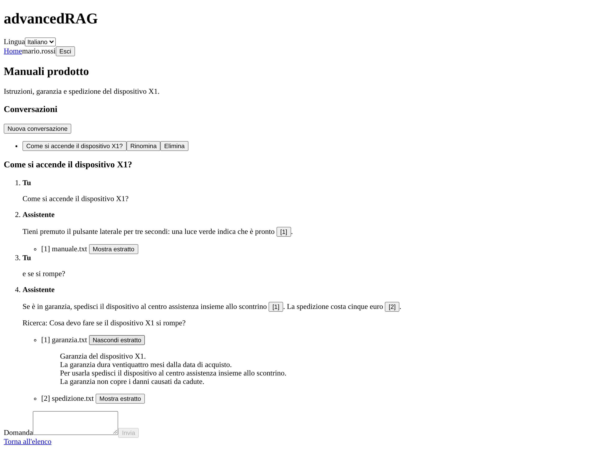
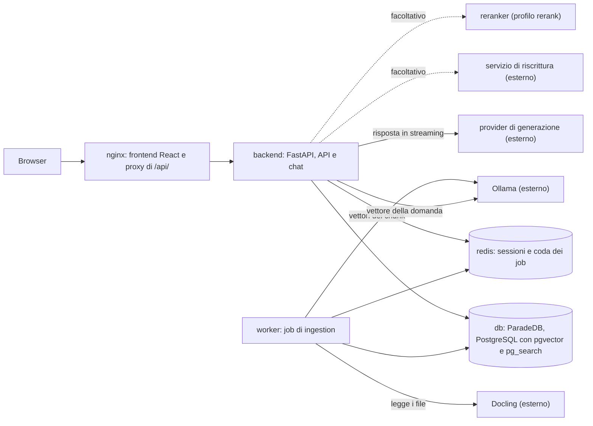

# advancedRAG

[English](README.md)

[](https://github.com/jumping2000/advancedRAG/actions/workflows/verify.yml) [](https://github.com/jumping2000/advancedRAG/blob/main/LICENSE) [](https://github.com/jumping2000/advancedRAG/commits/main) [](https://github.com/jumping2000/advancedRAG/issues) [](https://github.com/jumping2000/advancedRAG/pulls)
[](https://github.com/jumping2000/advancedRAG/blob/main/backend/pyproject.toml) [](https://github.com/jumping2000/advancedRAG/blob/main/backend/pyproject.toml) [](https://github.com/jumping2000/advancedRAG/blob/main/frontend/package.json) [](https://github.com/jumping2000/advancedRAG/blob/main/frontend/package.json) [](https://github.com/jumping2000/advancedRAG/blob/main/compose.yaml) [](https://github.com/jumping2000/advancedRAG/blob/main/compose.yaml) [](https://github.com/jumping2000/advancedRAG/blob/main/compose.yaml) [](https://github.com/jumping2000/advancedRAG/tree/main/nginx)
[](https://github.com/jumping2000/advancedRAG) [](https://github.com/jumping2000/advancedRAG) [](https://github.com/jumping2000/advancedRAG/stargazers) [](https://github.com/jumping2000/advancedRAG/forks) [](https://github.com/jumping2000/advancedRAG/graphs/contributors)
[](https://github.com/jumping2000/advancedRAG/tree/main/docs/guide) [](https://github.com/jumping2000/advancedRAG/blob/main/AGENTS.md)

## Panoramica

advancedRAG risponde a domande sui tuoi documenti. Un amministratore raccoglie i documenti in knowledge base (KB) e assegna ogni KB agli utenti; un utente apre una KB, fa una domanda in italiano o in inglese e legge la risposta mentre viene scritta, con fonti numerate che aprono l'estratto del documento da cui vengono. L'interfaccia è in italiano e in inglese.

È un'applicazione di Retrieval-Augmented Generation (RAG): prima si cercano nella KB i passaggi che rispondono alla domanda, poi il modello scrive la risposta a partire da quelli. L'applicazione è un monolite modulare (backend FastAPI, worker di ingestion, frontend React, PostgreSQL con ParadeDB, Redis, Nginx) che si avvia con Docker Compose. Ollama (vettori) e Docling (lettura dei file) sono servizi esterni, come il provider di generazione, una qualsiasi API compatibile con OpenAI: li fornisci tu e ne scrivi gli indirizzi in `.env`.

## Funzioni principali

- **Più knowledge base, tenute separate.** Un utente vede solo le KB assegnate a lui e le proprie conversazioni; documenti, fonti e conversazioni di una KB non vengono mai restituiti a chi non è autorizzato.
- **Due ruoli.** L'admin gestisce utenti, KB, documenti e impostazioni, e legge le conversazioni di tutti; l'utente chatta sulle KB assegnate.
- **Ingestione di file PDF, DOCX, PPTX, XLSX, TXT e MD.** Un worker legge ogni file (PDF, DOCX, PPTX e XLSX tramite Docling), lo divide in chunk e li indicizza con i vettori di Ollama; l'admin vede lo stato di ogni documento e può riprovare uno fallito. L'originale di un documento viene eliminato quando il documento è «Pronto» o «Non supportato»; quello di un documento «Fallito» resta per `FAILED_ORIGINAL_RETENTION_DAYS` giorni (7 per impostazione predefinita) perché «Riprova» funzioni.
- **Ricerca ibrida.** La ricerca vettoriale (pgvector) e quella per parole chiave (BM25, pg_search) sono unite con la Reciprocal Rank Fusion.
- **Due passi facoltativi.** La riscrittura di una domanda di approfondimento come domanda autonoma, e un reranker che riordina i passaggi trovati. Ognuno agisce solo quando il suo servizio è configurato in `.env` e l'admin l'ha attivato nella pagina «Impostazioni».
- **Risposte in streaming con fonti numerate.** Ogni citazione [n] apre l'estratto a cui si riferisce; quando la domanda è stata riscritta, la risposta mostra la domanda cercata («Ricerca: …»). Le conversazioni sono salvate: nuova, rinomina, elimina.



## Architettura in breve



`nginx` è l'unico servizio che pubblica una porta. `backend` e `worker` usano la stessa immagine; il `worker` prende i job di ingestione da `redis` e scrive chunk e vettori in `db`. Le linee tratteggiate sono facoltative: il servizio di riscrittura è esterno e il reranker di Compose parte solo con il profilo `rerank`, su CPU o su GPU NVIDIA. Come si collegano le parti, come viaggiano un documento e una domanda e come ogni KB è isolata è nella [guida di architettura](docs/guide/it/architecture.md).

## Avvio rapido

Da un clone alla pagina di accesso. Servono Docker con il plugin Compose e Git, e un Ollama e un Docling (docling-serve) raggiungibili dai container: Compose non li avvia. Scarica prima il modello di embedding in Ollama (`ollama pull bge-m3`). Perché la chat risponda serve anche un provider di generazione (un'API compatibile con OpenAI): imposta `GENERATION_BASE_URL` e `GENERATION_MODEL` in `.env`.

Scarica il codice e crea il file `.env`:

```bash
git clone https://github.com/jumping2000/advancedRAG.git
cd advancedRAG
cp .env.example .env
```

Apri `.env` e imposta almeno queste cinque variabili (i valori qui sotto sono segnaposto: usa gli indirizzi dei tuoi servizi e password robuste tue). Compose si rifiuta di partire se le prime tre sono vuote; le ultime due creano il primo admin:

```bash
POSTGRES_PASSWORD=change-me
OLLAMA_BASE_URL=http://ollama.example.internal:11434
DOCLING_BASE_URL=http://docling.example.internal:5001
ADMIN_USERNAME=admin
ADMIN_PASSWORD=change-me-at-least-12-characters
```

Costruisci e avvia lo stack in background; il primo avvio costruisce le immagini e richiede qualche minuto. Aspetta che `docker compose ps` mostri ogni servizio come `healthy`:

```bash
docker compose up --build -d
docker compose ps
```

Apri `http://localhost` (o `http://localhost:<HTTP_PORT>` se hai cambiato la porta) e accedi nella pagina «Accedi» con `ADMIN_USERNAME` e `ADMIN_PASSWORD`. Tutto il resto (ogni variabile, HTTPS, il reranker facoltativo, il controllo di salute, backup e aggiornamento) è nella [guida all'installazione](docs/guide/it/installation.md); creare utenti e KB e caricare documenti è nella [guida admin](docs/guide/it/admin.md).

## Documentazione

- [Guida utente](docs/guide/it/user.md): accedere, scegliere una KB, fare domande, leggere le fonti.
- [Guida admin](docs/guide/it/admin.md): utenti, knowledge base, documenti, conversazioni e impostazioni.
- [Guida all'installazione e all'operatività](docs/guide/it/installation.md): prerequisiti, ogni variabile di `.env`, HTTPS, reranker, controllo di salute, aggiornamento.
- [Guida di architettura e sviluppo](docs/guide/it/architecture.md): componenti, percorsi dei dati, isolamento, verifiche e flusso SDD per chi contribuisce.
- [`docs/system/`](docs/system/): le pagine d'area, il comportamento attuale per chi sviluppa (in inglese).
- [`docs/specs/`](docs/specs/): la specifica e il piano di ogni fase.
- [`docs/adr/`](docs/adr/): le decisioni di architettura (ADR).

## Licenza

advancedRAG è rilasciato con la licenza Apache 2.0 (`Apache-2.0`): vedi il file [LICENSE](LICENSE).
