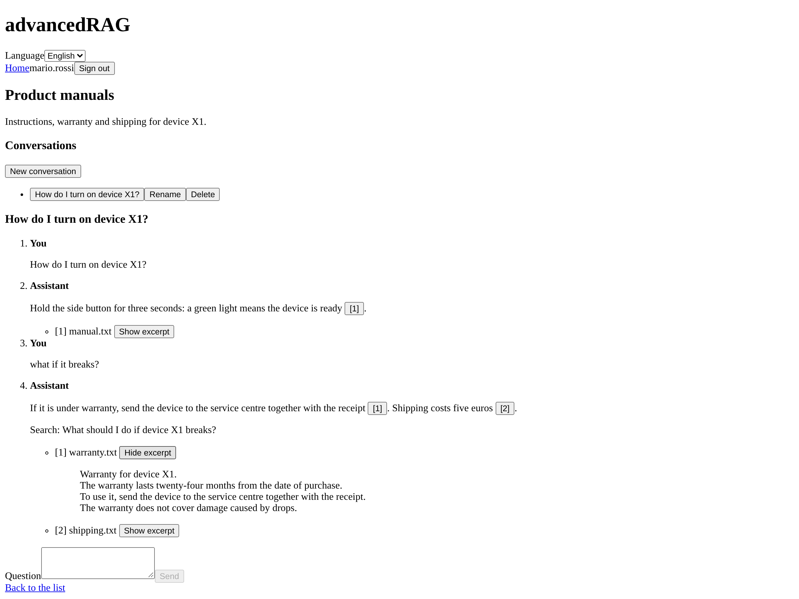
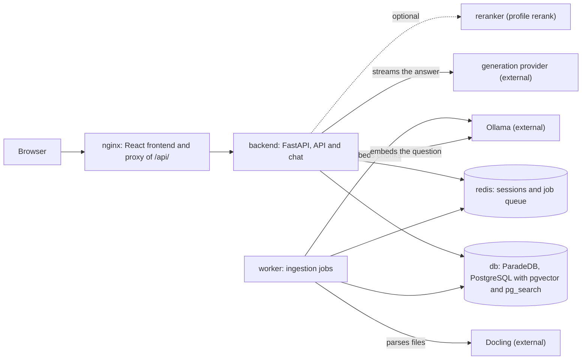

# advancedRAG

[Italiano](README.it.md)

[](https://github.com/jumping2000/advancedRAG/actions/workflows/verify.yml) [](https://github.com/jumping2000/advancedRAG/blob/main/LICENSE) [](https://github.com/jumping2000/advancedRAG/commits/main) [](https://github.com/jumping2000/advancedRAG/issues) [](https://github.com/jumping2000/advancedRAG/pulls)
[](https://github.com/jumping2000/advancedRAG/blob/main/backend/pyproject.toml) [](https://github.com/jumping2000/advancedRAG/blob/main/backend/pyproject.toml) [](https://github.com/jumping2000/advancedRAG/blob/main/frontend/package.json) [](https://github.com/jumping2000/advancedRAG/blob/main/frontend/package.json) [](https://github.com/jumping2000/advancedRAG/blob/main/compose.yaml) [](https://github.com/jumping2000/advancedRAG/blob/main/compose.yaml) [](https://github.com/jumping2000/advancedRAG/blob/main/compose.yaml) [](https://github.com/jumping2000/advancedRAG/tree/main/nginx)
[](https://github.com/jumping2000/advancedRAG) [](https://github.com/jumping2000/advancedRAG) [](https://github.com/jumping2000/advancedRAG/stargazers) [](https://github.com/jumping2000/advancedRAG/forks) [](https://github.com/jumping2000/advancedRAG/graphs/contributors)
[](https://github.com/jumping2000/advancedRAG/tree/main/docs/guide) [](https://github.com/jumping2000/advancedRAG/blob/main/AGENTS.md)

## Overview

advancedRAG answers questions about your own documents. An administrator gathers the documents in knowledge bases (KB) and assigns each KB to users; a user opens a KB, asks a question in Italian or English and reads the answer while it is written, with numbered sources that open the excerpt of the document each one comes from. The interface is in Italian and English.

It is a Retrieval-Augmented Generation (RAG) application: the passages that answer the question are searched in the KB first, and the model writes the answer from them. The application is a modular monolith (FastAPI backend, ingestion worker, React frontend, PostgreSQL with ParadeDB, Redis, Nginx) that you run with Docker Compose. Ollama (embeddings) and Docling (reading the files) are external services, and so is the generation provider, any OpenAI-compatible API: you provide them and set their addresses in `.env`.

## Main features

- **Several knowledge bases, kept apart.** A user sees only the KBs assigned to them and their own conversations; documents, sources and conversations of a KB are never returned to someone who is not authorized for it.
- **Two roles.** The admin manages users, KBs, documents and settings, and reads the conversations of everyone; the user chats on the assigned KBs.
- **Ingestion of PDF, DOCX, PPTX, XLSX, TXT and MD files.** A worker reads each file (PDF, DOCX, PPTX and XLSX through Docling), cuts it into chunks and indexes them with the embeddings of Ollama; the admin sees the state of every document and can retry a failed one. The uploaded originals are deleted once processed.
- **Hybrid retrieval.** Vector search (pgvector) and keyword search (BM25, pg_search) are merged with Reciprocal Rank Fusion.
- **Two optional steps.** Rewriting a follow-up question as a standalone one, and a reranker that reorders the passages found. Each runs only when its service is configured in `.env` and the admin has switched it on in the page «Settings».
- **Streamed answers with numbered sources.** Each citation [n] opens the excerpt it refers to; when the question was rewritten, the answer shows the question that was searched («Search: …»). Conversations are saved: new, rename, delete.



## Architecture at a glance



`nginx` is the only service that publishes a port. `backend` and `worker` share the same image; the `worker` takes the ingestion jobs from `redis` and writes the chunks and vectors in `db`. The dotted line is optional: the reranker of Compose starts only with the profile `rerank`, on CPU or on an NVIDIA GPU. How the parts fit together, how a document and a question travel through them and how each KB is isolated is in the [architecture guide](docs/guide/en/architecture.md).

## Quick start

From a clone to the login page. You need Docker with the Compose plugin and Git, and an Ollama and a Docling (docling-serve) that the containers can reach: Compose does not start them. Pull the embedding model in Ollama first (`ollama pull bge-m3`). For the chat to answer you also need a generation provider (an OpenAI-compatible API): set `GENERATION_BASE_URL` and `GENERATION_MODEL` in `.env`.

Get the code and create the `.env` file:

```bash
git clone https://github.com/jumping2000/advancedRAG.git
cd advancedRAG
cp .env.example .env
```

Open `.env` and set at least these five variables (the values below are placeholders: use the addresses of your services and your own strong passwords). Compose refuses to start when the first three are empty; the last two create the first admin:

```bash
POSTGRES_PASSWORD=change-me
OLLAMA_BASE_URL=http://ollama.example.internal:11434
DOCLING_BASE_URL=http://docling.example.internal:5001
ADMIN_USERNAME=admin
ADMIN_PASSWORD=change-me-at-least-12-characters
```

Build and start the stack in the background; the first start builds the images and takes a few minutes. Wait until `docker compose ps` shows every service as `healthy`:

```bash
docker compose up --build -d
docker compose ps
```

Open `http://localhost` (or `http://localhost:<HTTP_PORT>` if you changed the port) and sign in on the page «Sign in» with `ADMIN_USERNAME` and `ADMIN_PASSWORD`. Everything else (every variable, HTTPS, the optional reranker, the health check, backup and update) is in the [installation guide](docs/guide/en/installation.md); creating users and KBs and uploading documents is in the [admin guide](docs/guide/en/admin.md).

## Documentation

- [User guide](docs/guide/en/user.md): sign in, choose a KB, ask questions, read the sources.
- [Admin guide](docs/guide/en/admin.md): users, knowledge bases, documents, conversations and settings.
- [Installation and operations guide](docs/guide/en/installation.md): prerequisites, every `.env` variable, HTTPS, reranker, health check, update.
- [Architecture and development guide](docs/guide/en/architecture.md): components, data paths, isolation, checks and the SDD flow for contributors.
- [`docs/system/`](docs/system/): the area pages, the current behaviour for developers (English).
- [`docs/specs/`](docs/specs/): the specification and the plan of each phase.
- [`docs/adr/`](docs/adr/): the architecture decision records.

## License

advancedRAG is released under the Apache License 2.0 (`Apache-2.0`): see the file [LICENSE](LICENSE).
