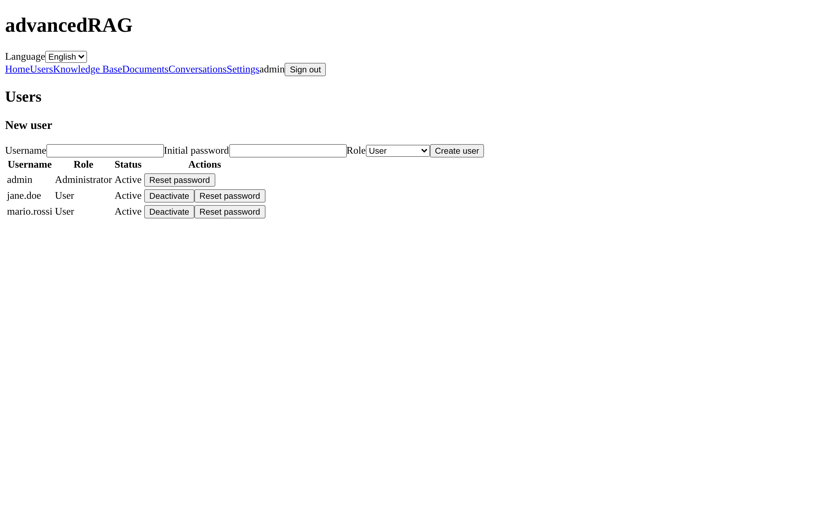
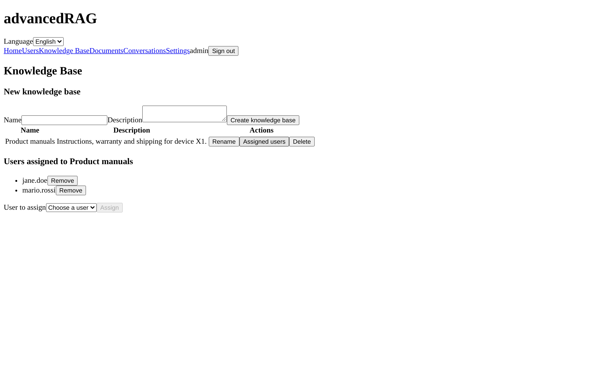
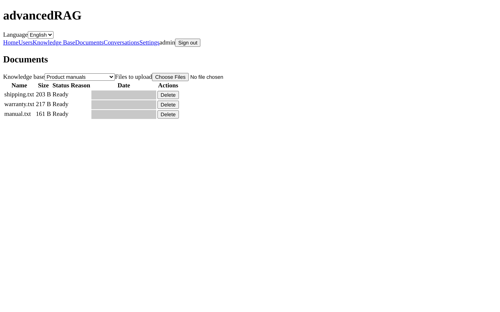
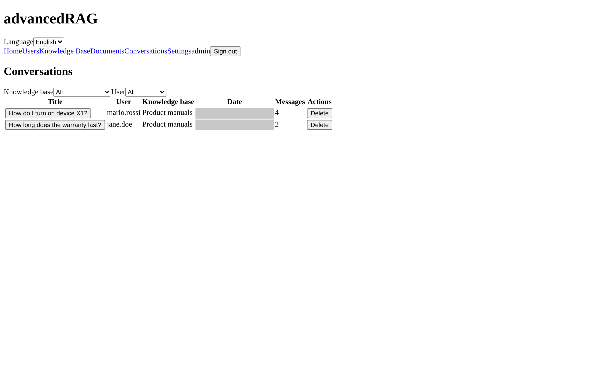
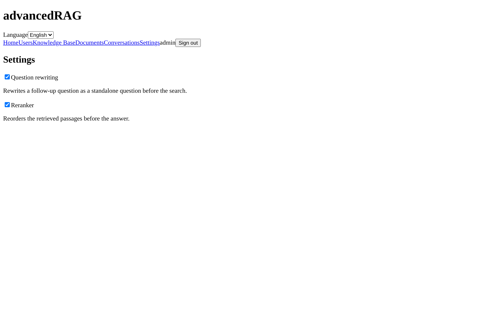

# Admin guide

[Italiano](../it/admin.md)

This guide is for the administrators: the people who create users and knowledge bases (KBs), upload the documents, read the conversations and switch the optional steps of the chat on and off. It names the texts of the English interface exactly as you see them, between guillemets, like «Create user». A text that has a part that changes (a username, a title) is written in italics, with … in place of that part, like *User … created.* Other quotation marks, such as "Product manuals", are for example values and for words that are not texts of the interface, such as the ones the browser draws. The screenshots show invented data. Using the chat is in the [user guide](user.md); installing the application and setting the variables of the `.env` file is in the [installation guide](installation.md).

The technical details are in the area pages [foundations](../../system/fondazioni.md) (login, sessions, users, knowledge bases, the page «Settings»), [ingestion](../../system/ingestion.md) (documents, the worker, statuses and reasons, originals) and [chat](../../system/chat.md) (retrieval, conversations, sources, the page «Conversations»). They are written in English for developers.

## The admin pages

An administrator signs in like every user (see the [user guide](user.md)). The first administrator is created at the first start of the stack from `ADMIN_USERNAME` and `ADMIN_PASSWORD` of the `.env` file (see the [installation guide](installation.md)); every other one is created from the page «Users».

The header of every page has, for an administrator, the links «Home», «Users», «Knowledge Base», «Documents», «Conversations» and «Settings». A person with the role «User» does not see them, and if they open the address of one of these pages the application takes them to the home page. Your home page lists every KB, under the title «All knowledge bases» (a user sees only the KBs assigned to them, under «Your knowledge bases»), and you can open any of them to ask questions.

## Users

The page «Users» lists every user and is where you create users, deactivate and reactivate them and reset their passwords. A user is a local account of the application: there is no registration page, and a user cannot change their own password, so an administrator does it. Users are never deleted from the page, only deactivated.

### Create a user

Fill in the form «New user» with «Username», «Initial password» and «Role», then choose «Create user». The page says *User … created.* and adds the user at the end of the table, whose columns are «Username», «Role», «Status» and «Actions».

- The username has 3 to 64 characters among letters, digits, dot, underscore and hyphen, and the spaces before and after it are removed. Two usernames that differ only by capital letters are the same one: the second gets «This username is already taken.» To sign in the user must type the username exactly as you wrote it, capital letters included.
- The initial password has at least 12 characters; nothing else is required. Give it to the person through a private channel and, if you want them to have another one, reset it later (see "Reset a password" below).
- A wrong username shows «The username must have 3 to 64 characters among letters, digits, dot, underscore and hyphen.» and a short password «The password must be at least 12 characters long.» Nothing is created in either case.

### Roles

A user has one of two roles, chosen when you create the account and shown in the column «Role»:

- «User»: sees the KBs assigned to them, asks questions in the chat and manages their own conversations. Nothing else.
- «Administrator»: sees every KB, uses the five pages of this guide and reads the conversations of everyone.

The page has no way to change the role of an existing user: create a new account with the right role and deactivate the other one.

### Deactivate and reactivate a user

The column «Status» shows «Active» or «Deactivated». For an active user, «Deactivate» opens the question *Deactivate …? All their sessions will be closed.* with the buttons «Deactivate» and «Cancel». When you confirm:

- every session of the user ends at once, and the user cannot sign in: they get «Invalid username or password.», the same message as for a wrong password;
- the user stays in the table, with «Deactivated» and the button «Reactivate», and nothing of theirs is deleted: their assignments to KBs and their conversations stay as they are.

«Reactivate» works at once, without a question. The user can sign in again with the password they had (or the one you reset in the meantime); the sessions that were closed do not come back.

Your own row has no button «Deactivate»: you cannot deactivate yourself, so there is always at least the administrator who is working. A deactivated user stays in the list of the assigned users of a KB, marked «Deactivated», and is not offered when you assign users.

### Reset a password

«Reset password» opens a form with the title *Reset the password of …*, the field «New password» and the buttons «Save password» and «Cancel». The new password follows the same rule as the initial one (at least 12 characters). When it is saved the page says *Password of … reset.*, and every session of that user ends: they must sign in again with the new password. You can reset the password of a deactivated user too; this does not reactivate them.

If you reset your own password, you are signed out and the sign-in page tells you «Your password has been reset: sign in again with the new password.»

### Messages of the page

| Message | When |
|---|---|
| «This username is already taken.» | You create a user whose username is already used, ignoring capital letters. |
| «The username must have 3 to 64 characters among letters, digits, dot, underscore and hyphen.» | The username is too short, too long or has other characters. |
| «The password must be at least 12 characters long.» | An initial or new password with fewer than 12 characters. |
| «You cannot deactivate your own user.» | The server refuses to deactivate the user who asks. The page has no button for it, so you do not normally see this message. |
| «User not found.» | The user does not exist or the identifier is not valid. The page never deletes a user, so you do not normally see this message. |

## Knowledge bases

A knowledge base is a set of documents that the application can answer questions about, and the unit of access: a user sees a KB only when you assign it to them. The page «Knowledge Base» creates, edits, assigns and deletes them. Its table has the columns «Name», «Description» and «Actions».

### Create a knowledge base

Fill in the form «New knowledge base»: «Name», required, and «Description», optional, then choose «Create knowledge base». The page says *Knowledge base … created.* and adds the KB to the table.

- The name has 1 to 100 characters and the description at most 500; otherwise you get «The name must have 1 to 100 characters and the description at most 500.» The spaces at the two ends are removed.
- Two KBs cannot have the same name, ignoring capital letters: «A knowledge base with this name already exists.»
- A new KB has no documents and no assigned users: only the administrators see it until you assign it.

### Edit a knowledge base

«Rename» opens a form with the title *Rename …*, the fields «New name» and «New description», already filled with the current values, and the buttons «Save» and «Cancel». The same form changes the name and the description; an empty description removes it. When it is saved the page says *Knowledge base … updated.* Renaming does not touch the documents or the conversations of the KB.

### Assign users

«Assigned users» opens, under the table, the list *Users assigned to …*, with the button «Remove» next to each user; when nobody is assigned the page says «No user is assigned.» To assign someone, choose them in «User to assign» (the first choice is «Choose a user») and then «Assign». Only active users are offered, and a user who is already assigned is not offered again. Both «Assign» and «Remove» act at once, without a question.

- An assigned user sees the KB under «Your knowledge bases» and can open its chat. An administrator sees every KB, so assigning one changes nothing.
- After «Remove» the KB disappears from the list of that user. If they open its address they get «Knowledge base not found.», the same message as for a KB that does not exist, so a user cannot find out which KBs exist. You get the same message if the KB was deleted in another window.
- The conversations that the user had in that KB are not deleted, but the user no longer sees them; you still read them in the page «Conversations».
- A user who was deactivated after being assigned stays in the list, marked «Deactivated».

### Delete a knowledge base

«Delete» opens the question *Delete the knowledge base …? The assignments of its users will be removed too.* with the buttons «Delete» and «Cancel». Deleting is final. The question names only the assignments, but the whole KB goes: its documents with their chunks and vectors, their original files, and every conversation of the KB with its messages and sources, for all users. The page then says *Knowledge base … deleted.*

## Documents

The page «Documents» is where the documents of a KB are uploaded and followed. A user never sees the documents of a KB, only the answers and the sources that come from them. Start by choosing the KB in «Knowledge base» (the first choice is «Choose a knowledge base»): the table lists its documents with the columns «Name», «Size», «Status», «Reason», «Date» and «Actions», or says «No document in this knowledge base.»

The grey boxes in the screenshots of «Documents» and «Conversations» cover the dates: they are hidden on purpose, because they change at every capture, and on your screen you see them. The text of the file chooser ("Choose Files", "No file chosen") is drawn by the browser in its own language, not by the page: the page follows the language of the interface, the chooser follows the browser. In the Italian screenshot of the Italian guide it stays in English for this reason.

### Upload files

With a KB chosen, «Files to upload» opens the file chooser of the browser; you can select more than one file. Each file is sent on its own, and while it is sent it appears in the list of uploads with «Uploading…». A file that is accepted becomes a row of the table with the status «Queued». A file that is refused adds no row: its name stays in the list of uploads with the reason.

- Formats: PDF, DOCX, PPTX, XLSX, TXT and MD. The extension, the type the browser declares and the beginning of the file must all say the same format, so a file renamed to another extension is refused. The refusal is «File type not supported. Allowed: PDF, DOCX, PPTX, XLSX, TXT and MD.»
- Size: at most 20 MB per file unless the administrator of the installation set another limit with `MAX_UPLOAD_SIZE_MB` in the `.env` file (see the [installation guide](installation.md)). A larger file gets «The file exceeds the maximum allowed size.»
- An empty file gets «The file is empty.»
- A file with the same content as a document that is already in the KB, whatever its name, gets «This file is already in the knowledge base.» This includes a document that failed, so to upload a failed file again you first delete its row.

### The statuses of a document

The column «Status» shows where the document is. While any document is «Queued» or «Processing» the page reads the list again every three seconds by itself.

| Status | What it means |
|---|---|
| «Queued» | The file was uploaded and waits for the worker, which processes one document at a time. |
| «Processing» | The worker is reading the file, cutting the text into chunks and asking Ollama for the vectors. PDF, DOCX, PPTX and XLSX files are read by Docling; TXT and MD files are read directly. |
| «Ready» | The document is indexed: the chat can find it and use it for its answers. The original file has been deleted. |
| «Failed» | Something went wrong. The column «Reason» says what, and the row has the button «Retry». The original is kept for a while so that you can retry. |
| «Unsupported» | The file was read, but too little text could be extracted from it (fewer than `MIN_EXTRACTED_CHARS` characters that are not blank, 50 by default). It happens with a scan that has no text, because there is no OCR. There is no «Retry»: upload a file that has text. The original has been deleted. |

A KB with no document that is «Ready» cannot answer: the chat ends at once with «No document available in this knowledge base». The reason of an «Unsupported» document is «Not enough text could be extracted from the file (scans without text are not supported).»

### Why a document fails

The column «Reason» of a «Failed» document says what went wrong. Most reasons are about one of the two external services, Docling (it reads the files) and Ollama (it computes the vectors), whose addresses are in the `.env` file; the [installation guide](installation.md) tells how to check them.

| Reason | What to do |
|---|---|
| «The document parsing service (Docling) cannot be reached.» | Docling did not answer on any attempt. Check that it runs and that the address is right, then «Retry». |
| «The document parsing service (Docling) returned an error.» | Docling answered with an error, or refused its key. Check it as above, then «Retry». |
| «The file could not be read.» | Docling refused the file, or a TXT or MD file is not UTF-8 text. «Retry» will not help: fix or convert the file and upload it again. |
| «The embedding service (Ollama) cannot be reached.» | Ollama did not answer on any attempt. Check that it runs and the address, then «Retry». |
| «The embedding service (Ollama) returned an error.» | Ollama answered with an error. Check it and the embedding model it has, then «Retry». |
| «The embedding service (Ollama) gave an invalid response.» | Ollama answered, but not with usable vectors. Check that the model is an embedding model, then «Retry». |
| «The vectors received have a different size from the configured one.» | The model gives vectors of another size than `EMBEDDING_DIMENSIONS`. Correct the `.env` file as the installation guide says, restart the stack, then «Retry». |
| «The check of the indexes failed: no content was saved.» | The new chunks were not found by the two indexes, so nothing was kept. «Retry». |
| «Unexpected error during processing.» | Anything else, such as a processing time over the limit or a worker that stopped in the middle. «Retry»; if it happens again, read the logs as the installation guide says. |

### Retry and delete

«Retry» is only on the rows with the status «Failed». It puts the document back to «Queued», clears its reason and the worker processes it again; the row follows the statuses as for a new upload. Two messages can follow:

- «The original file no longer exists: upload the document again.» The original was deleted because the time it is kept ran out (see below). The button disappears from the row: delete the document and upload the file again.
- «The document cannot be retried: it is no longer in the Failed state.» The status changed in the meantime, for example because another administrator already retried it. The page reads the list again.

«Delete» is on every row, whatever its status. It opens the question *Delete the document …? Its chunks will be removed too.* with the buttons «Confirm» and «Cancel». Deleting removes the document, its chunks and its original, and cannot be undone. The answers already written stay as they are, but a source that came from that document shows «Source no longer available».

### The original files

The original of an uploaded file lives only in the folder of uploads on the server (`UPLOAD_DIR`, a volume of the stack), under the identifier of the document and not under its name. It is deleted:

- as soon as the document is «Ready» or «Unsupported»: from then on the application keeps only the chunks of text and their vectors;
- when the document is deleted, or the KB it belongs to;
- for a «Failed» document, after `FAILED_ORIGINAL_RETENTION_DAYS` days from the failure (7 by default). Until then you can use «Retry»; a retry that fails again starts the time again. After that the worker deletes the file (it checks every hour) and the document stays «Failed».

The logs never hold the content, the names or the vectors of the documents.

## Conversations

The page «Conversations» lets you read the conversations of all the users, for example to see how the KBs are used and which sources the answers had. For the content it is read-only: you read every conversation, and you write in none of those of other users.

### Read the conversations of everyone

The table lists every conversation of every user, with the columns «Title», «User», «Knowledge base», «Date», «Messages» and «Actions». The two filters «Knowledge base» and «User» both start at «All» (the choices of the first are «All» and the KBs, those of the second «All» and the users); choose one or both to narrow the list. With no conversation the page says «No conversations yet.»

Choose a title to read the conversation under the table: its messages, in order, with the sources of each answer. A source is the line with its number and the name of the document, such as `[1] manual.txt`, with the button «Show excerpt», which opens the passage the answer used (and «Hide excerpt» closes it); if the document was deleted meanwhile you see «Source no longer available». Under an answer there can also be the line *Search: …*, with the question that was searched: it is not on every answer, and the [user guide](user.md) says when it appears.

The conversation has no question field and no «Retry»: an administrator cannot ask, retry or rename in a conversation of another user. The conversations that you had yourself, as an administrator, are in the same list.

### Delete a conversation

The only change you can make here is to delete. «Delete» on a row opens the question *Delete the conversation "…"? Its messages will be removed too.* with the buttons «Confirm» and «Cancel». Deleting is final, for the user too: the conversation, its messages and its sources are removed. If the conversation was already gone, the page says «Conversation not found.» and reads the list again.

## Settings

The page «Settings» has the two switches of the optional steps of the chat. Both are off the first time, and both are global: they apply to every KB and to every user. There is no save button and no message: each switch is saved as soon as you change it, and it is disabled for the moment that takes.

### The two switches

- «Question rewriting»: «Rewrites a follow-up question as a standalone question before the search.» When a user asks a short follow-up question, a rewriting service, with the earlier messages, turns it into a complete one and the search uses that. The user sees what was searched in the line *Search: …*, when it differs from their question. If the service does not answer, the search uses the question as it was written.
- «Reranker»: «Reorders the retrieved passages before the answer.» The search finds candidate passages, and the reranker, a service that judges how well each one answers the question, reorders the first ones (20 by default) before the model writes the answer. If the reranker does not answer, the order of the search is kept. It adds no line to the answer.

A change applies to the answers that start after it; an answer already being written keeps what it started with.

### Switch a step on

A step works only when its service is configured in the `.env` file of the installation, which is done outside the application. When it is not, the switch is disabled and the page says «Not configured» under it: you cannot switch it on from here.

- For «Question rewriting»: `REWRITE_BASE_URL` and `REWRITE_MODEL`.
- For «Reranker»: `RERANK_BASE_URL` and `RERANK_API` (and `RERANK_MODEL` for a reranker with the `cohere` format), or the reranker that the stack can start for you.

The [installation guide](installation.md#rewriting-and-reranker) lists the variables of the two steps, and [the reranker on CPU](installation.md#the-reranker-on-cpu) explains how to start the reranker of the stack. After changing the `.env` file, restart the stack as that guide says; then the switch is no longer disabled.

If a switch is refused anyway, because the service is not configured, it goes back to where it was and the page says «The service of this step is not configured.» If you remove a service from the `.env` file while its switch is on, the page still shows the switch as on, disabled, with «Not configured»: the step is not active, and you cannot switch it off from the page.

The technical details of the two steps, such as the settings and the health checks, are in the area pages [chat](../../system/chat.md) and [foundations](../../system/fondazioni.md).
