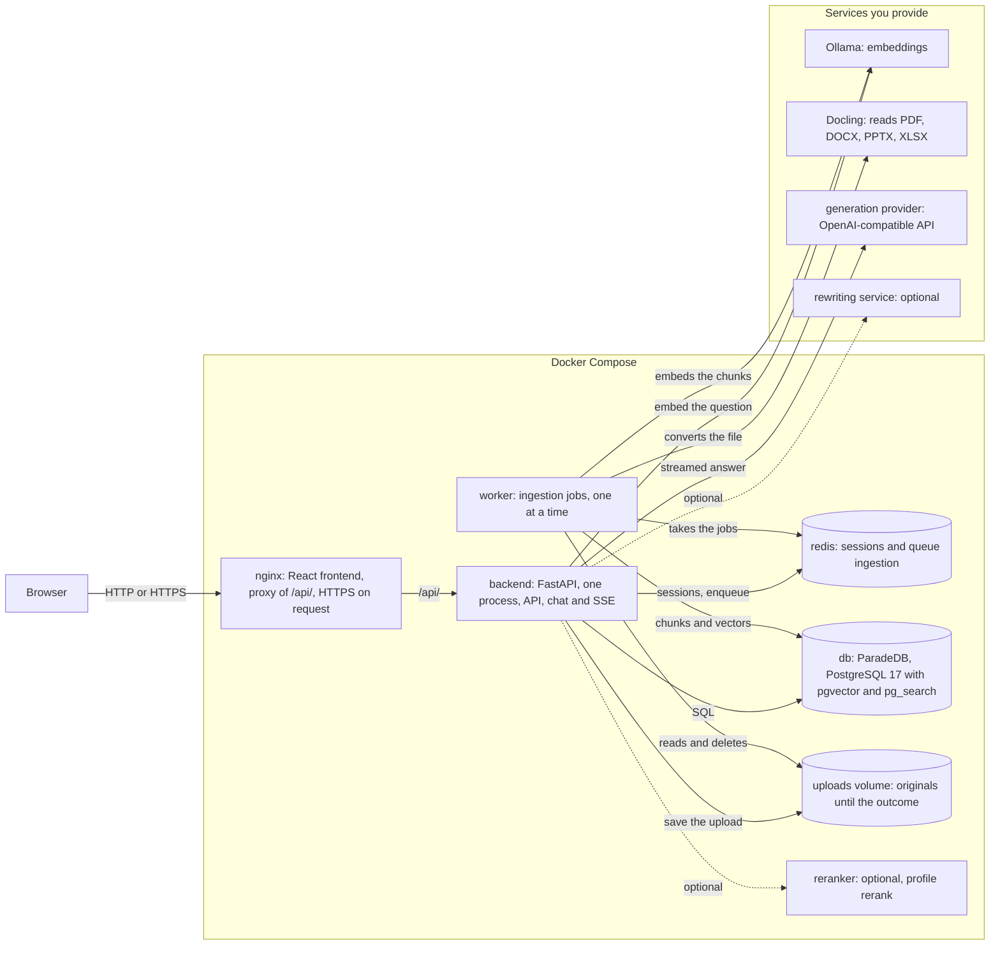

# Architecture and development guide

[Italiano](../it/architecture.md)

This guide is for a developer: it shows how the parts of advancedRAG fit together, how a document and a question travel through them, how each knowledge base (KB) is kept apart from the others, how to prepare the environment and run the checks, and how a change is made, from the specification to the merge. The texts of the interface that it names are those of the English interface. The user guide and the admin guide (`user.md` and `admin.md` in this folder) are separate; to install and run the stack read the [installation and operations guide](installation.md).

The behaviour is described in detail, for developers, in the area pages [foundations](../../system/fondazioni.md), [ingestion](../../system/ingestion.md) and [chat](../../system/chat.md); this guide does not copy them and sends you to the right one at each step. They are written in English only.

## The components

### Overview

advancedRAG is a modular monolith: one FastAPI backend with one ingestion worker, a React frontend served by Nginx, PostgreSQL (ParadeDB) and Redis. The services drawn on the right are not started by Compose: you provide them and set their addresses in `.env`.



A reranker does not have to be the one of Compose: `RERANK_BASE_URL` can point to another service, and then the `reranker` service is not started. Dotted lines are the optional steps: the admin switches them on in the page «Settings», and they run only when their service is configured.

### The services of Compose

| Service | What it is | Notes |
|---|---|---|
| `nginx` | Serves the compiled frontend and proxies `/api/` to the backend | The only service with a host port (`HTTP_PORT`, `HTTPS_PORT` with `compose.tls.yaml`); limits the size of the upload; sends the answer stream without buffering |
| `backend` | FastAPI on port 8000, inside the Compose network only | At start it applies the database migrations, creates the first admin and the indexing profile, and fails the answers left pending; then starts uvicorn, **one process** (ADR-003) |
| `worker` | The same image as the backend, running `python -m app.worker` | Takes the jobs of the RQ queue `ingestion`, one at a time; no port; shares the `uploads` volume with the backend |
| `redis` | Sessions of the logins and the queue of the ingestion jobs | |
| `db` | ParadeDB: PostgreSQL 17 with `pgvector` (vectors, HNSW) and `pg_search` (BM25) | Data in the `pgdata` volume |
| `reranker` | Hugging Face text-embeddings-inference, optional | Only with `--profile rerank`; CPU image, or the GPU one with `compose.rerank-gpu.yaml`; model in the `reranker-models` volume |

### The external services

| Service | Used for | By |
|---|---|---|
| Ollama | the embeddings of the chunks and of the questions | worker and backend |
| Docling (docling-serve) | converting PDF, DOCX, PPTX and XLSX files to text blocks; TXT and MD files are read directly | worker |
| The generation provider | the answer of the chat: any OpenAI-compatible API | backend |
| The rewriting service (optional) | rewriting a follow-up question as a standalone one | backend |

Only the backend and the worker call them, each with its own settings (the worker never receives the generation, rewriting or reranker variables). In automated tests they are always replaced by fakes (`backend/tests/fakes/`); the real services are used only by opt-in live tests.

### The code

| Path | Contents |
|---|---|
| `backend/app/main.py`, `run.py`, `worker.py` | the application factory; the container entry point (migrations, first admin, uvicorn); the ingestion worker |
| `backend/app/auth/`, `users/` | login and sessions in Redis, `require_admin`; the local accounts |
| `backend/app/knowledge_bases/` | the KBs, their members and `KnowledgeBaseRepository` |
| `backend/app/documents/` | upload, validation of the file, storage of the originals, the queue |
| `backend/app/ingestion/` | the pipeline of the worker: readers, Docling client, normalization, chunker, embeddings, persistence, indexing profile, cleanup |
| `backend/app/chat/` | retrieval, rewriting, reranker, generation, prompt, the SSE stream, conversations |
| `backend/app/app_settings/` | the two admin switches of the optional steps |
| `backend/app/api/health.py` | `GET /api/health` |
| `backend/app/db/`, `backend/migrations/` | SQLAlchemy models and sessions; Alembic migrations |
| `frontend/src/` | the React pages, the API client, the language files `i18n/it.json` and `en.json` |
| `nginx/` | the Nginx configuration, with and without TLS |

## The path of a document

An admin uploads a file in the page «Documents». Details, statuses and reason codes are in [ingestion](../../system/ingestion.md).

1. **Upload.** The browser sends one file in `POST /api/kbs/{kb_id}/documents` (`multipart/form-data`). Nginx refuses a body above `MAX_UPLOAD_SIZE_MB` plus 1 MB with the same JSON error as the backend.
2. **Validation.** The backend checks the session and the role (admin only), finds the KB through `KnowledgeBaseRepository`, copies the file in streaming to `UPLOAD_DIR/{id}.part` while it computes the size and the SHA-256, and refuses an empty file, or one whose extension, declared MIME type and signature do not name the same format (PDF, DOCX, PPTX, XLSX, TXT or MD). The same checksum twice in a KB is a 409.
3. **Queue.** The document is inserted as `QUEUED`, the file is renamed `UPLOAD_DIR/{id}` and the job `process_document_job` is put on the RQ queue `ingestion` in Redis. The answer is 202, and the page polls the list every 3 seconds.
4. **Worker.** `worker` takes the job and moves the document from `QUEUED` to `PROCESSING` in one statement; if the document was deleted meanwhile, the job ends quietly.
5. **Reading.** TXT and MD are read as UTF-8. PDF, DOCX, PPTX and XLSX go to Docling (no OCR), repeating the call after a temporary error, up to `INGESTION_MAX_ATTEMPTS` attempts.
6. **Chunks.** The text is normalized and cut into structural chunks (`CHUNK_*` settings). With fewer than `MIN_EXTRACTED_CHARS` characters the document becomes `UNSUPPORTED`.
7. **Embeddings.** Ollama gives the vectors in groups of `EMBEDDING_BATCH_SIZE` texts, for the active indexing profile (model and dimensions).
8. **Indexes.** All the chunks are saved in one transaction. The BM25 index of `pg_search` is created by a migration; the HNSW index of `pgvector` is created for each profile at run time. The worker checks that both return every chunk.
9. **Outcome.** The document is `READY` with its `chunk_count` and the original is deleted. Any failure makes it `FAILED` with a reason code, no chunk and the original kept for `FAILED_ORIGINAL_RETENTION_DAYS` days, so that «Retry» can queue it again.

## The path of a question

A user asks a question in the chat of a KB. Details, errors and limits are in [chat](../../system/chat.md).

1. **Request.** `POST /api/kbs/{kb_id}/conversations` (new conversation) or `POST /api/conversations/{id}/messages`. The backend checks the session, the KB and the conversation, the question and `GENERATION_BASE_URL`, and saves the question and a `PENDING` answer in one transaction. The response is `text/event-stream` and starts with the event `conversation`.
2. **Switches.** The answer reads once the switches `rewrite_enabled` and `rerank_enabled` of the admin page and keeps them to its end. A step is active only when its switch is on and its base URL is set.
3. **Nothing to search.** If the KB has no `READY` document with chunks of the active profile, the answer is completed at once with the notice `no_documents`: no service is called.
4. **Rewriting (optional).** With the rewriting active and a non-empty history, the rewriting service turns the question into a standalone one, used only for the search; the model of the answer still receives the original question. On any error the original question is used. The page shows the rewritten one as «Search: …».
5. **Hybrid search.** The searched question is embedded with Ollama, then two searches run on the KB, each with `RETRIEVAL_CANDIDATES` results: the vector search (HNSW, cosine distance) and the BM25 search of `pg_search`. Reciprocal Rank Fusion (`RRF_K`) merges the two lists.
6. **Reranker (optional).** With the reranker active, the best `RERANK_CANDIDATES` chunks of the fusion are scored by the reranker and reordered; on any error the RRF order stays.
7. **Generation.** The first `CHAT_CONTEXT_CHUNKS` chunks and the last `CHAT_HISTORY_MESSAGES` messages build the prompt. The provider answers in streaming, and the backend sends each fragment as an SSE `delta` event, with a keepalive comment at least every 15 seconds (Nginx reads with a 60 second timeout and the response carries `X-Accel-Buffering: no`).
8. **Saved message.** At the end the citations are checked against the sources, and `complete_answer` saves the text and the sources (`message_sources`); the `done` event closes the stream. A failure saves the answer as `FAILED` and sends `error`; «Retry» generates it again.

## Isolation per knowledge base

Isolation is the main rule of the project: a user sees only the KBs assigned to them, and no route, query or log ever returns the chunks, sources or metadata of a KB the caller cannot read.

### The rules

- Every access to a KB, to its documents or to its conversations goes through `KnowledgeBaseRepository.list_for` or `get_for`, or through a query joined with `kb_members` in the same SQL statement. Every such path has an isolation test that calls it directly (`backend/tests/test_isolation.py`, `test_conversation_isolation.py`).
- For every role other than the exact `admin`, `KnowledgeBaseRepository` joins `kb_members` on the user. Every statement that reads `chunks` carries, in the same SQL, the visibility of the KB (`visible_kb_ids`), the `kb_id`, the join on documents that are `READY` and the `profile_id`.
- A KB that is not assigned, does not exist or has an id that is not a UUID gets the same 404 `kb_not_found`; the conversation of another user, of an unassigned KB, an unknown one and an id that is not a UUID get the same 404, never a 403. The admin reads every conversation and writes in none of another user's (403).
- Vectors of different indexing profiles never mix: every vector search filters on `profile_id` and uses the HNSW expression `embedding::vector(N)` of the profile.
- Managing users, KBs, documents and settings, and reading every conversation, are admin only: `require_admin` runs before the path ids and the body, and a `user` gets 403.
- The uploaded originals live only in `UPLOAD_DIR`, named by the document id, and are deleted at `READY` or `UNSUPPORTED`, with the document or its KB, and `FAILED_ORIGINAL_RETENTION_DAYS` days after `FAILED`. Logs never hold document content, names, questions or vectors.

### Sensitive areas

A change to these paths is flagged by `diff_scope.py` (the `SENSITIVE` line of the PR), and the reviewer reads its diff with more care.

| Path | Why |
|---|---|
| `backend/app/auth/` | login, sessions, passwords |
| `backend/app/documents/` | upload validation and file storage |
| `backend/app/chat/` | isolation of conversations and sources |
| `backend/app/app_settings/` | the admin switches |
| `backend/migrations/` | the schema: an applied migration is never edited, a new one is added |
| `compose.yaml`, `compose.rerank-gpu.yaml` | the services, their ports and volumes |
| `nginx/` | the exposed edge: limits, TLS, proxy |
| `.github/workflows/` | the CI |

## Setting up the environment

You need Docker with the Compose plugin, Git, Python 3.12 with [uv](https://docs.astral.sh/uv/) for the backend, and Node.js (the CI uses version 22) with npm for the frontend. The scripts of the playbook in `scripts/` use the standard library only and are called with `python3`.

Install the dependencies of both sides:

```bash
uv sync --project backend
npm ci --prefix frontend
```

The backend tests need PostgreSQL (ParadeDB) and Redis. Start them with the test Compose file, which publishes them on `127.0.0.1` only, at ports 55432 and 56379:

```bash
docker compose -f compose.test.yaml up -d --wait
```

Then, to run the whole stack from your working tree, copy `.env.example` to `.env`, fill the required variables as the [installation guide](installation.md) explains, and start it:

```bash
docker compose up --build
```

The worker is the service `worker`. For HTTPS add `-f compose.yaml -f compose.tls.yaml` and put `cert.pem` and `key.pem` in `nginx/certs/`; for the reranker add `--profile rerank` (ADR-004), and on an NVIDIA GPU also `-f compose.rerank-gpu.yaml`: one reranker image at a time.

Two things stay local to your machine and are never committed: the `.env` file, and any change to the Dockerfiles for a proxy or a corporate certificate authority.

## Verifying and testing

### The full verification

`python3 scripts/verify.py` is the definition of "done". It runs, in order: the format, lint and type checks of the backend and of the frontend, the frontend tests, the start of the test services, the backend tests, the end-to-end tests of the full stack, and the secrets scan. The CI (`.github/workflows/verify.yml`) runs it on every pull request and on `main`. A task is not done without a green run.

```bash
python3 scripts/verify.py
```

While you work, the fast run executes only the quick static steps (format, lint and the secrets scan) and no test:

```bash
python3 scripts/verify.py --fast
```

A step name selects that step (`python3 scripts/verify.py frontend-test`), and `--keep-going` goes on after a failure. The documents have their own check, which verify does not run: `python3 scripts/docs_check.py README.md README.it.md docs` tests the relative links and the Mermaid blocks.

### Single tests

With the test services up, run one backend test, or one frontend file:

```bash
uv run --project backend pytest <path>::<name>
npm --prefix frontend run test -- <file>
```

For example `uv run --project backend pytest backend/tests/test_docs_install_guide.py`. The tests of the documentation (`backend/tests/test_docs_*.py`) compare the guides with the real sources, such as `.env.example`, `compose.yaml` and the language files, so a change that forgets a guide fails the verification.

### End-to-end tests

The e2e tests start the full stack with Compose, with the fake Ollama, Docling, generation, rewriting and reranker services of `backend/tests/e2e/compose.fakes.yaml`, and drive the interface with Playwright and Chromium:

```bash
uv run --directory backend pytest -m e2e
```

Chromium comes from `playwright install` (this is the CI step), or from a browser that is already installed:

```bash
uv run --frozen --directory backend playwright install --with-deps chromium
```

If you have a Chromium, set the variable `PLAYWRIGHT_CHROMIUM_EXECUTABLE` to its executable instead of installing one. Each e2e test file uses its own Compose project name and its own host ports, waits for conditions and never sleeps, and tears the stack down with `down -v`. The ports in use are listed in `AGENTS.md`; the next free one is 19080.

### Screenshots of the guides

The screenshots of the user and admin guides are captured by an optional test, not part of `scripts/verify.py` or of the CI. It needs Docker and Chromium, like the e2e tests, uses its own Compose project and the host port 18980, starts the fake services with invented users, KBs and documents, and writes the PNG files of each language in `docs/guide/images/en/` and `docs/guide/images/it/`:

```bash
uv run --directory backend pytest -m screenshots
```

Run it again after a change of the interface, then look at every image before you commit it.

## The SDD flow

The project is built with spec-driven development (SDD): nothing is coded before a confirmed specification and a merged plan, and every task is one reviewed pull request. The steps, with the playbook skill that guides each one:

1. **Specification** (`sdd-start`). The idea becomes `docs/specs/<id>/spec.md` through rounds of options: requirements, acceptance criteria (ACs) in Given/when/then form, non-scope and anti-goals. `python3 scripts/spec_lint.py` checks it, and the owner confirms it (`Status: approved`).
2. **Plan** (`sdd-plan`). `plan.md` has the approach and a discarded alternative, the interfaces, a flowchart, 3 to 8 vertical tasks (each one with its ACs, files, dependencies and verify command) and the review focus.
3. **Design PR.** The spec, the plan and, if the design brings durable facts, the update of `AGENTS.md` go in one pull request. Its merge is the approval of both; no task starts before it.
4. **One PR per task** (`sdd-task`). The task has its own branch, `task/<spec id>-T-nn`:
   - the tests are written first, from the ACs, and run red for the right reason (an assertion, not an import error);
   - they are committed alone with the trailer `Test-Lock: T-nn`, and from then on they do not change (`diff_scope.py` reports any later change);
   - the implementation is the smallest code that makes them pass, in a commit with the trailer `Task: T-nn`;
   - `python3 scripts/verify.py` is green, `python3 scripts/trace_check.py` finds every AC of the task in a passing test, and `python3 scripts/diff_scope.py` finds only the files of the task;
   - the documentation changed by the task goes in the same PR.
5. **Independent review.** A separate subagent, `sdd-reviewer`, with no part in the work, reads the diff against the spec and the checks; a high or medium problem is fixed before the merge question.
6. **Merge question.** The PR is shown with the covered ACs, the checks, the verdict and the sensitive files, and you choose `Merge into main`, `Change it` or `Leave it open`. Nothing is merged without that choice.

Tasks that are ready at the same time and touch different files can run together (`sdd-parallel`): one git worktree and one agent per task, at most three, merged one at a time with the checks run again on the new `main`. The last task of a feature also writes the area page in `docs/system/` with its five diagrams, sets the spec to `Status: implemented` and proposes the lessons for `AGENTS.md`. A defect is not a task: it goes through `sdd-bugfix`, with a file in `docs/bugs/`, a red test first and a minimal fix. `sdd-next` tells where you are in this cycle.

## Contributing

### Rules for a change

- Read `spec.md` and `plan.md` of the phase, and the area page, before the code.
- A change of behaviour needs a test written from the ACs before the code, and no task is done without a green `python3 scripts/verify.py`.
- A change of behaviour updates the spec or the area page in `docs/system/`, and the guides in `docs/guide/en/` and `docs/guide/it/`, in the same PR. A guide is written in both languages at once.
- Dependencies are only those of ADR-001, ADR-002 and ADR-004; any other is asked first and justified in the PR. A new infrastructure component needs an ADR.
- Automated tests never call the real Ollama, Docling, generation provider, rewriting provider or reranker: they use fakes.
- API errors are `{"error": {"code", "message"}}`; names are unique on `lower()` with unique indexes, and a violation (`IntegrityError` 23505) is a 409.
- Ambiguity or a missing requirement: stop and ask, never assume.

### Who decides what

| The agent decides alone | The agent asks first | Never |
|---|---|---|
| Internal names and structure within the conventions and the plan's interfaces; library calls, algorithms and data structures the plan leaves open; test data and structure; log messages. Each one is written under "Decisions taken alone" in the PR | Anything a user can see that the spec leaves open (values, limits, defaults, messages); changes of the data model or of a public interface beyond the plan; a new dependency or a deviation from an ADR; a file outside the task's files; a call to an external service the spec does not configure | Change the spec or the plan inside a task (a change is a new design PR); modify or weaken a locked test, or any test, to make it pass; commit on `main` or push to it; merge without your choice; return chunks, sources or metadata of a KB the caller cannot read |

A decision that no line names counts as "asks first".

### What is never done

An applied migration of `backend/migrations/versions/` is never edited: add a new one. A Dockerfile with a proxy or a certificate patch is never committed. A real secret, password or personal data never goes in a document, a screenshot or a test. A test that disagrees with the code is not changed to agree: the spec decides which of the two is wrong.

## Where to read more

- [`docs/system/`](../../system/fondazioni.md): the area pages with the current behaviour and five diagrams each: [foundations](../../system/fondazioni.md), [ingestion](../../system/ingestion.md), [chat](../../system/chat.md).
- [`docs/specs/`](../../specs/2026-11-06-fase-1-fondazioni/spec.md): one folder per phase with `spec.md` and `plan.md`: the foundations, the ingestion, the chat, the reranker and the rewriting, and the documentation (this phase).
- [`docs/adr/`](../../adr/ADR-001-toolchain-fase-1.md): the architecture decisions [ADR-001](../../adr/ADR-001-toolchain-fase-1.md) (toolchain), [ADR-002](../../adr/ADR-002-ingestion.md) (ingestion), [ADR-003](../../adr/ADR-003-chat.md) (chat) and [ADR-004](../../adr/ADR-004-rerank-rewrite.md) (reranker and rewriting). The specs and the ADRs are mostly in Italian.
- [`AGENTS.md`](../../../AGENTS.md): commands, conventions, rules and decision rights for people and agents.
- [`docs/constitution.md`](../../constitution.md): the principles that every phase follows (stack, isolation, data minimization, CPU first, tests with fakes).
- [Installation and operations guide](installation.md): how to install, configure and update the stack.
