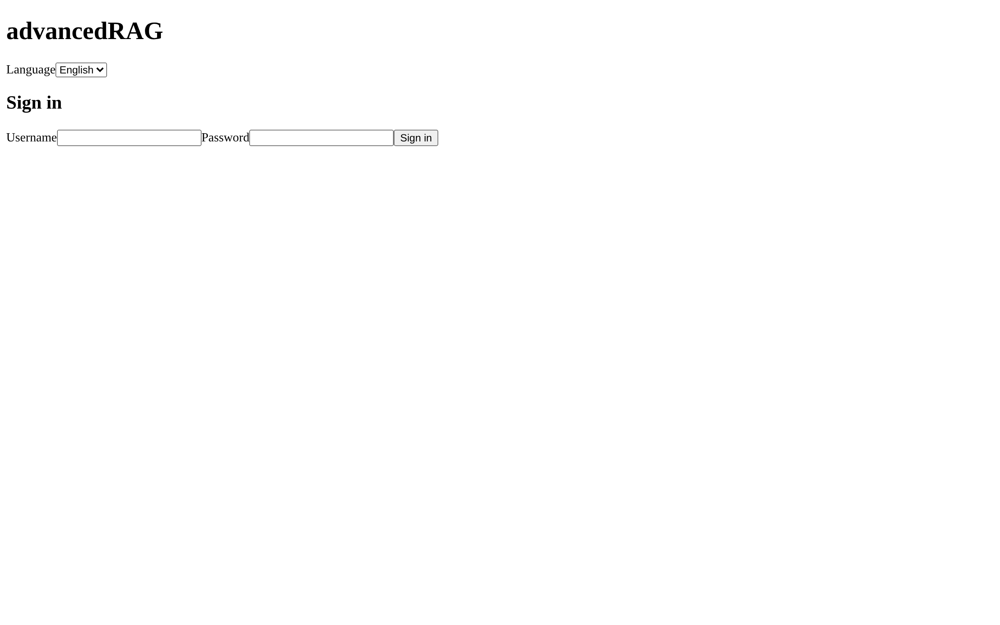
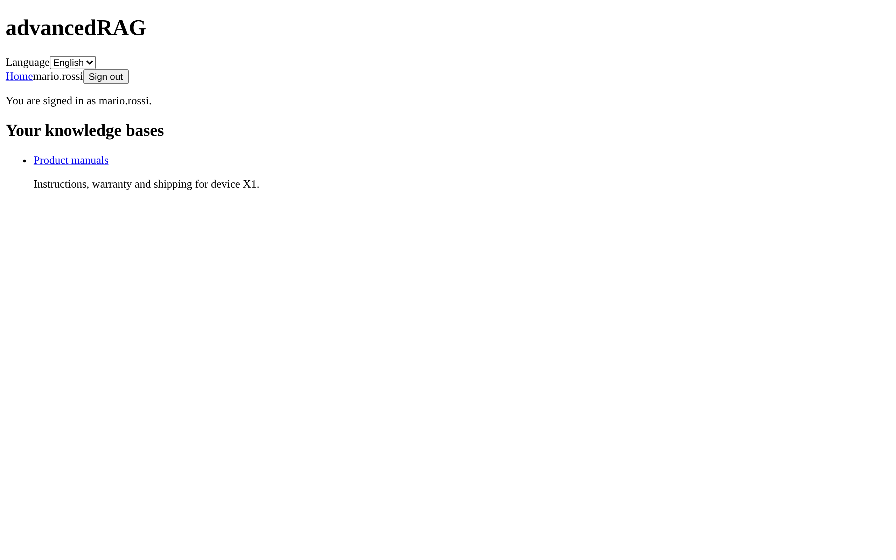
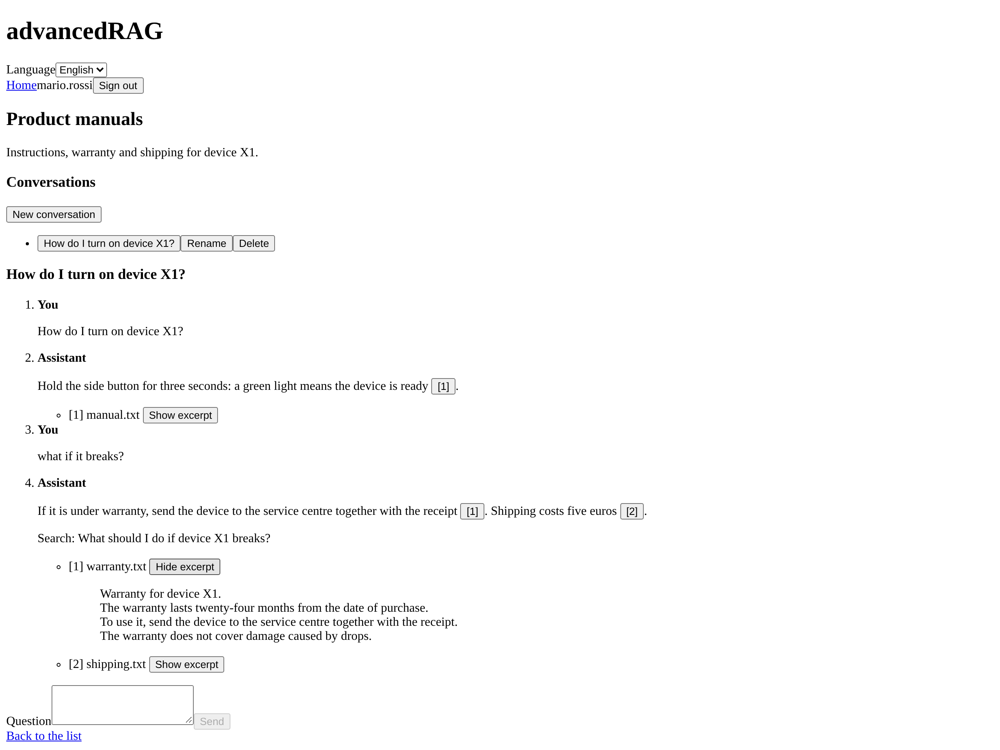

# User guide

[Italiano](../it/user.md)

This guide is for the people who use the application: you sign in, choose a knowledge base (KB), ask questions and read the answers with their sources. It names the texts of the English interface exactly as you see them, between guillemets, like «Sign in». A text that has a part that changes (your username, a question) is in *italics*, with … in place of that part. Other quotation marks, such as "forgot my password", are for words that are not on the screen: examples and the names of the sections of this guide. The screenshots show invented data. Managing users, KBs, documents and settings is the work of an administrator, in the admin guide; installing the application is in the [installation guide](installation.md).

The technical details are in the area pages [foundations](../../system/fondazioni.md) (login, sessions, users, knowledge bases) and [chat](../../system/chat.md) (retrieval, streamed answers, conversations, sources). They are written in English for developers.

## Signing in and out

### Sign in

Open the address of the application that your administrator gave you. Without a session you get the page «Sign in», with the fields «Username» and «Password» and the button «Sign in». Type your username and password, then choose «Sign in».

Your accounts are created by an administrator: there is no way to register yourself, and the page has no "forgot my password" link. If you do not have an account, or you need a new password, ask an administrator.

After signing in you land on the home page, which says *You are signed in as …*, with your username in place of the dots. The header, on every page, has the name of the application, the language selector «Language» and, once you are signed in, the links «Home», your username and the button «Sign out».

The session ends by itself after a period without any activity: 480 minutes (8 hours) unless the administrator set another value, and every action you take starts the count again. It also ends when an administrator deactivates your user or resets your password.

### Sign out

Choose «Sign out» in the header. You get back to the page «Sign in». Do this on a computer that other people use.

### Choose the language

The interface has two languages, «Italiano» and «English». It starts in the language of your browser: Italian if the first language of the browser is Italian, English otherwise. To change it, use the selector «Language» in the header; the page changes at once, without reloading.

- Before you sign in, the choice only changes the page you are looking at. After signing out, the sign-in page keeps the last language you used.
- After you sign in, the choice is also saved in your profile, and the language saved in your profile is the one you get the next time you sign in, on any browser.
- If the choice cannot be saved, the page goes back to the previous language and shows an error message (see the section "Error messages" below).

## Your knowledge bases

A knowledge base is a set of documents that the application can answer questions about. After signing in, the home page lists the KBs assigned to you under «Your knowledge bases»: for each one its name, which is a link, and its description when it has one.

- Choose the name of a KB to open its chat.
- You only see the KBs an administrator assigned to you. If the list says «No knowledge base is assigned to you.», ask an administrator to assign one. An administrator sees every KB, under the title «All knowledge bases».
- A KB that does not exist and a KB that is not assigned to you give the same message, «Knowledge base not found.».
- On the chat page the link «Back to the list» takes you back to the home page, and so does «Home» in the header.

## The chat

The page of a KB shows its name and description, the list of your conversations with the button «New conversation», and the messages of the open conversation with the question field.

### Ask a question

1. Write your question in the field «Question». You can write in Italian or in English, and the application looks for the answer in the documents of the KB you opened.
2. Choose «Send». The button is disabled while the field is empty. The spaces before and after the text are removed.
3. Wait for the answer. While it is generated the field and the buttons are disabled and the page shows «Generating the answer…»: you can ask the next question only when the answer is finished, and you cannot open, rename or delete a conversation meanwhile.

A question can be at most 4000 characters long, unless the administrator set another limit. A longer one is refused with «The text is not valid: check its length.», and your text stays in the field.

A question asked while no conversation is open creates a new conversation, and its title is the beginning of the question (the first 80 characters). The next questions go to the open conversation, so you can ask follow-up questions such as "and the shipping?": the application uses the most recent messages of the conversation (six by default) to understand them.

### Read the answer

The answer appears while the model writes it, a piece at a time, so you do not wait for the end to start reading. The messages are listed in order: the label «You» marks your questions and «Assistant» the answers. The text is shown as it is: it is never interpreted as formatting or as a web page.

If the KB has no document that is ready to be read, the answer ends at once with «No document available in this knowledge base». The administrator can see in the page «Documents» whether the documents are ready.

### Sources and excerpts

The numbers in square brackets in the answer, such as `[1]`, point to the sources the answer is based on. Under the answer each source has a line with its number and the name of the document, such as `[1] manual.txt`, followed by the title of the section and the pages when the document has them (`p. 3`, or `pp. 3–5` for a range), and by the button «Show excerpt». The list of sources has no title on the screen; it is labelled «Sources» for screen readers.

- Choose «Show excerpt» next to a source, or the number `[1]` in the text of the answer, to read the passage of the document the answer used. The excerpt opens under the source. «Hide excerpt» closes it.
- If the passage no longer exists, for example because the document was deleted, the excerpt says «Source no longer available». The name of the document stays in the list.
- Only the numbers that correspond to a source are buttons.

### The line *Search: …*

Under some answers there is a line *Search: …*, with the question that was searched in place of the dots, after the text of the answer and before the sources. It is not shown on every answer. It appears only when all of these are true:

- the administrator has switched on the step «Question rewriting» in the page «Settings», and the rewriting service is configured in the installation;
- the conversation already has earlier questions with an answer that worked: the first question of a conversation never has the line, and neither has a question that follows only failed answers;
- the rewriting worked: when the service does not answer, the search uses your question as you wrote it and no line is shown;
- the rewritten question is different from yours, ignoring the spaces at its ends and the capital letters.

The step rewrites a short follow-up question (for example "and the shipping?") as a standalone one, using the earlier messages, and the application looks in the documents for that one. The line shows you what was searched, so you can see why the sources are what they are. It appears when the answer is finished. When it is missing, the search used your question as you wrote it.

The administrator can also switch on the step «Reranker», which reorders the retrieved passages before the answer. It adds no line of its own.

### Retry a failed answer

An answer can fail, for example because the service that writes it did not answer in time. The answer then shows the reason (see the section "Why an answer fails" below) and the button «Retry».

- Choose «Retry» to generate the answer again, in the same place, without writing the question again.
- «Retry» is only on the last message of the conversation and only when it failed. If you ask another question after a failed answer, the failed one cannot be retried any more.
- If the connection breaks while the answer is written, or the application was restarted at that moment, the answer ends as «The answer was interrupted.» and can be retried too.
- If the application refuses the question before the answer starts, for example because it cannot be reached, nothing is added to the conversation: your earlier messages stay as they were, the question goes back into the field and a message tells you why.

## Conversations

Every question belongs to a conversation of one KB, and the conversations are saved. They are listed under «Conversations», on the page of the KB, with the most recently used first. When there is none, the page says «No conversations yet.» and, in place of the messages, «Ask a question about this knowledge base.».

### Start a new conversation

Choose «New conversation»: the messages are cleared and the next question you send starts a new conversation. Use it when you change subject, because the earlier messages of a conversation are part of what the application knows when it answers the next question. The button is disabled while an answer is being generated.

### Open a conversation

Choose the title of a conversation in the list: its messages, sources and excerpts load («Loading…») and you can go on asking. If you open a conversation whose answer is still being generated, the page shows «Generating the answer…» and reads the conversation again every few seconds until the answer is finished.

### Rename a conversation

Choose «Rename» next to the title. A field «New title» opens with «Save» and «Cancel». The title cannot be empty or longer than 200 characters, otherwise you get «The text is not valid: check its length.». Renaming does not change the order of the list.

### Delete a conversation

Choose «Delete» next to the title. The page asks *Delete the conversation "…"? Its messages will be removed too.*, with the title in place of the dots, and shows «Confirm» and «Cancel». Deleting is final: the conversation, its messages and its sources are removed, and the application cannot bring them back.

Your conversations are yours: the other users cannot see them. The administrators can read every conversation, in their page «Conversations», but only read it: they cannot write in yours.

## Error messages

The application shows its messages in the language of the interface. These are the ones you can see, with what they usually mean and what to do.

### When you sign in or your session ends

| Message | What it means |
|---|---|
| «Invalid username or password.» | The username or the password is wrong, or your user has been deactivated. Check them and try again, or ask an administrator. |
| «Your session has expired: please sign in again.» | Your session ended: you were inactive for too long, or an administrator deactivated your user or reset your password. Reload the page and sign in again. |
| «The request is not valid.» | The application refused what the page sent. Try again; if it stays, tell an administrator. |
| «The server cannot be reached. Please try again.» | There is no connection with the application. Check your network and try again. |
| «Something went wrong. Please try again.» | An error that has no more specific message. Try again; if it stays, tell an administrator. |

The last four can appear on any page, and the last one also in place of a more specific message that the page does not know.

### In the chat

| Message | What it means |
|---|---|
| «Knowledge base not found.» | The KB does not exist or is not assigned to you. Go back to the list. |
| «Conversation not found.» | The conversation does not exist any more (for example you deleted it in another window) or you cannot see it any more. Go back to the list of conversations. |
| «The generation provider is not configured: contact the administrator.» | The service that writes the answers has not been set up in the installation. Nothing was saved: tell an administrator. |
| «An answer is already being generated in this conversation.» | Another answer of the same conversation is running, for example in another window. Wait for it to finish. |
| «Retry is not possible: only the last answer, if it failed, can be repeated.» | The answer you want to retry is not the last message of the conversation, or it did not fail. |
| «The text is not valid: check its length.» | A question that is empty or longer than the limit, or a title that is empty or longer than 200 characters. |

### Why an answer fails

When an answer fails it shows one of these reasons, under the button «Retry».

| Message | What it means |
|---|---|
| «The embedding service (Ollama) could not process the question.» | The service that turns the question into numbers for the search did not work. Try «Retry»; if it stays, tell an administrator. |
| «The generation provider failed or sent an invalid answer.» | The service that writes the answers had an error. Try «Retry»; if it stays, tell an administrator. |
| «The generation provider did not finish in time.» | The service that writes the answers was too slow. Try «Retry». |
| «The answer could not be completed because of an internal error.» | An error of the application. Try «Retry»; if it stays, tell an administrator. |
| «The answer was interrupted.» | The connection broke, or the application was restarted, while the answer was written. Try «Retry». |

When the application does not know the reason of a failure, the message is the general one, «Something went wrong. Please try again.».
