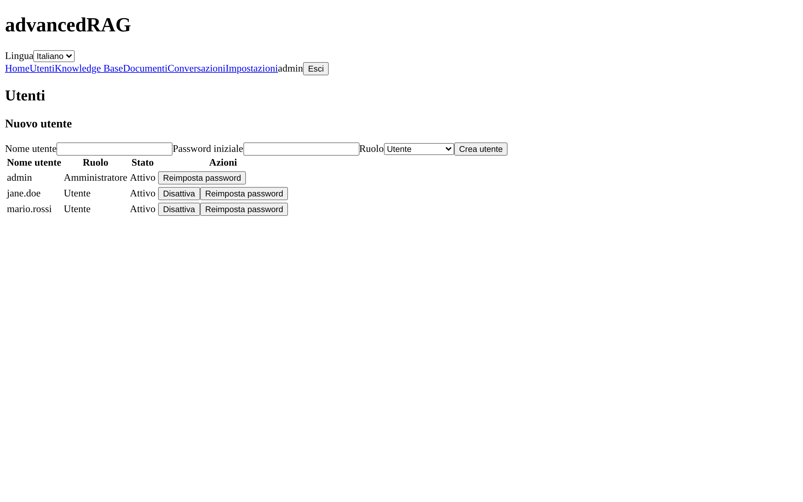
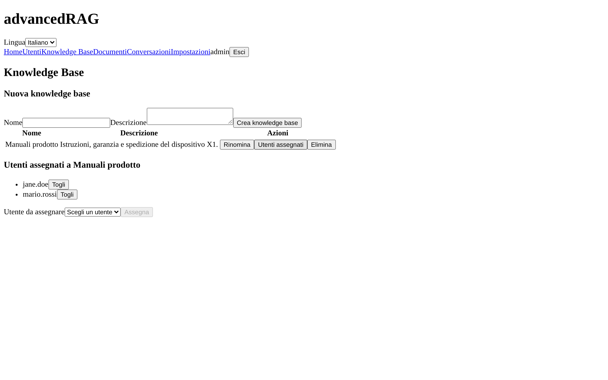
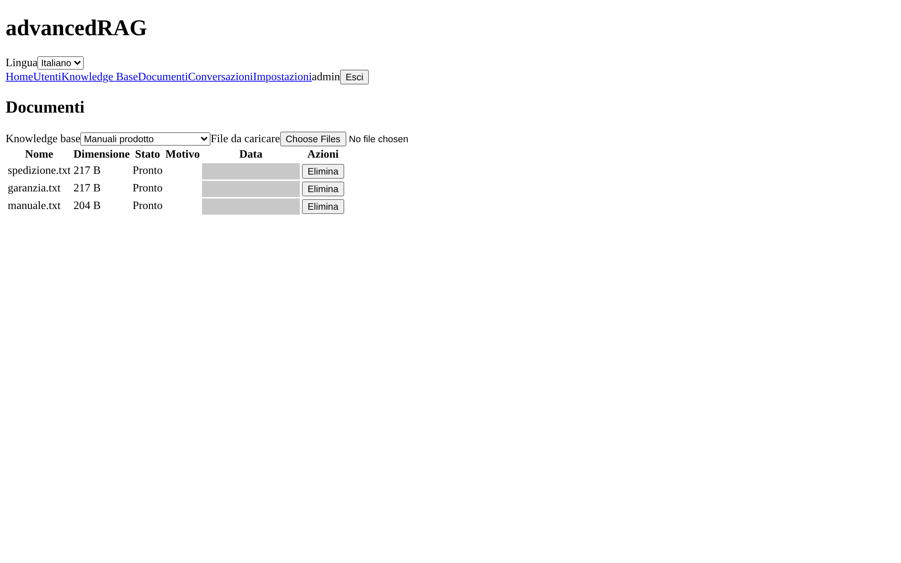
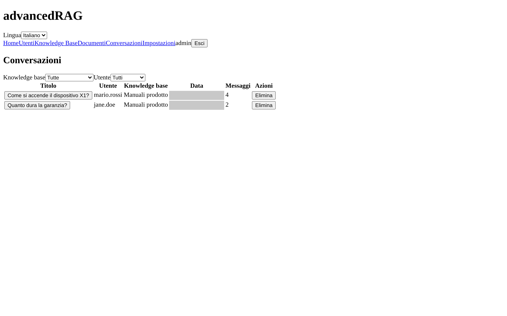
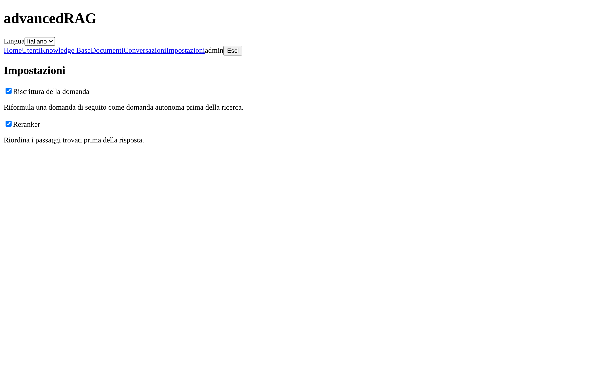

# Guida admin

[English](../en/admin.md)

Questa guida è per gli amministratori: le persone che creano utenti e knowledge base (KB), caricano i documenti, leggono le conversazioni e attivano o disattivano i passi facoltativi della chat. Cita i testi dell'interfaccia italiana esattamente come li vedi, tra virgolette caporali, come «Crea utente». Un testo che ha una parte che cambia (un nome utente, un titolo) è scritto in corsivo, con … al posto di quella parte, come *Utente … creato.* Le altre virgolette, come "Manuali prodotto", sono per valori d'esempio e per parole che non sono testi dell'interfaccia, come quelle che disegna il browser. Le schermate mostrano dati inventati. L'uso della chat è nella [guida utente](user.md); l'installazione dell'applicazione e le variabili del file `.env` sono nella [guida all'installazione](installation.md).

I dettagli tecnici sono nelle pagine di area [fondazioni](../../system/fondazioni.md) (accesso, sessioni, utenti, knowledge base, la pagina «Impostazioni»), [ingestione](../../system/ingestion.md) (documenti, worker, stati e motivi, originali) e [chat](../../system/chat.md) (ricerca, conversazioni, fonti, la pagina «Conversazioni»). Sono scritte in inglese per chi sviluppa.

## Le pagine dell'amministratore

Un amministratore accede come ogni utente (vedi la [guida utente](user.md)). Il primo amministratore viene creato al primo avvio dello stack con `ADMIN_USERNAME` e `ADMIN_PASSWORD` del file `.env` (vedi la [guida all'installazione](installation.md)); tutti gli altri si creano dalla pagina «Utenti».

L'intestazione di ogni pagina ha, per un amministratore, i link «Home», «Utenti», «Knowledge Base», «Documenti», «Conversazioni» e «Impostazioni». Chi ha il ruolo «Utente» non li vede, e se apre l'indirizzo di una di queste pagine l'applicazione lo porta alla pagina iniziale. La tua pagina iniziale elenca tutte le KB, sotto il titolo «Tutte le knowledge base» (un utente vede solo le KB che gli sono assegnate, sotto «Le tue knowledge base»), e puoi aprirne una qualsiasi per fare domande.

## Utenti

La pagina «Utenti» elenca tutti gli utenti e serve a crearli, disattivarli, riattivarli e reimpostare le loro password. Un utente è un account locale dell'applicazione: non c'è una pagina di registrazione e un utente non può cambiare da solo la propria password, lo fa un amministratore. Gli utenti non si eliminano dalla pagina, si disattivano soltanto.

### Creare un utente

Compila il modulo «Nuovo utente» con «Nome utente», «Password iniziale» e «Ruolo», poi scegli «Crea utente». La pagina dice *Utente … creato.* e aggiunge l'utente in fondo alla tabella, che ha le colonne «Nome utente», «Ruolo», «Stato» e «Azioni».

- Il nome utente ha da 3 a 64 caratteri tra lettere, cifre, punto, trattino basso e trattino, e gli spazi prima e dopo vengono tolti. Due nomi che differiscono solo per le maiuscole sono lo stesso nome: il secondo riceve «Questo nome utente è già usato.» Per accedere l'utente deve scrivere il nome esattamente come l'hai scritto tu, maiuscole comprese.
- La password iniziale ha almeno 12 caratteri; non è richiesto altro. Consegnala alla persona con un canale riservato e, se vuoi che ne abbia un'altra, reimpostala dopo (vedi "Reimpostare una password" più sotto).
- Un nome utente sbagliato mostra «Il nome utente deve avere da 3 a 64 caratteri tra lettere, cifre, punto, trattino basso e trattino.» e una password corta «La password deve avere almeno 12 caratteri.» In entrambi i casi non viene creato nulla.

### Ruoli

Un utente ha uno di due ruoli, scelto quando crei l'account e mostrato nella colonna «Ruolo»:

- «Utente»: vede le KB che gli sono assegnate, fa domande nella chat e gestisce le proprie conversazioni. Nient'altro.
- «Amministratore»: vede tutte le KB, usa le cinque pagine di questa guida e legge le conversazioni di tutti.

La pagina non permette di cambiare il ruolo di un utente esistente: crea un nuovo account con il ruolo giusto e disattiva l'altro.

### Disattivare e riattivare un utente

La colonna «Stato» mostra «Attivo» o «Disattivato». Per un utente attivo, «Disattiva» apre la domanda *Disattivare …? Tutte le sue sessioni verranno chiuse.* con i pulsanti «Disattiva» e «Annulla». Quando confermi:

- tutte le sessioni dell'utente terminano subito e l'utente non può accedere: riceve «Nome utente o password non validi.», lo stesso messaggio di una password sbagliata;
- l'utente resta nella tabella, con «Disattivato» e il pulsante «Riattiva», e nulla di suo viene eliminato: le assegnazioni alle KB e le conversazioni restano come sono.

«Riattiva» agisce subito, senza domande. L'utente può accedere di nuovo con la password che aveva (o con quella che nel frattempo hai reimpostato); le sessioni chiuse non tornano.

La tua riga non ha il pulsante «Disattiva»: non puoi disattivare te stesso, così c'è sempre almeno l'amministratore che sta lavorando. Un utente disattivato resta nell'elenco degli utenti assegnati a una KB, segnato «Disattivato», e non viene proposto quando assegni gli utenti.

### Reimpostare una password

«Reimposta password» apre un modulo con il titolo *Reimposta la password di …*, il campo «Nuova password» e i pulsanti «Salva password» e «Annulla». La nuova password segue la stessa regola di quella iniziale (almeno 12 caratteri). Quando viene salvata la pagina dice *Password di … reimpostata.* e tutte le sessioni di quell'utente terminano: deve accedere di nuovo con la nuova password. Puoi reimpostare anche la password di un utente disattivato; questo non lo riattiva.

Se reimposti la tua password, esci dall'applicazione e la pagina di accesso ti dice «La tua password è stata reimpostata: accedi di nuovo con la nuova password.»

### Messaggi della pagina

| Messaggio | Quando |
|---|---|
| «Questo nome utente è già usato.» | Crei un utente con un nome già in uso, senza distinguere le maiuscole. |
| «Il nome utente deve avere da 3 a 64 caratteri tra lettere, cifre, punto, trattino basso e trattino.» | Il nome è troppo corto, troppo lungo o ha altri caratteri. |
| «La password deve avere almeno 12 caratteri.» | Una password iniziale o nuova con meno di 12 caratteri. |
| «Non puoi disattivare il tuo utente.» | Il server rifiuta di disattivare l'utente che lo chiede. La pagina non ha il pulsante, quindi di solito non vedi questo messaggio. |
| «Utente non trovato.» | L'utente non esiste o l'identificatore non è valido. La pagina non elimina mai un utente, quindi di solito non vedi questo messaggio. |

## Knowledge base

Una knowledge base è un insieme di documenti sui quali l'applicazione sa rispondere alle domande, ed è l'unità di accesso: un utente vede una KB solo se gliela assegni. La pagina «Knowledge Base» le crea, le modifica, le assegna e le elimina. La sua tabella ha le colonne «Nome», «Descrizione» e «Azioni».

### Creare una knowledge base

Compila il modulo «Nuova knowledge base»: «Nome», obbligatorio, e «Descrizione», facoltativa, poi scegli «Crea knowledge base». La pagina dice *Knowledge base … creata.* e aggiunge la KB alla tabella.

- Il nome ha da 1 a 100 caratteri e la descrizione al massimo 500; altrimenti ricevi «Il nome deve avere da 1 a 100 caratteri e la descrizione al massimo 500.» Gli spazi ai due estremi vengono tolti.
- Due KB non possono avere lo stesso nome, senza distinguere le maiuscole: «Esiste già una knowledge base con questo nome.»
- Una KB nuova non ha documenti né utenti assegnati: finché non la assegni la vedono solo gli amministratori.

### Modificare una knowledge base

«Rinomina» apre un modulo con il titolo *Rinomina …*, i campi «Nuovo nome» e «Nuova descrizione», già compilati con i valori attuali, e i pulsanti «Salva» e «Annulla». Lo stesso modulo cambia il nome e la descrizione; una descrizione vuota la toglie. Quando viene salvato la pagina dice *Knowledge base … aggiornata.* Rinominare non tocca i documenti né le conversazioni della KB.

### Assegnare gli utenti

«Utenti assegnati» apre, sotto la tabella, l'elenco *Utenti assegnati a …*, con il pulsante «Togli» accanto a ogni utente; quando nessuno è assegnato la pagina dice «Nessun utente assegnato.» Per assegnare qualcuno sceglilo in «Utente da assegnare» (la prima voce è «Scegli un utente») e poi «Assegna». Vengono proposti solo gli utenti attivi, e un utente già assegnato non viene proposto di nuovo. «Assegna» e «Togli» agiscono subito, senza domande.

- Un utente assegnato vede la KB sotto «Le tue knowledge base» e può aprirne la chat. Un amministratore vede tutte le KB, quindi assegnarne uno non cambia nulla.
- Dopo «Togli» la KB sparisce dall'elenco di quell'utente. Se ne apre l'indirizzo riceve «Knowledge base non trovata.», lo stesso messaggio di una KB che non esiste, così un utente non può scoprire quali KB esistono. Lo stesso messaggio lo ricevi tu se la KB è stata eliminata in un'altra finestra.
- Le conversazioni che l'utente aveva in quella KB non vengono eliminate, ma lui non le vede più; tu le leggi ancora nella pagina «Conversazioni».
- Un utente disattivato dopo l'assegnazione resta nell'elenco, segnato «Disattivato».

### Eliminare una knowledge base

«Elimina» apre la domanda *Eliminare la knowledge base …? Anche le assegnazioni dei suoi utenti verranno rimosse.* con i pulsanti «Elimina» e «Annulla». L'eliminazione è definitiva. La domanda nomina solo le assegnazioni, ma se ne va tutta la KB: i suoi documenti con chunk e vettori, i file originali e ogni conversazione della KB con i suoi messaggi e le sue fonti, per tutti gli utenti. Poi la pagina dice *Knowledge base … eliminata.*

## Documenti

La pagina «Documenti» serve a caricare e seguire i documenti di una KB. Un utente non vede mai i documenti di una KB, solo le risposte e le fonti che ne derivano. Si comincia scegliendo la KB in «Knowledge base» (la prima voce è «Scegli una knowledge base»): la tabella ne elenca i documenti con le colonne «Nome», «Dimensione», «Stato», «Motivo», «Data» e «Azioni», oppure dice «Nessun documento in questa knowledge base.»

I riquadri grigi nelle schermate di «Documenti» e «Conversazioni» coprono le date: sono nascoste di proposito, perché cambiano a ogni cattura, e sul tuo schermo le vedi. Il testo del selettore di file ("Choose Files", "No file chosen") è disegnato dal browser nella sua lingua, non dalla pagina: la pagina segue la lingua dell'interfaccia, il selettore segue il browser. Per questo nella schermata italiana di questa guida resta in inglese.

### Caricare i file

Con una KB scelta, «File da caricare» apre il selettore di file del browser; puoi sceglierne più di uno. Ogni file viene inviato da solo e, mentre viene inviato, compare nell'elenco dei caricamenti con «Caricamento in corso…». Un file accettato diventa una riga della tabella con lo stato «In coda». Un file rifiutato non aggiunge righe: il suo nome resta nell'elenco dei caricamenti con il motivo.

- Formati: PDF, DOCX, PPTX, XLSX, TXT e MD. L'estensione, il tipo dichiarato dal browser e l'inizio del file devono dire tutti lo stesso formato, quindi un file rinominato con un'altra estensione viene rifiutato. Il rifiuto è «Tipo di file non supportato. Sono ammessi PDF, DOCX, PPTX, XLSX, TXT e MD.»
- Dimensione: al massimo 20 MB per file, salvo che l'amministratore dell'installazione abbia impostato un altro limite con `MAX_UPLOAD_SIZE_MB` nel file `.env` (vedi la [guida all'installazione](installation.md)). Un file più grande riceve «Il file supera la dimensione massima consentita.»
- Un file vuoto riceve «Il file è vuoto.»
- Un file con lo stesso contenuto di un documento già presente nella KB, qualunque sia il suo nome, riceve «Questo file è già presente nella knowledge base.» Vale anche per un documento fallito: per caricare di nuovo un file fallito devi prima eliminare la sua riga.

### Gli stati di un documento

La colonna «Stato» dice a che punto è il documento. Finché un documento è «In coda» o «In elaborazione» la pagina rilegge l'elenco da sola ogni tre secondi.

| Stato | Cosa significa |
|---|---|
| «In coda» | Il file è stato caricato e aspetta il worker, che elabora un documento alla volta. |
| «In elaborazione» | Il worker sta leggendo il file, dividendo il testo in chunk e chiedendo a Ollama i vettori. I file PDF, DOCX, PPTX e XLSX sono letti da Docling; i file TXT e MD sono letti direttamente. |
| «Pronto» | Il documento è indicizzato: la chat può trovarlo e usarlo per le risposte. Il file originale è stato eliminato. |
| «Fallito» | Qualcosa è andato storto. La colonna «Motivo» dice cosa, e la riga ha il pulsante «Riprova». L'originale viene tenuto per un po' perché tu possa riprovare. |
| «Non supportato» | Il file è stato letto, ma ne è stato estratto troppo poco testo (meno di `MIN_EXTRACTED_CHARS` caratteri che non siano spazi, 50 per impostazione predefinita). Succede con una scansione senza testo, perché non c'è l'OCR. Non c'è «Riprova»: carica un file che abbia del testo. L'originale è stato eliminato. |

Una KB senza documenti «Pronto» non può rispondere: la chat termina subito con «Nessun documento disponibile in questa knowledge base». Il motivo di un documento «Non supportato» è «Dal file non è stato estratto abbastanza testo (le scansioni senza testo non sono supportate).»

### Perché un documento fallisce

La colonna «Motivo» di un documento «Fallito» dice cosa è andato storto. La maggior parte dei motivi riguarda uno dei due servizi esterni, Docling (legge i file) e Ollama (calcola i vettori), i cui indirizzi stanno nel file `.env`; la [guida all'installazione](installation.md) spiega come controllarli.

| Motivo | Cosa fare |
|---|---|
| «Il servizio di lettura dei documenti (Docling) non è raggiungibile.» | Docling non ha risposto a nessun tentativo. Controlla che sia in funzione e che l'indirizzo sia giusto, poi «Riprova». |
| «Il servizio di lettura dei documenti (Docling) ha restituito un errore.» | Docling ha risposto con un errore, o ha rifiutato la sua chiave. Controllalo come sopra, poi «Riprova». |
| «Il file non può essere letto.» | Docling ha rifiutato il file, oppure un file TXT o MD non è testo UTF-8. «Riprova» non serve: correggi o converti il file e caricalo di nuovo. |
| «Il servizio degli embedding (Ollama) non è raggiungibile.» | Ollama non ha risposto a nessun tentativo. Controlla che sia in funzione e l'indirizzo, poi «Riprova». |
| «Il servizio degli embedding (Ollama) ha restituito un errore.» | Ollama ha risposto con un errore. Controllalo, insieme al modello di embedding che ha, poi «Riprova». |
| «Il servizio degli embedding (Ollama) ha dato una risposta non valida.» | Ollama ha risposto, ma non con vettori utilizzabili. Controlla che il modello sia un modello di embedding, poi «Riprova». |
| «I vettori ricevuti hanno una dimensione diversa da quella configurata.» | Il modello dà vettori di una dimensione diversa da `EMBEDDING_DIMENSIONS`. Correggi il file `.env` come dice la guida all'installazione, riavvia lo stack, poi «Riprova». |
| «La verifica degli indici non è riuscita: nessun contenuto è stato salvato.» | I nuovi chunk non sono stati trovati dai due indici, quindi non è stato tenuto nulla. «Riprova». |
| «Errore imprevisto durante l'elaborazione.» | Qualunque altro caso, come un tempo di elaborazione oltre il limite o un worker che si è fermato a metà. «Riprova»; se si ripete, leggi i log come dice la guida all'installazione. |

### Riprovare ed eliminare

«Riprova» c'è solo sulle righe con lo stato «Fallito». Rimette il documento «In coda», cancella il motivo e il worker lo elabora di nuovo; la riga segue gli stati come per un caricamento nuovo. Possono seguire due messaggi:

- «Il file originale non esiste più: carica di nuovo il documento.» L'originale è stato eliminato perché è scaduto il tempo per cui viene tenuto (vedi sotto). Il pulsante sparisce dalla riga: elimina il documento e carica di nuovo il file.
- «Il documento non può essere riprovato: non è più nello stato Fallito.» Lo stato è cambiato nel frattempo, per esempio perché un altro amministratore l'ha già riprovato. La pagina rilegge l'elenco.

«Elimina» c'è su ogni riga, qualunque sia lo stato. Apre la domanda *Eliminare il documento …? Verranno rimossi anche i suoi chunk.* con i pulsanti «Conferma» e «Annulla». L'eliminazione rimuove il documento, i suoi chunk e il suo originale, e non si può annullare. Le risposte già scritte restano come sono, ma una fonte che veniva da quel documento mostra «Fonte non più disponibile».

### I file originali

L'originale di un file caricato vive solo nella cartella dei caricamenti sul server (`UPLOAD_DIR`, un volume dello stack), con l'identificatore del documento e non con il suo nome. Viene eliminato:

- appena il documento è «Pronto» o «Non supportato»: da quel momento l'applicazione tiene solo i chunk di testo e i loro vettori;
- quando il documento viene eliminato, o la KB a cui appartiene;
- per un documento «Fallito», dopo `FAILED_ORIGINAL_RETENTION_DAYS` giorni dal fallimento (7 per impostazione predefinita). Fino ad allora puoi usare «Riprova»; un nuovo tentativo che fallisce ancora fa ripartire il conteggio. Dopo, il worker elimina il file (controlla ogni ora) e il documento resta «Fallito».

I log non contengono mai il contenuto, i nomi o i vettori dei documenti.

## Conversazioni

La pagina «Conversazioni» ti fa leggere le conversazioni di tutti gli utenti, per esempio per vedere come vengono usate le KB e quali fonti hanno avuto le risposte. Per il contenuto è in sola lettura: leggi ogni conversazione e non scrivi in nessuna di quelle degli altri utenti.

### Leggere le conversazioni di tutti

La tabella elenca ogni conversazione di ogni utente, con le colonne «Titolo», «Utente», «Knowledge base», «Data», «Messaggi» e «Azioni». I due filtri «Knowledge base» e «Utente» partono entrambi da «Tutte» e «Tutti» (le voci del primo sono «Tutte» e le KB, quelle del secondo «Tutti» e gli utenti); scegline uno o entrambi per restringere l'elenco. Senza conversazioni la pagina dice «Nessuna conversazione.»

Scegli un titolo per leggere la conversazione sotto la tabella: i suoi messaggi, in ordine, con le fonti di ogni risposta. Una fonte è la riga con il suo numero e il nome del documento, come `[1] manuale.txt`, con il pulsante «Mostra estratto», che apre il passaggio usato dalla risposta («Nascondi estratto» lo chiude); se nel frattempo il documento è stato eliminato vedi «Fonte non più disponibile». Sotto una risposta può esserci anche la riga *Ricerca: …*, con la domanda che è stata cercata: non c'è su ogni risposta, e la [guida utente](user.md) dice quando compare.

La conversazione non ha il campo della domanda né «Riprova»: un amministratore non può fare domande, riprovare né rinominare in una conversazione di un altro utente. Le conversazioni che hai avuto tu, come amministratore, sono nello stesso elenco.

### Eliminare una conversazione

L'unica modifica possibile qui è l'eliminazione. «Elimina» su una riga apre la domanda *Eliminare la conversazione «…»? Anche i suoi messaggi saranno cancellati.* con i pulsanti «Conferma» e «Annulla». L'eliminazione è definitiva, anche per l'utente: la conversazione, i suoi messaggi e le sue fonti vengono rimossi. Se la conversazione non c'era già più, la pagina dice «Conversazione non trovata.» e rilegge l'elenco.

## Impostazioni

La pagina «Impostazioni» ha i due interruttori dei passi facoltativi della chat. Entrambi sono disattivati la prima volta, ed entrambi sono globali: valgono per ogni KB e per ogni utente. Non c'è un pulsante di salvataggio né un messaggio: ogni interruttore viene salvato appena lo cambi, ed è disabilitato per il tempo che serve.

### I due interruttori

- «Riscrittura della domanda»: «Riformula una domanda di seguito come domanda autonoma prima della ricerca.» Quando un utente fa una domanda di seguito breve, un servizio di riscrittura, con i messaggi precedenti, la trasforma in una domanda completa e la ricerca usa quella. L'utente vede cosa è stato cercato nella riga *Ricerca: …*, quando è diverso dalla sua domanda. Se il servizio non risponde, la ricerca usa la domanda com'era stata scritta.
- «Reranker»: «Riordina i passaggi trovati prima della risposta.» La ricerca trova dei passaggi candidati e il reranker, un servizio che valuta quanto ognuno risponde alla domanda, riordina i primi (20 per impostazione predefinita) prima che il modello scriva la risposta. Se il reranker non risponde, resta l'ordine della ricerca. Non aggiunge righe alla risposta.

Una modifica vale per le risposte che iniziano dopo; una risposta già in corso mantiene quello con cui era partita.

### Attivare un passo

Un passo funziona solo se il suo servizio è configurato nel file `.env` dell'installazione, cosa che si fa fuori dall'applicazione. Quando non lo è, l'interruttore è disabilitato e la pagina dice «Non configurato» sotto di esso: da qui non puoi attivarlo.

- Per «Riscrittura della domanda»: `REWRITE_BASE_URL` e `REWRITE_MODEL`.
- Per «Reranker»: `RERANK_BASE_URL` e `RERANK_API` (e `RERANK_MODEL` per un reranker nel formato `cohere`), oppure il reranker che lo stack può avviare per te.

La [guida all'installazione](installation.md#riscrittura-e-reranker) elenca le variabili dei due passi, e [il reranker su CPU](installation.md#il-reranker-su-cpu) spiega come avviare il reranker dello stack. Dopo aver cambiato il file `.env`, riavvia lo stack come dice quella guida; poi l'interruttore non è più disabilitato.

Se un interruttore viene rifiutato comunque, perché il servizio non è configurato, torna dov'era e la pagina dice «Il servizio di questo passo non è configurato.» Se togli un servizio dal file `.env` mentre il suo interruttore è attivo, la pagina continua a mostrarlo attivo, disabilitato, con «Non configurato»: il passo non è attivo e non puoi disattivarlo dalla pagina.

I dettagli tecnici dei due passi, come le impostazioni e i controlli di salute, sono nelle pagine di area [chat](../../system/chat.md) e [fondazioni](../../system/fondazioni.md).
