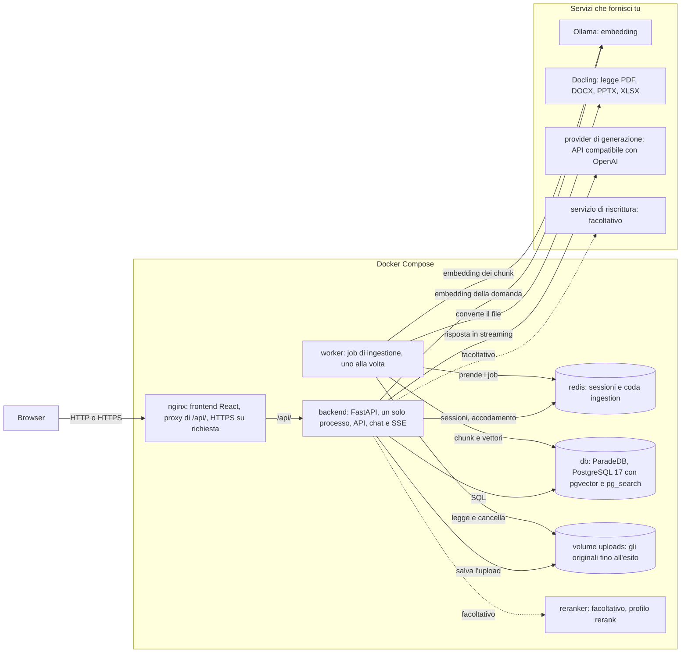

# Guida di architettura e sviluppo

[English](../en/architecture.md)

Questa guida è per chi sviluppa: mostra come si incastrano le parti di advancedRAG, come un documento e una domanda le attraversano, come ogni knowledge base (KB) resta separata dalle altre, come preparare l'ambiente ed eseguire i controlli, e come si fa una modifica, dalla specifica al merge. I testi dell'interfaccia che cita sono quelli dell'interfaccia italiana. La guida utente e la guida admin (`user.md` e `admin.md` in questa cartella) sono guide separate; per installare e far funzionare lo stack leggi la [guida all'installazione e all'operatività](installation.md).

Il comportamento è descritto nei dettagli, per chi sviluppa, nelle pagine d'area [fondazioni](../../system/fondazioni.md), [ingestione](../../system/ingestion.md) e [chat](../../system/chat.md); questa guida non le copia e a ogni passo ti manda a quella giusta. Sono scritte solo in inglese.

## I componenti

### Panoramica

advancedRAG è un monolite modulare: un backend FastAPI con un worker di ingestione, un frontend React servito da Nginx, PostgreSQL (ParadeDB) e Redis. I servizi disegnati a destra non li avvia Compose: li fornisci tu e ne scrivi gli indirizzi in `.env`.



Il reranker non deve essere per forza quello di Compose: `RERANK_BASE_URL` può puntare a un altro servizio, e allora il servizio `reranker` non viene avviato. Le linee tratteggiate sono i passi facoltativi: l'admin li accende nella pagina «Impostazioni» e girano solo se il loro servizio è configurato.

### I servizi di Compose

| Servizio | Cos'è | Note |
|---|---|---|
| `nginx` | Serve il frontend compilato e fa da proxy di `/api/` verso il backend | L'unico servizio con una porta sull'host (`HTTP_PORT`, `HTTPS_PORT` con `compose.tls.yaml`); limita la dimensione dell'upload; non mette in buffer il flusso della risposta |
| `backend` | FastAPI sulla porta 8000, solo dentro la rete di Compose | All'avvio applica le migrazioni del database, crea il primo admin e il profilo di indicizzazione e segna come fallite le risposte rimaste in sospeso; poi avvia uvicorn, **un solo processo** (ADR-003) |
| `worker` | La stessa immagine del backend, con `python -m app.worker` | Prende i job della coda RQ `ingestion`, uno alla volta; nessuna porta; condivide il volume `uploads` con il backend |
| `redis` | Le sessioni degli accessi e la coda dei job di ingestione | |
| `db` | ParadeDB: PostgreSQL 17 con `pgvector` (vettori, HNSW) e `pg_search` (BM25) | Dati nel volume `pgdata` |
| `reranker` | Hugging Face text-embeddings-inference, facoltativo | Solo con `--profile rerank`; immagine CPU, oppure quella GPU con `compose.rerank-gpu.yaml`; modello nel volume `reranker-models` |

### I servizi esterni

| Servizio | A cosa serve | Chi lo usa |
|---|---|---|
| Ollama | gli embedding dei chunk e delle domande | worker e backend |
| Docling (docling-serve) | convertire i file PDF, DOCX, PPTX e XLSX in blocchi di testo; i file TXT e MD si leggono direttamente | worker |
| Il provider di generazione | la risposta della chat: una qualsiasi API compatibile con OpenAI | backend |
| Il servizio di riscrittura (facoltativo) | riscrivere una domanda di seguito come domanda autonoma | backend |

Li chiamano solo il backend e il worker, ciascuno con le proprie impostazioni (il worker non riceve mai le variabili di generazione, riscrittura o reranker). Nei test automatici sono sempre sostituiti da servizi finti (`backend/tests/fakes/`); i servizi veri si usano solo nei test live, su richiesta.

### Il codice

| Percorso | Contenuto |
|---|---|
| `backend/app/main.py`, `run.py`, `worker.py` | la factory dell'applicazione; il punto d'ingresso del container (migrazioni, primo admin, uvicorn); il worker di ingestione |
| `backend/app/auth/`, `users/` | accesso e sessioni in Redis, `require_admin`; gli account locali |
| `backend/app/knowledge_bases/` | le KB, i loro membri e `KnowledgeBaseRepository` |
| `backend/app/documents/` | upload, validazione del file, salvataggio degli originali, la coda |
| `backend/app/ingestion/` | la pipeline del worker: lettori, client di Docling, normalizzazione, chunker, embedding, salvataggio, profilo di indicizzazione, pulizia |
| `backend/app/chat/` | ricerca, riscrittura, reranker, generazione, prompt, il flusso SSE, conversazioni |
| `backend/app/app_settings/` | i due interruttori admin dei passi facoltativi |
| `backend/app/api/health.py` | `GET /api/health` |
| `backend/app/db/`, `backend/migrations/` | modelli e sessioni SQLAlchemy; migrazioni Alembic |
| `frontend/src/` | le pagine React, il client delle API, i file delle lingue `i18n/it.json` e `en.json` |
| `nginx/` | la configurazione di Nginx, con e senza TLS |

## Il percorso di un documento

Un admin carica un file nella pagina «Documenti». I dettagli, gli stati e i codici dei motivi sono in [ingestione](../../system/ingestion.md).

1. **Upload.** Il browser invia un file con `POST /api/kbs/{kb_id}/documents` (`multipart/form-data`). Nginx rifiuta un corpo oltre `MAX_UPLOAD_SIZE_MB` più 1 MB con lo stesso errore JSON del backend.
2. **Validazione.** Il backend controlla la sessione e il ruolo (solo admin), trova la KB con `KnowledgeBaseRepository`, copia il file in streaming in `UPLOAD_DIR/{id}.part` calcolando dimensione e SHA-256, e rifiuta un file vuoto, o la cui estensione, tipo MIME dichiarato e firma non indicano lo stesso formato (PDF, DOCX, PPTX, XLSX, TXT o MD). Lo stesso checksum due volte in una KB è un 409.
3. **Coda.** Il documento è inserito come `QUEUED`, il file è rinominato `UPLOAD_DIR/{id}` e il job `process_document_job` è messo sulla coda RQ `ingestion` in Redis. La risposta è 202 e la pagina rilegge l'elenco ogni 3 secondi.
4. **Worker.** `worker` prende il job e porta il documento da `QUEUED` a `PROCESSING` con una sola istruzione; se nel frattempo il documento è stato eliminato, il job finisce senza rumore.
5. **Lettura.** TXT e MD si leggono come UTF-8. PDF, DOCX, PPTX e XLSX vanno a Docling (senza OCR), che si richiama dopo un errore temporaneo, fino a `INGESTION_MAX_ATTEMPTS` tentativi.
6. **Chunk.** Il testo è normalizzato e tagliato in chunk strutturali (impostazioni `CHUNK_*`). Con meno di `MIN_EXTRACTED_CHARS` caratteri il documento diventa `UNSUPPORTED`.
7. **Embedding.** Ollama dà i vettori a gruppi di `EMBEDDING_BATCH_SIZE` testi, per il profilo di indicizzazione attivo (modello e dimensioni).
8. **Indici.** Tutti i chunk sono salvati in una transazione. L'indice BM25 di `pg_search` è creato da una migrazione; l'indice HNSW di `pgvector` è creato per ogni profilo a runtime. Il worker controlla che entrambi restituiscano ogni chunk.
9. **Esito.** Il documento è `READY` con il suo `chunk_count` e l'originale è cancellato. Ogni errore lo rende `FAILED` con un codice del motivo, nessun chunk e l'originale conservato per `FAILED_ORIGINAL_RETENTION_DAYS` giorni, così «Riprova» può rimetterlo in coda.

## Il percorso di una domanda

Un utente fa una domanda nella chat di una KB. I dettagli, gli errori e i limiti sono in [chat](../../system/chat.md).

1. **Richiesta.** `POST /api/kbs/{kb_id}/conversations` (nuova conversazione) oppure `POST /api/conversations/{id}/messages`. Il backend controlla la sessione, la KB e la conversazione, la domanda e `GENERATION_BASE_URL`, e salva la domanda e una risposta `PENDING` in una transazione. La risposta HTTP è `text/event-stream` e comincia con l'evento `conversation`.
2. **Interruttori.** La risposta legge una sola volta gli interruttori `rewrite_enabled` e `rerank_enabled` della pagina admin e li tiene fino alla fine. Un passo è attivo solo se il suo interruttore è acceso e il suo URL di base è impostato.
3. **Niente da cercare.** Se la KB non ha nessun documento `READY` con chunk del profilo attivo, la risposta si completa subito con l'avviso `no_documents`: nessun servizio viene chiamato.
4. **Riscrittura (facoltativa).** Con la riscrittura attiva e una cronologia non vuota, il servizio di riscrittura trasforma la domanda in una domanda autonoma, usata solo per la ricerca; il modello della risposta riceve sempre la domanda originale. A ogni errore si usa la domanda originale. La pagina mostra quella riscritta come «Ricerca: …».
5. **Ricerca ibrida.** La domanda cercata è trasformata in vettore da Ollama, poi due ricerche girano sulla KB, ciascuna con `RETRIEVAL_CANDIDATES` risultati: la ricerca vettoriale (HNSW, distanza del coseno) e la ricerca BM25 di `pg_search`. La Reciprocal Rank Fusion (`RRF_K`) unisce le due liste.
6. **Reranker (facoltativo).** Con il reranker attivo, i migliori `RERANK_CANDIDATES` chunk della fusione ricevono un punteggio dal reranker e sono riordinati; a ogni errore resta l'ordine RRF.
7. **Generazione.** I primi `CHAT_CONTEXT_CHUNKS` chunk e gli ultimi `CHAT_HISTORY_MESSAGES` messaggi costruiscono il prompt. Il provider risponde in streaming e il backend invia ogni frammento come evento SSE `delta`, con un commento di keepalive almeno ogni 15 secondi (Nginx legge con un timeout di 60 secondi e la risposta porta `X-Accel-Buffering: no`).
8. **Messaggio salvato.** Alla fine le citazioni sono controllate contro le fonti e `complete_answer` salva il testo e le fonti (`message_sources`); l'evento `done` chiude il flusso. Un errore salva la risposta come `FAILED` e invia `error`; «Riprova» la genera di nuovo.

## L'isolamento per knowledge base

L'isolamento è la regola principale del progetto: un utente vede solo le KB che gli sono assegnate, e nessuna rotta, query o log restituisce mai chunk, fonti o metadati di una KB che chi chiede non può leggere.

### Le regole

- Ogni accesso a una KB, ai suoi documenti o alle sue conversazioni passa da `KnowledgeBaseRepository.list_for` o `get_for`, oppure da una query unita a `kb_members` nella stessa istruzione SQL. Ogni percorso così ha un test di isolamento che lo chiama direttamente (`backend/tests/test_isolation.py`, `test_conversation_isolation.py`).
- Per ogni ruolo diverso dall'esatto `admin`, `KnowledgeBaseRepository` unisce `kb_members` all'utente. Ogni istruzione che legge `chunks` porta, nello stesso SQL, la visibilità della KB (`visible_kb_ids`), il `kb_id`, il join sui documenti `READY` e il `profile_id`.
- Una KB non assegnata, inesistente o con un id che non è un UUID riceve lo stesso 404 `kb_not_found`; la conversazione di un altro utente, di una KB non assegnata, una sconosciuta e un id che non è un UUID ricevono lo stesso 404, mai un 403. L'admin legge ogni conversazione e non scrive in nessuna di un altro utente (403).
- I vettori di profili di indicizzazione diversi non si mescolano mai: ogni ricerca vettoriale filtra su `profile_id` e usa l'espressione HNSW `embedding::vector(N)` del profilo.
- Gestire utenti, KB, documenti e impostazioni, e leggere ogni conversazione, è solo per l'admin: `require_admin` viene prima degli id nel percorso e del corpo, e uno `user` riceve 403.
- Gli originali caricati vivono solo in `UPLOAD_DIR`, con l'id del documento come nome, e sono cancellati a `READY` o `UNSUPPORTED`, con il documento o la sua KB, e `FAILED_ORIGINAL_RETENTION_DAYS` giorni dopo `FAILED`. I log non contengono mai contenuto dei documenti, nomi, domande o vettori.

### Le aree sensibili

Una modifica a questi percorsi è segnalata da `diff_scope.py` (la riga `SENSITIVE` della PR) e chi revisiona ne legge il diff con più attenzione.

| Percorso | Perché |
|---|---|
| `backend/app/auth/` | accesso, sessioni, password |
| `backend/app/documents/` | validazione dell'upload e salvataggio dei file |
| `backend/app/chat/` | isolamento di conversazioni e fonti |
| `backend/app/app_settings/` | gli interruttori admin |
| `backend/migrations/` | lo schema: una migrazione già applicata non si modifica mai, se ne aggiunge una nuova |
| `compose.yaml`, `compose.rerank-gpu.yaml` | i servizi, le loro porte e i loro volumi |
| `nginx/` | il bordo esposto: limiti, TLS, proxy |
| `.github/workflows/` | la CI |

## Preparare l'ambiente

Servono Docker con il plugin Compose, Git, Python 3.12 con [uv](https://docs.astral.sh/uv/) per il backend e Node.js (la CI usa la versione 22) con npm per il frontend. Gli script del playbook in `scripts/` usano solo la libreria standard e si chiamano con `python3`.

Installa le dipendenze dei due lati:

```bash
uv sync --project backend
npm ci --prefix frontend
```

I test del backend richiedono PostgreSQL (ParadeDB) e Redis. Avviali con il file Compose di test, che li pubblica solo su `127.0.0.1`, alle porte 55432 e 56379:

```bash
docker compose -f compose.test.yaml up -d --wait
```

Poi, per far girare l'intero stack dal tuo albero di lavoro, copia `.env.example` in `.env`, compila le variabili obbligatorie come spiega la [guida all'installazione](installation.md) e avvialo:

```bash
docker compose up --build
```

Il worker è il servizio `worker`. Per HTTPS aggiungi `-f compose.yaml -f compose.tls.yaml` e metti `cert.pem` e `key.pem` in `nginx/certs/`; per il reranker aggiungi `--profile rerank` (ADR-004) e, su una GPU NVIDIA, anche `-f compose.rerank-gpu.yaml`: una sola immagine del reranker alla volta.

Due cose restano locali alla tua macchina e non si committano mai: il file `.env` e ogni modifica ai Dockerfile per un proxy o per un'autorità di certificazione aziendale.

## Verifica e test

### La verifica completa

`python3 scripts/verify.py` è la definizione di «fatto». Esegue, in ordine: i controlli di formato, lint e tipi del backend e del frontend, i test del frontend, l'avvio dei servizi di test, i test del backend, i test end-to-end dello stack completo e la scansione dei segreti. La CI (`.github/workflows/verify.yml`) la esegue a ogni pull request e su `main`. Un task non è finito senza un'esecuzione verde.

```bash
python3 scripts/verify.py
```

Mentre lavori, l'esecuzione veloce fa solo i passi statici rapidi (formato, lint e scansione dei segreti) e nessun test:

```bash
python3 scripts/verify.py --fast
```

Il nome di un passo lo seleziona (`python3 scripts/verify.py frontend-test`) e `--keep-going` prosegue dopo un errore. I documenti hanno un controllo proprio, che verify non esegue: `python3 scripts/docs_check.py README.md README.it.md docs` verifica i link relativi e i blocchi Mermaid.

### Test singoli

Con i servizi di test avviati, esegui un solo test del backend, o un solo file del frontend:

```bash
uv run --project backend pytest <path>::<name>
npm --prefix frontend run test -- <file>
```

Per esempio `uv run --project backend pytest backend/tests/test_docs_install_guide.py`. I test della documentazione (`backend/tests/test_docs_*.py`) confrontano le guide con le fonti vere, come `.env.example`, `compose.yaml` e i file delle lingue, quindi una modifica che dimentica una guida fa fallire la verifica.

### Test end-to-end

I test e2e avviano lo stack completo con Compose, con i servizi finti di Ollama, Docling, generazione, riscrittura e reranker di `backend/tests/e2e/compose.fakes.yaml`, e guidano l'interfaccia con Playwright e Chromium:

```bash
uv run --directory backend pytest -m e2e
```

Chromium arriva da `playwright install` (è il passo della CI), oppure da un browser già installato:

```bash
uv run --frozen --directory backend playwright install --with-deps chromium
```

Se hai già un Chromium, imposta la variabile `PLAYWRIGHT_CHROMIUM_EXECUTABLE` con il suo eseguibile invece di installarne uno. Ogni file di test e2e usa un nome di progetto Compose e porte sull'host proprie, aspetta le condizioni senza mai dormire e smonta lo stack con `down -v`. Le porte in uso sono elencate in `AGENTS.md`; la prossima libera è la 19080.

### Schermate delle guide

Le schermate delle guide utente e admin si catturano con un test facoltativo, che non fa parte di `scripts/verify.py` né della CI. Richiede Docker e Chromium, come i test e2e, usa un progetto Compose proprio e la porta 18980 dell'host, avvia i servizi finti con utenti, KB e documenti inventati e scrive i file PNG di ogni lingua in `docs/guide/images/en/` e `docs/guide/images/it/`:

```bash
uv run --directory backend pytest -m screenshots
```

Eseguilo di nuovo dopo una modifica dell'interfaccia e guarda ogni immagine prima di committarla.

## Il flusso SDD

Il progetto è costruito con lo sviluppo guidato dalle specifiche (SDD): niente si scrive prima di una specifica confermata e di un piano già in `main`, e ogni task è una pull request revisionata. I passi, con la skill del playbook che guida ciascuno:

1. **Specifica** (`sdd-start`). L'idea diventa `docs/specs/<id>/spec.md` con giri di opzioni: requisiti, criteri di accettazione (AC) nella forma Given/when/then, non-scope e anti-obiettivi. `python3 scripts/spec_lint.py` la controlla e l'owner la conferma (`Status: approved`).
2. **Piano** (`sdd-plan`). `plan.md` ha l'approccio con un'alternativa scartata, le interfacce, un flowchart, da 3 a 8 task verticali (ciascuno con i suoi AC, i file, le dipendenze e il comando di verifica) e i punti di attenzione della revisione.
3. **PR di design.** La specifica, il piano e, se il design porta fatti duraturi, l'aggiornamento di `AGENTS.md` vanno in un'unica pull request. Il suo merge è l'approvazione di entrambi; nessun task parte prima.
4. **Una PR per task** (`sdd-task`). Il task ha un branch proprio, `task/<spec id>-T-nn`:
   - i test si scrivono per primi, dagli AC, e girano rossi per il motivo giusto (un'asserzione, non un errore di import);
   - si committano da soli con il trailer `Test-Lock: T-nn` e da quel momento non cambiano (`diff_scope.py` segnala ogni modifica successiva);
   - l'implementazione è il codice più piccolo che li fa passare, in un commit con il trailer `Task: T-nn`;
   - `python3 scripts/verify.py` è verde, `python3 scripts/trace_check.py` trova ogni AC del task in un test che passa e `python3 scripts/diff_scope.py` trova solo i file del task;
   - la documentazione che il task modifica va nella stessa PR.
5. **Revisione indipendente.** Un subagente separato, `sdd-reviewer`, che non ha partecipato al lavoro, legge il diff contro la specifica e i controlli; un problema alto o medio si corregge prima della domanda di merge.
6. **Domanda di merge.** La PR è mostrata con gli AC coperti, i controlli, il verdetto e i file sensibili, e scegli `Merge into main`, `Change it` o `Leave it open`. Senza questa scelta non si fa il merge.

I task pronti nello stesso momento che toccano file diversi possono andare insieme (`sdd-parallel`): un worktree git e un agente per task, al massimo tre, con i merge uno alla volta e i controlli rieseguiti sul nuovo `main`. L'ultimo task di una funzionalità scrive anche la pagina d'area in `docs/system/` con i suoi cinque diagrammi, porta la specifica a `Status: implemented` e propone per `AGENTS.md` ciò che la funzionalità ha insegnato. Un difetto non è un task: passa da `sdd-bugfix`, con un file in `docs/bugs/`, un test rosso per primo e una correzione minima. `sdd-next` dice a che punto sei in questo ciclo.

## Contribuire

### Regole per una modifica

- Leggi `spec.md` e `plan.md` della fase, e la pagina d'area, prima del codice.
- Una modifica di comportamento richiede un test scritto dagli AC prima del codice, e nessun task è finito senza un `python3 scripts/verify.py` verde.
- Una modifica di comportamento aggiorna la specifica o la pagina d'area in `docs/system/`, e le guide in `docs/guide/en/` e `docs/guide/it/`, nella stessa PR. Una guida si scrive in entrambe le lingue insieme.
- Le dipendenze sono solo quelle di ADR-001, ADR-002 e ADR-004; ogni altra si chiede prima e si motiva nella PR. Un nuovo componente di infrastruttura richiede un'ADR.
- I test automatici non chiamano mai il vero Ollama, Docling, provider di generazione, provider di riscrittura o reranker: usano servizi finti.
- Gli errori delle API sono `{"error": {"code", "message"}}`; i nomi sono unici su `lower()` con indici univoci e una violazione (`IntegrityError` 23505) è un 409.
- Ambiguità o requisito mancante: ci si ferma e si chiede, non si assume mai.

### Chi decide cosa

| L'agente decide da solo | L'agente chiede prima | Mai |
|---|---|---|
| Nomi interni e struttura entro le convenzioni e le interfacce del piano; chiamate di libreria, algoritmi e strutture dati che il piano lascia aperti; dati e struttura dei test; messaggi di log. Ognuna si scrive sotto «Decisions taken alone» nella PR | Tutto ciò che un utente può vedere e che la specifica lascia aperto (valori, limiti, predefiniti, messaggi); cambi del modello dei dati o di un'interfaccia pubblica oltre il piano; una nuova dipendenza o una deviazione da un'ADR; un file fuori da quelli del task; la chiamata a un servizio esterno che la specifica non configura | Cambiare la specifica o il piano dentro un task (un cambio è una nuova PR di design); modificare o indebolire un test bloccato, o un qualsiasi test, per farlo passare; committare su `main` o fare push su di esso; fare il merge senza la tua scelta; restituire chunk, fonti o metadati di una KB che chi chiede non può leggere |

Una decisione che nessuna riga nomina conta come «chiede prima».

### Cosa non si fa mai

Una migrazione già applicata di `backend/migrations/versions/` non si modifica mai: se ne aggiunge una nuova. Un Dockerfile con una patch per un proxy o per un certificato non si committa mai. Un segreto vero, una password o un dato personale non finiscono mai in un documento, in una schermata o in un test. Un test che non è d'accordo con il codice non si cambia per dargli ragione: è la specifica a decidere quale dei due sbaglia.

## Dove leggere di più

- [`docs/system/`](../../system/fondazioni.md): le pagine d'area con il comportamento attuale e cinque diagrammi ciascuna: [fondazioni](../../system/fondazioni.md), [ingestione](../../system/ingestion.md), [chat](../../system/chat.md).
- [`docs/specs/`](../../specs/2026-11-06-fase-1-fondazioni/spec.md): una cartella per fase con `spec.md` e `plan.md`: le fondazioni, l'ingestione, la chat, il reranker e la riscrittura, e la documentazione (questa fase).
- [`docs/adr/`](../../adr/ADR-001-toolchain-fase-1.md): le decisioni di architettura [ADR-001](../../adr/ADR-001-toolchain-fase-1.md) (toolchain), [ADR-002](../../adr/ADR-002-ingestion.md) (ingestione), [ADR-003](../../adr/ADR-003-chat.md) (chat) e [ADR-004](../../adr/ADR-004-rerank-rewrite.md) (reranker e riscrittura). Le specifiche e le ADR sono per lo più in italiano.
- [`AGENTS.md`](../../../AGENTS.md): comandi, convenzioni, regole e diritti di decisione per persone e agenti.
- [`docs/constitution.md`](../../constitution.md): i princìpi che ogni fase segue (stack, isolamento, minimizzazione dei dati, prima la CPU, test con servizi finti).
- [Guida all'installazione e all'operatività](installation.md): come installare, configurare e aggiornare lo stack.
