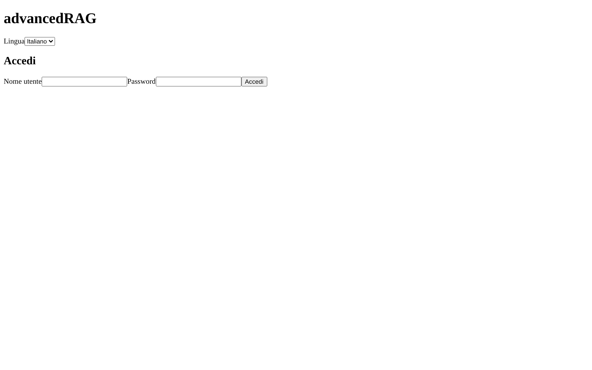
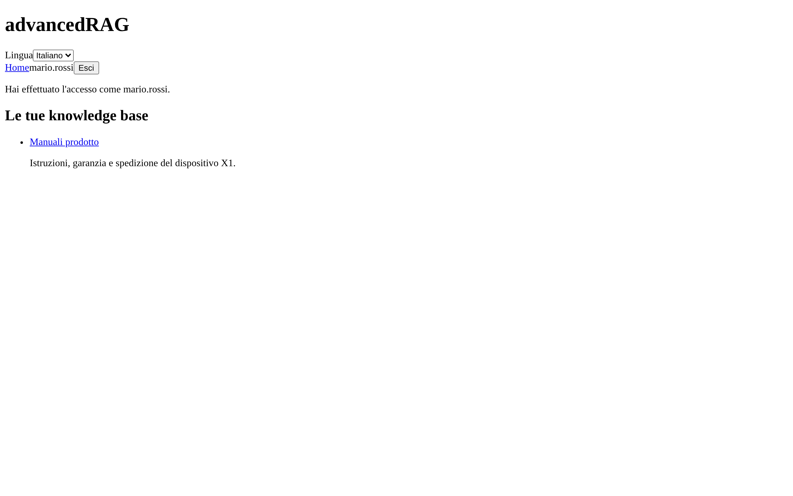
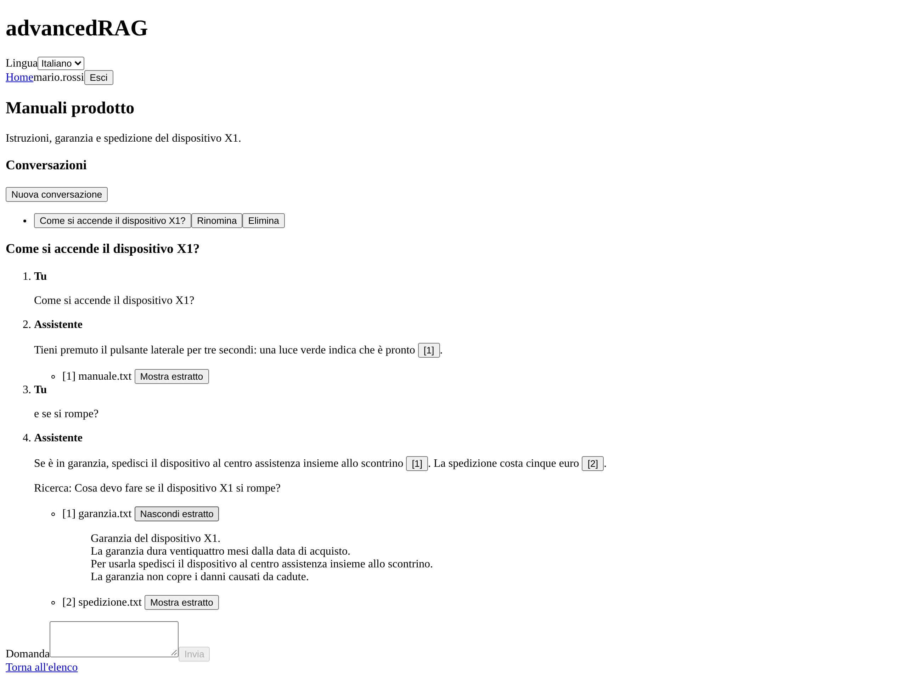

# Guida utente

[English](../en/user.md)

Questa guida è per chi usa l'applicazione: si accede, si sceglie una knowledge base (KB), si fanno domande e si leggono le risposte con le loro fonti. Cita i testi dell'interfaccia italiana esattamente come li vedi, tra virgolette caporali, come «Accedi». Un testo che ha una parte che cambia (il tuo nome utente, una domanda) è in *corsivo*, con … al posto di quella parte. Le altre virgolette, come "password dimenticata", sono per parole che non sono sullo schermo: esempi e nomi delle sezioni di questa guida. Le schermate mostrano dati inventati. Gestire utenti, KB, documenti e impostazioni è compito di un amministratore, nella guida admin; l'installazione dell'applicazione è nella [guida all'installazione](installation.md).

I dettagli tecnici sono nelle pagine di area [fondazioni](../../system/fondazioni.md) (login, sessioni, utenti, knowledge base) e [chat](../../system/chat.md) (ricerca, risposte in streaming, conversazioni, fonti). Sono scritte in inglese per chi sviluppa.

## Accesso e uscita

### Accedere

Apri l'indirizzo dell'applicazione che ti ha dato l'amministratore. Senza una sessione compare la pagina «Accedi», con i campi «Nome utente» e «Password» e il pulsante «Accedi». Scrivi nome utente e password, poi scegli «Accedi».

Gli account li crea un amministratore: non ci si può registrare da soli e la pagina non ha un link "password dimenticata". Se non hai un account, o ti serve una nuova password, rivolgiti a un amministratore.

Dopo l'accesso arrivi alla pagina iniziale, che dice *Hai effettuato l'accesso come …*, con il tuo nome utente al posto dei puntini. L'intestazione, in ogni pagina, ha il nome dell'applicazione, il selettore della lingua «Lingua» e, dopo l'accesso, i link «Home», il tuo nome utente e il pulsante «Esci».

La sessione termina da sola dopo un periodo senza alcuna attività: 480 minuti (8 ore), salvo che l'amministratore abbia impostato un altro valore, e ogni azione che fai fa ripartire il conteggio. Termina anche quando un amministratore disattiva il tuo utente o reimposta la tua password.

### Uscire

Scegli «Esci» nell'intestazione: torni alla pagina «Accedi». Fallo sempre su un computer che usano anche altre persone.

### Scegliere la lingua

L'interfaccia ha due lingue, «Italiano» e «English». Parte nella lingua del browser: italiano se la prima lingua del browser è l'italiano, inglese in tutti gli altri casi. Per cambiarla usa il selettore «Lingua» nell'intestazione; la pagina cambia subito, senza ricaricarsi.

- Prima di accedere, la scelta cambia solo la pagina che stai guardando. Dopo l'uscita, la pagina di accesso resta nell'ultima lingua usata.
- Dopo l'accesso, la scelta viene salvata anche nel tuo profilo, e la lingua salvata nel profilo è quella che trovi al prossimo accesso, da qualsiasi browser.
- Se la scelta non si può salvare, la pagina torna alla lingua precedente e mostra un messaggio d'errore (vedi la sezione "Messaggi d'errore" più sotto).

## Le tue knowledge base

Una knowledge base è un insieme di documenti sui quali l'applicazione sa rispondere alle domande. Dopo l'accesso, la pagina iniziale elenca le KB che ti sono assegnate sotto «Le tue knowledge base»: di ognuna il nome, che è un link, e la descrizione quando c'è.

- Scegli il nome di una KB per aprirne la chat.
- Vedi solo le KB che un amministratore ti ha assegnato. Se l'elenco dice «Nessuna knowledge base ti è assegnata.», chiedi a un amministratore di assegnartene una. Un amministratore vede tutte le KB, sotto il titolo «Tutte le knowledge base».
- Una KB che non esiste e una KB che non ti è assegnata danno lo stesso messaggio, «Knowledge base non trovata.».
- Nella pagina della chat il link «Torna all'elenco» ti riporta alla pagina iniziale, come «Home» nell'intestazione.

## La chat

La pagina di una KB mostra il suo nome e la sua descrizione, l'elenco delle tue conversazioni con il pulsante «Nuova conversazione», e i messaggi della conversazione aperta con il campo della domanda.

### Fare una domanda

1. Scrivi la domanda nel campo «Domanda». Puoi scrivere in italiano o in inglese, e l'applicazione cerca la risposta nei documenti della KB che hai aperto.
2. Scegli «Invia». Il pulsante è disattivato finché il campo è vuoto. Gli spazi prima e dopo il testo vengono tolti.
3. Aspetta la risposta. Mentre viene generata, il campo e i pulsanti sono disattivati e la pagina mostra «Risposta in corso…»: la domanda successiva si può fare solo a risposta finita, e nel frattempo non si può aprire, rinominare o eliminare una conversazione.

Una domanda può avere al massimo 4000 caratteri, salvo che l'amministratore abbia impostato un altro limite. Una domanda più lunga viene rifiutata con «Il testo non è valido: controlla la lunghezza.» e il tuo testo resta nel campo.

Una domanda fatta quando nessuna conversazione è aperta crea una nuova conversazione, e il suo titolo è l'inizio della domanda (i primi 80 caratteri). Le domande successive vanno alla conversazione aperta, così puoi fare domande di seguito come "e la spedizione?": per capirle l'applicazione usa gli ultimi messaggi della conversazione (sei, per impostazione predefinita).

### Leggere la risposta

La risposta compare mentre il modello la scrive, un pezzo alla volta, quindi puoi iniziare a leggere senza aspettare la fine. I messaggi sono in ordine: l'etichetta «Tu» indica le tue domande e «Assistente» le risposte. Il testo è mostrato così com'è: non viene mai interpretato come formattazione o come pagina web.

Se la KB non ha nessun documento pronto per essere letto, la risposta finisce subito con «Nessun documento disponibile in questa knowledge base». L'amministratore può vedere nella pagina «Documenti» se i documenti sono pronti.

### Fonti ed estratti

I numeri tra parentesi quadre nella risposta, come `[1]`, indicano le fonti su cui si basa la risposta. Sotto la risposta ogni fonte ha una riga con il suo numero e il nome del documento, come `[1] manuale.txt`, seguiti dal titolo della sezione e dalle pagine quando il documento li ha (`p. 3`, oppure `pp. 3–5` per un intervallo), e dal pulsante «Mostra estratto». L'elenco delle fonti non ha un titolo sullo schermo; per chi usa uno screen reader si chiama «Fonti».

- Scegli «Mostra estratto» accanto a una fonte, oppure il numero `[1]` nel testo della risposta, per leggere il passaggio del documento che la risposta ha usato. L'estratto si apre sotto la fonte. «Nascondi estratto» lo chiude.
- Se il passaggio non esiste più, per esempio perché il documento è stato eliminato, l'estratto dice «Fonte non più disponibile». Il nome del documento resta nell'elenco.
- Solo i numeri che corrispondono a una fonte sono pulsanti.

### La riga *Ricerca: …*

Sotto alcune risposte c'è una riga *Ricerca: …*, con al posto dei puntini la domanda che è stata cercata, dopo il testo della risposta e prima delle fonti. Non compare su ogni risposta. Compare solo quando sono vere tutte queste condizioni:

- l'amministratore ha attivato il passo «Riscrittura della domanda» nella pagina «Impostazioni», e il servizio di riscrittura è configurato nell'installazione;
- la conversazione ha già domande precedenti con una risposta andata a buon fine: la prima domanda di una conversazione non ha mai la riga, e non ce l'ha nemmeno una domanda che segue solo risposte fallite;
- la riscrittura è riuscita: quando il servizio non risponde, la ricerca usa la tua domanda come l'hai scritta e nessuna riga viene mostrata;
- la domanda riscritta è diversa dalla tua, senza contare gli spazi alle estremità e le maiuscole.

Il passo riscrive una breve domanda di seguito (per esempio "e la spedizione?") come domanda autonoma, usando i messaggi precedenti, e l'applicazione cerca nei documenti quella. La riga ti mostra che cosa è stato cercato, così capisci perché le fonti sono quelle. Compare quando la risposta è finita. Quando manca, la ricerca ha usato la tua domanda come l'hai scritta.

L'amministratore può attivare anche il passo «Reranker», che riordina i passaggi trovati prima della risposta. Non aggiunge nessuna riga.

### Riprovare una risposta fallita

Una risposta può fallire, per esempio perché il servizio che la scrive non ha risposto in tempo. La risposta mostra allora il motivo (vedi la sezione "Perché una risposta fallisce" più sotto) e il pulsante «Riprova».

- Scegli «Riprova» per generare di nuovo la risposta, nello stesso punto, senza riscrivere la domanda.
- «Riprova» c'è solo sull'ultimo messaggio della conversazione e solo se è fallito. Se dopo una risposta fallita fai un'altra domanda, la risposta fallita non si può più riprovare.
- Se la connessione si interrompe mentre la risposta viene scritta, o l'applicazione era stata riavviata in quel momento, la risposta finisce come «La risposta è stata interrotta.» e si può riprovare anche questa.
- Se l'applicazione rifiuta la domanda prima che la risposta inizi, per esempio perché non è raggiungibile, nella conversazione non viene aggiunto nulla: i messaggi precedenti restano come erano, la domanda torna nel campo e un messaggio ti dice il perché.

## Conversazioni

Ogni domanda appartiene a una conversazione di una KB, e le conversazioni vengono salvate. Sono elencate sotto «Conversazioni», nella pagina della KB, con la più usata di recente per prima. Quando non ce n'è nessuna, la pagina dice «Nessuna conversazione.» e, al posto dei messaggi, «Fai una domanda su questa knowledge base.».

### Iniziare una nuova conversazione

Scegli «Nuova conversazione»: i messaggi vengono svuotati e la prossima domanda che invii avvia una nuova conversazione. Usala quando cambi argomento, perché i messaggi precedenti di una conversazione fanno parte di ciò che l'applicazione sa quando risponde alla domanda successiva. Il pulsante è disattivato mentre una risposta viene generata.

### Aprire una conversazione

Scegli il titolo di una conversazione nell'elenco: i suoi messaggi, le fonti e gli estratti si caricano («Caricamento…») e puoi continuare a fare domande. Se apri una conversazione la cui risposta è ancora in corso, la pagina mostra «Risposta in corso…» e rilegge la conversazione ogni pochi secondi finché la risposta è finita.

### Rinominare una conversazione

Scegli «Rinomina» accanto al titolo. Si apre un campo «Nuovo titolo» con «Salva» e «Annulla». Il titolo non può essere vuoto né più lungo di 200 caratteri, altrimenti ottieni «Il testo non è valido: controlla la lunghezza.». Rinominare non cambia l'ordine dell'elenco.

### Eliminare una conversazione

Scegli «Elimina» accanto al titolo. La pagina chiede *Eliminare la conversazione «…»? Anche i suoi messaggi saranno cancellati.*, con il titolo al posto dei puntini, e mostra «Conferma» e «Annulla». L'eliminazione è definitiva: la conversazione, i suoi messaggi e le sue fonti vengono rimossi e l'applicazione non può ripristinarli.

Le tue conversazioni sono tue: gli altri utenti non le vedono. Gli amministratori possono leggere ogni conversazione, nella loro pagina «Conversazioni», ma solo leggerla: non possono scrivere nelle tue.

## Messaggi d'errore

L'applicazione mostra i suoi messaggi nella lingua dell'interfaccia. Questi sono quelli che puoi vedere, con il loro significato più comune e che cosa fare.

### All'accesso o quando la sessione finisce

| Messaggio | Che cosa significa |
|---|---|
| «Nome utente o password non validi.» | Il nome utente o la password sono sbagliati, oppure il tuo utente è stato disattivato. Controllali e riprova, oppure rivolgiti a un amministratore. |
| «Sessione scaduta: accedi di nuovo.» | La sessione è finita: sei rimasto inattivo troppo a lungo, oppure un amministratore ha disattivato il tuo utente o reimpostato la tua password. Ricarica la pagina e accedi di nuovo. |
| «La richiesta non è valida.» | L'applicazione ha rifiutato ciò che la pagina ha inviato. Riprova; se resta, avvisa un amministratore. |
| «Il server non è raggiungibile. Riprova.» | Non c'è connessione con l'applicazione. Controlla la rete e riprova. |
| «Si è verificato un errore. Riprova.» | Un errore che non ha un messaggio più specifico. Riprova; se resta, avvisa un amministratore. |

Gli ultimi quattro possono comparire in qualsiasi pagina, e l'ultimo anche al posto di un messaggio più specifico che la pagina non conosce.

### Nella chat

| Messaggio | Che cosa significa |
|---|---|
| «Knowledge base non trovata.» | La KB non esiste o non ti è assegnata. Torna all'elenco. |
| «Conversazione non trovata.» | La conversazione non esiste più (per esempio l'hai eliminata in un'altra finestra) oppure non puoi più vederla. Torna all'elenco delle conversazioni. |
| «Il provider di generazione non è configurato: contatta l'amministratore.» | Il servizio che scrive le risposte non è stato configurato nell'installazione. Non è stato salvato nulla: avvisa un amministratore. |
| «Una risposta è già in corso in questa conversazione.» | Un'altra risposta della stessa conversazione è in corso, per esempio in un'altra finestra. Aspetta che finisca. |
| «Non si può riprovare: solo l'ultima risposta, se è fallita, si può ripetere.» | La risposta che vuoi riprovare non è l'ultimo messaggio della conversazione, oppure non è fallita. |
| «Il testo non è valido: controlla la lunghezza.» | Una domanda vuota o più lunga del limite, oppure un titolo vuoto o più lungo di 200 caratteri. |

### Perché una risposta fallisce

Quando una risposta fallisce mostra uno di questi motivi, con il pulsante «Riprova».

| Messaggio | Che cosa significa |
|---|---|
| «Il servizio di embedding (Ollama) non ha elaborato la domanda.» | Il servizio che trasforma la domanda in numeri per la ricerca non ha funzionato. Prova «Riprova»; se resta, avvisa un amministratore. |
| «Il provider di generazione ha avuto un errore o ha inviato una risposta non valida.» | Il servizio che scrive le risposte ha avuto un errore. Prova «Riprova»; se resta, avvisa un amministratore. |
| «Il provider di generazione non ha finito in tempo.» | Il servizio che scrive le risposte è stato troppo lento. Prova «Riprova». |
| «La risposta non è stata completata per un errore interno.» | Un errore dell'applicazione. Prova «Riprova»; se resta, avvisa un amministratore. |
| «La risposta è stata interrotta.» | La connessione si è interrotta, o l'applicazione è stata riavviata, mentre la risposta veniva scritta. Prova «Riprova». |

Quando l'applicazione non conosce il motivo di un fallimento, il messaggio è quello generale, «Si è verificato un errore. Riprova.».
