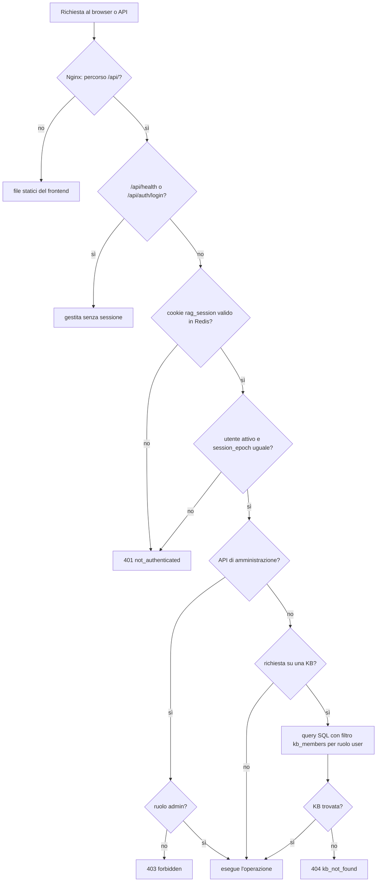
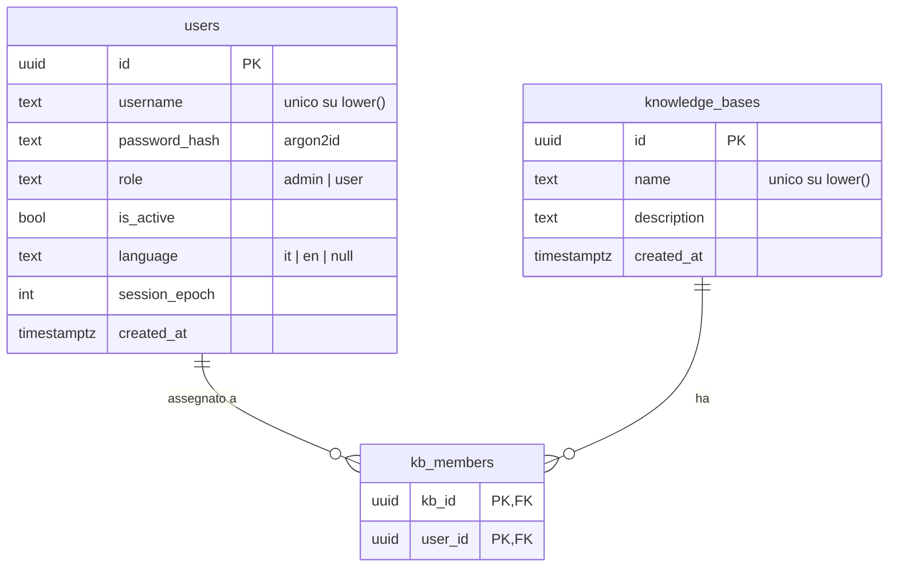

# PLAN for SPEC-2026-11-06-fase-1-fondazioni

## Approach
Monorepo con `backend/` (Python 3.12, gestito con `uv`) e `frontend/` (Vite + React + TypeScript, gestito con `npm`).
Il frontend viene compilato dentro l'immagine Nginx (build multi-stage), che lo serve e inoltra `/api/` al backend: un
solo container espone porte, come chiede REQ-001.

Backend FastAPI con SQLAlchemy 2 async (`asyncpg`) e migrazioni Alembic, eseguite all'avvio da `python -m app.run`
insieme alla creazione del primo admin, prima di avviare uvicorn. Le sessioni sono lato server in Redis (chiave
`session:<token>`, TTL rinnovato a ogni richiesta). Ogni richiesta autenticata ricarica l'utente dal database: un
utente disattivato o con `session_epoch` diverso da quello salvato nella sessione riceve 401. In questo modo
disattivazione e reset della password invalidano tutte le sue sessioni senza dover cercare le chiavi in Redis.

Isolamento: ogni lettura di una KB passa da `KnowledgeBaseRepository`, che per il ruolo `user` aggiunge sempre la join
su `kb_members` con `user_id` nella stessa query SQL. "Non assegnata" e "inesistente" danno lo stesso 404.

I test di backend usano un PostgreSQL ParadeDB e un Redis reali, avviati da `compose.test.yaml` (porte 55432 e 56379).
I test end-to-end avviano lo stack completo con `docker compose` e usano Playwright (Python) per la UI. Ollama e Docling
sono sempre server finti (`tests/fakes/`).

Alternative scartate:
- SQLite nei test: non ha `pg_search`, `vector` né il comportamento di indici e collation di PostgreSQL, quindi i test
  di isolamento SQL non proverebbero la query vera.
- Token JWT nel `localStorage`: non si può invalidare alla disattivazione (AC-017) senza una lista di revoca, ed è
  esposto agli XSS. La sessione lato server con cookie `HttpOnly` è più semplice e soddisfa REQ-005.
- Frontend servito da un container Node separato: aggiungerebbe un servizio e una seconda porta interna senza benefici.
  Nginx serve i file statici compilati.

## Interfaces
- External (HTTP, JSON; errori sempre `{"error": {"code": "<codice>", "message": "<testo inglese>"}}`, la UI traduce il
  `code`):
  - `GET /api/health` → 200|503 `{"status": "ok"|"degraded", "checks": {"database"|"redis"|"ollama"|"docling": "ok"|"unreachable"}}`
  - `POST /api/auth/login` `{"username", "password"}` → 200 `UserOut` + cookie `rag_session`; 401 `invalid_credentials`
  - `POST /api/auth/logout` → 204; `GET /api/auth/me` → 200 `UserOut`; `PATCH /api/auth/me` `{"language": "it"|"en"}` → 200 `UserOut`
  - `GET /api/admin/users` → 200 `[UserOut]`; `POST /api/admin/users` `{"username", "password", "role"}` → 201 `UserOut`;
    409 `username_taken`; 422 `password_too_short` | `invalid_username`
  - `PATCH /api/admin/users/{user_id}` `{"is_active": bool}` → 200 `UserOut`; 409 `cannot_deactivate_self`
  - `PUT /api/admin/users/{user_id}/password` `{"password"}` → 204
  - `GET /api/kbs` → 200 `[KnowledgeBaseOut]`; `GET /api/kbs/{kb_id}` → 200 `KnowledgeBaseOut`; 404 `kb_not_found`
  - `POST /api/kbs` `{"name", "description"?}` → 201; `PATCH /api/kbs/{kb_id}` `{"name"?, "description"?}` → 200;
    `DELETE /api/kbs/{kb_id}` → 204; 409 `kb_name_taken`
  - `GET /api/kbs/{kb_id}/members` → 200 `[UserOut]`; `PUT /api/kbs/{kb_id}/members/{user_id}` → 204;
    `DELETE /api/kbs/{kb_id}/members/{user_id}` → 204
  - status generici: 401 `not_authenticated`, 403 `forbidden`, 422 `validation_error`
  - `UserOut` = `{"id": uuid, "username", "role": "admin"|"user", "is_active", "language": "it"|"en"|null}`;
    `KnowledgeBaseOut` = `{"id": uuid, "name", "description": str|null, "created_at"}`
- Configurazione (`.env.example`): `POSTGRES_PASSWORD`, `DATABASE_URL`, `REDIS_URL`, `OLLAMA_BASE_URL`,
  `DOCLING_BASE_URL`, `HEALTH_CHECK_TIMEOUT_SECONDS` (default 2), `ADMIN_USERNAME`, `ADMIN_PASSWORD`,
  `SESSION_IDLE_TIMEOUT_MINUTES` (default 480), `HTTP_PORT` (80), `HTTPS_PORT` (443).
- `backend/app/config.py`: produce `Settings` (pydantic-settings) e `get_settings() -> Settings`.
- `backend/app/db/models.py`: produce le tabelle `users` (`id`, `username`, `password_hash`, `role`, `is_active`,
  `language`, `session_epoch`, `created_at`; indice univoco su `lower(username)`), `knowledge_bases` (`id`, `name`,
  `description`, `created_at`; indice univoco su `lower(name)`), `kb_members` (`kb_id`, `user_id`, chiave primaria
  composta, `ON DELETE CASCADE` su entrambe). Consuma `backend/app/db/session.py`: `get_session() -> AsyncSession`.
- `backend/app/auth/passwords.py`: `hash_password(plain: str) -> str`, `verify_password(plain: str, hashed: str) -> bool`
  (Argon2id), `MIN_PASSWORD_LENGTH = 12`.
- `backend/app/auth/sessions.py`: `SessionStore` con `create(user_id, epoch) -> str`, `get(token) -> SessionData | None`
  (rinnova il TTL), `delete(token)`.
- `backend/app/auth/deps.py`: `current_user() -> User` (401 se sessione assente, scaduta, utente inattivo o epoch
  diverso), `require_admin() -> User` (403). Le usano T-04, T-05 e T-06.
- `backend/app/auth/bootstrap.py`: `ensure_admin(session, settings) -> None`, solleva `MissingAdminConfig(var_name)`.
- `backend/app/knowledge_bases/repository.py`: `KnowledgeBaseRepository.list_for(user) -> list[KnowledgeBase]`,
  `get_for(user, kb_id) -> KnowledgeBase | None` (filtro su `kb_members` nella query per `role == "user"`). Le fasi
  2–3 lo riusano per ogni accesso a una KB.
- Frontend: `frontend/src/api/client.ts` produce `api.get/post/patch/put/delete<T>()` e `ApiError {status, code}`;
  `frontend/src/i18n/index.ts` produce `i18n` (i18next) con `it.json` e `en.json`; `frontend/src/auth/AuthContext.tsx`
  produce `useAuth() -> {user, login, logout, setLanguage}`.

## Flowchart

## Other diagrams

## Tasks
- [x] T-01 Lo stack parte con `docker compose up` e risponde all'health check, con toolchain, verify e CI completi — covers: AC-001, AC-002, AC-005, AC-006, AC-032, AC-033 — files: `compose.yaml`, `compose.test.yaml`, `.env.example`, `nginx/Dockerfile`, `nginx/default.conf.template`, `backend/Dockerfile`, `backend/pyproject.toml`, `backend/app/main.py`, `backend/app/run.py`, `backend/app/config.py`, `backend/app/db/session.py`, `backend/app/api/health.py`, `backend/migrations/env.py`, `frontend/package.json`, `frontend/src/main.tsx`, `scripts/verify.py`, `.github/workflows/verify.yml`, `backend/tests/test_health.py`, `backend/tests/test_env_example.py`, `backend/tests/e2e/test_stack.py` — depends: none — verify: `python3 scripts/verify.py`
- [x] T-02 Nginx attiva l'HTTPS quando trova certificato e chiave, altrimenti resta in HTTP — covers: AC-003, AC-004 — files: `nginx/entrypoint-tls.sh`, `nginx/default.conf.template`, `nginx/tls.conf.template`, `nginx/Dockerfile`, `backend/tests/e2e/test_tls.py` — depends: T-01 — verify: `python3 scripts/verify.py`
- [ ] T-03 Il primo admin nasce dal `.env` ed entra dalla pagina di login in italiano o inglese — covers: AC-007, AC-008, AC-009, AC-010, AC-011, AC-012, AC-013, AC-026, AC-027, AC-029 — files: `backend/app/db/models.py`, `backend/migrations/versions/0001_users.py`, `backend/app/auth/passwords.py`, `backend/app/auth/sessions.py`, `backend/app/auth/deps.py`, `backend/app/auth/bootstrap.py`, `backend/app/auth/routes.py`, `backend/tests/test_bootstrap.py`, `backend/tests/test_auth.py`, `frontend/src/api/client.ts`, `frontend/src/i18n/index.ts`, `frontend/src/i18n/it.json`, `frontend/src/i18n/en.json`, `frontend/src/auth/AuthContext.tsx`, `frontend/src/pages/LoginPage.tsx`, `frontend/src/app/App.tsx`, `frontend/src/pages/LoginPage.test.tsx`, `frontend/src/i18n/keys.test.ts` — depends: T-01 — verify: `python3 scripts/verify.py`
- [ ] T-04 L'utente sceglie la lingua dal selettore e la ritrova al login successivo — covers: AC-028 — files: `backend/app/auth/routes.py`, `backend/tests/test_language.py`, `frontend/src/components/LanguageSelector.tsx`, `frontend/src/components/LanguageSelector.test.tsx` — depends: T-03 — verify: `python3 scripts/verify.py`
- [ ] T-05 L'admin gestisce gli utenti dalla pagina Utenti — covers: AC-014, AC-015, AC-016, AC-017, AC-018, AC-019, AC-025 — files: `backend/app/users/routes.py`, `backend/app/users/service.py`, `backend/app/users/schemas.py`, `backend/tests/test_users.py`, `frontend/src/pages/admin/UsersPage.tsx`, `frontend/src/pages/admin/UsersPage.test.tsx` — depends: T-03 — verify: `python3 scripts/verify.py`
- [ ] T-06 L'admin crea KB e assegna utenti; ogni utente vede e apre solo le sue KB — covers: AC-020, AC-021, AC-022, AC-023, AC-024, AC-025, AC-030, AC-031 — files: `backend/migrations/versions/0002_knowledge_bases.py`, `backend/app/knowledge_bases/repository.py`, `backend/app/knowledge_bases/routes.py`, `backend/app/knowledge_bases/schemas.py`, `backend/tests/test_knowledge_bases.py`, `backend/tests/test_isolation.py`, `frontend/src/pages/KnowledgeBasesPage.tsx`, `frontend/src/pages/admin/KnowledgeBaseAdminPage.tsx`, `frontend/src/pages/admin/KnowledgeBaseAdminPage.test.tsx`, `backend/tests/e2e/test_admin_flow.py` — depends: T-05 — verify: `python3 scripts/verify.py`

## Review focus
- Nome utente o di KB con maiuscole, spazi iniziali o finali, caratteri Unicode: gli spazi vengono tolti prima del
  controllo di unicità e il confronto è su `lower()` (T-05, T-06).
- Richieste concorrenti che creano lo stesso nome: l'indice univoco decide, la seconda riceve 409 e non 500 (T-05, T-06).
- Header `X-Forwarded-Proto` da Nginx: il cookie è `Secure` solo in HTTPS e il backend non si fida dell'header se non
  arriva da Nginx (T-02, T-03).
- Richieste da altri siti con il cookie di sessione (CSRF): `SameSite=Lax` più API solo JSON; un `POST` con
  `Content-Type` diverso da `application/json` riceve 422 e non crea nulla (T-03).
- `kb_id` non valido come UUID: 404 `kb_not_found` come una KB inesistente, non 422, per non distinguere i casi (T-06).

## Risks
- Docker Hub può rifiutare i pull per limite di richieste (già visto con l'immagine nginx): la CI usa le stesse immagini
  con versione fissata; in caso di 429 si ripete il job, non si cambia immagine senza chiedere.
- Gli e2e con lo stack completo e Playwright allungano `verify`: restano nel passo `e2e`, escluso da `--fast`.
- Una migrazione sbagliata dopo il merge non si modifica (`AGENTS.md`): si corregge con una nuova migrazione.
- L'immagine ParadeDB cambia nome o versione delle estensioni: AC-002 lo verifica a ogni esecuzione degli e2e.

## Revisions
- none
