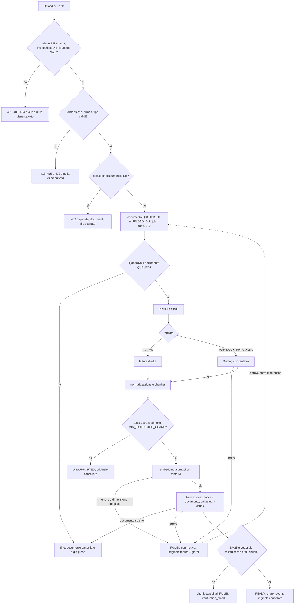
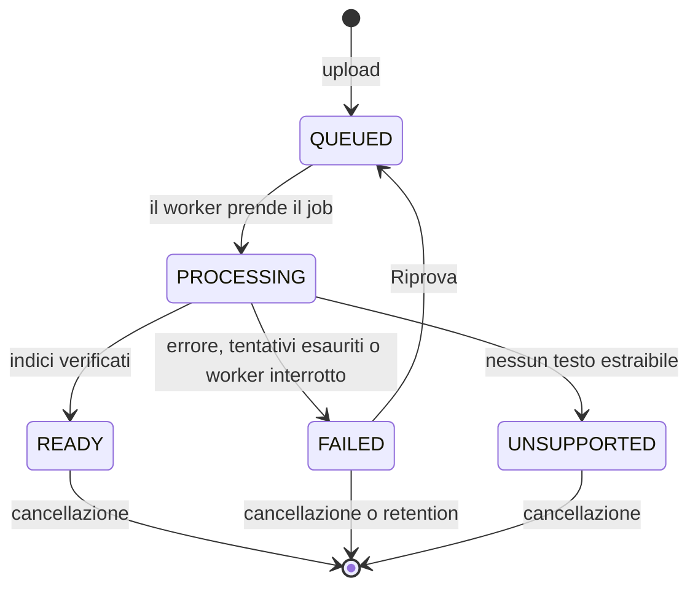
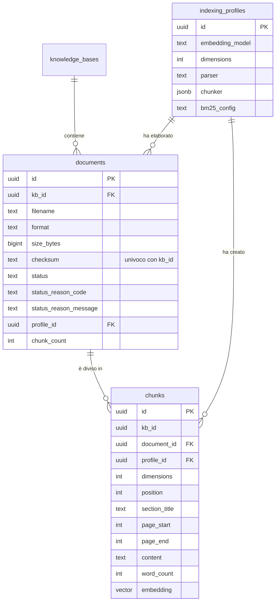

# PLAN for SPEC-2026-11-07-fase-2-ingestion

## Approach
Due pacchetti nuovi del backend: `app/documents` (API: rotte, repository, archivio dei file caricati, validazione) e
`app/ingestion` (pipeline: lettura, normalizzazione, chunker, client Docling e Ollama, profilo, salvataggio, verifica,
pulizia). L'elaborazione gira in un processo separato, il servizio Compose `worker` (stessa immagine del backend, comando
`python -m app.worker`), che consuma la coda RQ `ingestion` su Redis.

Flusso: l'upload copia il file in streaming in `UPLOAD_DIR/{id}.part` calcolando SHA-256 e dimensione, inserisce il
documento (QUEUED) contando sull'indice univoco `(kb_id, checksum)` per i duplicati, rinomina il file in `UPLOAD_DIR/{id}`
e mette in coda `process_document_job(id)`. Il job è idempotente: la prima istruzione è `UPDATE documents SET
status = 'PROCESSING' ... WHERE id = :id AND status = 'QUEUED' RETURNING ...`; senza riga (documento cancellato, già preso o
non in coda) il job finisce senza fare nulla. Poi legge e analizza il file (Docling per PDF, DOCX, PPTX e XLSX; lettura
diretta per TXT e MD), normalizza, divide in chunk, calcola gli embedding a gruppi, salva tutti i chunk in una transazione
che prima blocca la riga del documento (`SELECT ... FOR UPDATE` con stato PROCESSING), verifica i due indici e solo allora
passa a READY e cancella l'originale. Una cancellazione concorrente aspetta il blocco e poi porta via anche i chunk
(`ON DELETE CASCADE`); il job che trova la riga sparita scarta il lavoro.

Scelte tecniche, verificate sull'immagine `paradedb/paradedb:0.26.4-pg17`:
- Colonna `chunks.embedding` di tipo `vector` senza dimensione fissa, più `chunks.dimensions` e il vincolo
  `CHECK (vector_dims(embedding) = dimensions)` con chiave esterna `(profile_id, dimensions)` verso il profilo: il database
  rifiuta un vettore di dimensione sbagliata (AC-027) e profili con dimensioni diverse convivono. L'indice HNSW si crea
  per profilo, a runtime, quando nasce il profilo: `CREATE INDEX ... USING hnsw ((embedding::vector(N))
  vector_cosine_ops) WHERE profile_id = '{uuid del profilo}'`.
- Indice BM25: `CREATE INDEX chunks_bm25 ON chunks USING bm25 (id, kb_id, document_id,
  (content::pdb.simple('lowercase=true','ascii_folding=true')), (section_title::pdb.simple('lowercase=true',
  'ascii_folding=true'))) WITH (key_field='id')`. Provato: nessuno stemming («caffetterie» non trova «caffetteria»),
  accenti normalizzati, `kb_id` e `document_id` filtrano nella stessa query, i chunk sono visibili subito dopo il commit.
  `conservative-v1` è questa configurazione.
- Verifica degli indici: `SELECT count(*) FROM chunks WHERE id @@@ pdb.all() AND document_id = :d` (BM25) e una ricerca
  per distanza coseno filtrata per `document_id` e `profile_id` (vettoriale) devono restituire tutti i chunk salvati.
- Il tipo `vector` è una piccola `UserDefinedType` del progetto (`app/db/vector.py`): nessuna libreria in più.
- Docling (`docling-serve`): `POST /v1/convert/file` con `files`, `from_formats` del singolo formato, `to_formats=json`,
  `do_ocr=false` (niente OCR, come da spec) e `X-Api-Key` se impostata; il testo si legge da `document.json_content`
  (DoclingDocument: titoli, paragrafi, tabelle, pagine), non dal Markdown, che perderebbe le pagine. TXT non è fra i
  formati in ingresso di Docling: si legge direttamente, come MD, per coerenza. Struttura verificata su un DoclingDocument
  reale (un DOCX di test del progetto docling): `body.children` elenca nell'ordine di lettura riferimenti `$ref` a
  `#/texts/N`, `#/groups/N`, `#/tables/N`, `#/pictures/N`, e i nodi hanno a loro volta `children`; `docling_json_to_blocks`
  li percorre in profondità. `label` `title` e `section_header` sono titoli (livello da `level`, 1 per `title`), gli altri
  testi (`text`, `list_item`, `caption`, `code`) sono paragrafi, le tabelle diventano una `table_row` per riga di
  `data.grid` con le celle unite da « | », immagini e `furniture` (intestazioni e piè di pagina) si ignorano, `prov[].page_no`
  dà la pagina (vuoto nel DOCX: pagina nulla). Le fixture dei test sono una copia ridotta di quel campione e una variante
  con pagine scritta a mano.
- Tentativi: `with_retries` ripete il singolo passo (la chiamata a Docling, ogni gruppo di embedding) con attesa raddoppiata
  e `sleep` iniettabile nei test; gli errori sono `TemporaryError` (connessione rifiutata, timeout, 5xx, 429) o
  `PermanentError`.
- Salute del worker: il processo scrive `ingestion:worker:alive:{hostname}` in Redis ogni 10 secondi con scadenza di 30;
  `GET /api/health` controlla che esista almeno una chiave con quel prefisso. Non dipende dalle chiavi interne di RQ.
- Il job gira con `rq.SimpleWorker` (rq 3.0.0, verificato): niente fork per job, quindi il thread di heartbeat, la pulizia
  oraria e un event loop `asyncio.run` per job convivono; timeout fisso di 3600 secondi.
- CSRF dell'upload: `require_json` ammette `multipart/form-data` solo per `POST /api/kbs/{kb_id}/documents` (confronto con
  `request.scope["route"].path`) e solo con `X-Requested-With: XMLHttpRequest`; altrimenti 422 come oggi.
- Limite di corpo: `nginx/api-proxy.conf` (snippet incluso dalle due configurazioni) è condiviso; una `location` a espressione
  regolare per `/api/kbs/{id}/documents` alza `client_max_body_size` a `MAX_UPLOAD_SIZE_MB + 1` e risponde 413 con il
  corpo JSON `file_too_large`; il resto di `/api/` resta a 1 MB.

Alternative scartate:
- `fastapi.BackgroundTasks` o un thread nel backend: l'elaborazione competerebbe con le richieste interattive (REQ-101) e
  si perderebbe a ogni riavvio.
- Il `Retry` di RQ: ripete l'intero job (rimanderebbe a Docling un file già interpretato) e non distingue errori
  temporanei da permanenti.
- Colonna `vector(1024)` fissa: più semplice, ma un secondo profilo con altre dimensioni (AC-026) non avrebbe dove
  salvare i vettori.
- La libreria `pgvector` per Python: una dipendenza per un solo tipo; bastano ~30 righe.
- Il Markdown di Docling dato al lettore MD: più semplice, ma senza numeri di pagina.
- Il fork per job (`rq.Worker`): thread e event loop andrebbero ricreati a ogni job.

Dipendenze nuove, da approvare con ADR-002: `rq>=3.0` e `python-multipart>=0.0.33` (necessaria a FastAPI per leggere un
upload multipart). Infrastruttura nuova: il servizio `worker` e il volume `uploads`.

## Interfaces
- External (HTTP; errori sempre `{"error": {"code", "message"}}`, il frontend traduce il `code`):
  - `POST /api/kbs/{kb_id}/documents` (solo admin, `multipart/form-data` con il campo `file`, intestazione
    `X-Requested-With: XMLHttpRequest`) → 202 `DocumentOut`; 413 `file_too_large`; 415 `unsupported_type`; 422
    `empty_file` o `validation_error`; 409 `duplicate_document` con `{"error": {..., "existing": {"id", "filename"}}}`;
    404 `kb_not_found`
  - `GET /api/kbs/{kb_id}/documents` → 200 `[DocumentOut]`, dal più recente; `GET /api/kbs/{kb_id}/documents/{document_id}`
    → 200 `DocumentOut`; 404 `kb_not_found` o `document_not_found`
  - `POST /api/kbs/{kb_id}/documents/{document_id}/retry` → 202 `DocumentOut`; 409 `not_retryable` o `original_missing`
  - `DELETE /api/kbs/{kb_id}/documents/{document_id}` → 204
  - `DocumentOut` = `{"id", "kb_id", "filename", "size_bytes", "status": "QUEUED"|"PROCESSING"|"READY"|"FAILED"|"UNSUPPORTED",
    "status_reason": {"code", "message"}|null, "chunk_count", "created_at", "updated_at"}`
  - `GET /api/health` aggiunge `"worker": "ok"|"unreachable"` a `checks`; 200/503 invariati
- External (servizi): Docling `POST {DOCLING_BASE_URL}/v1/convert/file` (multipart `files`; campi `from_formats`,
  `to_formats=json`, `do_ocr=false`; risposta `{"document": {"json_content": {...}}, "status":
  "success"|"partial_success"|"skipped"|"failure", "errors": [...]}`); Ollama `POST {OLLAMA_BASE_URL}/api/embed` con
  `{"model", "input": [testo, ...]}` → `{"embeddings": [[numero, ...], ...]}`
- Settings (`app/config.py`, tutte in `.env.example`; T-01: `upload_dir` e `max_upload_size_mb`; T-03: modello, dimensioni
  e parametri del chunker; T-04: `embedding_batch_size` e `embedding_timeout_seconds`; T-05: Docling, tentativi e
  `min_extracted_chars`; T-06: la retention): `upload_dir: Path`, `max_upload_size_mb: int = 20`,
  `docling_api_key: SecretStr | None`, `docling_timeout_seconds: float = 600`, `embedding_model: str = "bge-m3"`,
  `embedding_dimensions: int = 1024` (1–2000), `embedding_batch_size: int = 16`, `embedding_timeout_seconds: float = 120`,
  `ingestion_max_attempts: int = 3`, `ingestion_retry_backoff_seconds: float = 10`, `chunk_target_words: int = 300`,
  `chunk_min_words: int = 50`, `chunk_max_words: int = 450`, `chunk_overlap_percent: int = 15`,
  `min_extracted_chars: int = 50`, `failed_original_retention_days: int = 7`; coerenza minimo ≤ obiettivo ≤ massimo
  verificata all'avvio.
- Database (migrazioni 0003 e 0004): `documents` (`id`, `kb_id` ON DELETE CASCADE, `filename`, `format`, `size_bytes`,
  `checksum`, `status`, `status_reason_code`, `status_reason_message`, `profile_id` null, `chunk_count`, `created_at`,
  `updated_at`; indice univoco `(kb_id, checksum)`; controlli: stato ammesso, motivo presente se e solo se FAILED o
  UNSUPPORTED, `chunk_count > 0` se READY); `indexing_profiles` (`id`, `embedding_model`, `dimensions`, `parser`,
  `chunker` jsonb, `bm25_config`, `created_at`; univoco su tutti i campi di configurazione e su `(id, dimensions)`);
  `chunks` (`id` uuid, `kb_id`, `document_id` ON DELETE CASCADE, `profile_id`, `dimensions`, `position`, `section_title`,
  `page_start`, `page_end`, `content`, `word_count`, `embedding vector`; indice su `document_id`; indice BM25; indice HNSW
  per profilo creato da `ensure_profile`).
- `app/db/vector.py`: `Vector` (`UserDefinedType`) che legge e scrive `[x,y,...]`.
- `app/documents/formats.py`: `DocumentFormat = Literal["pdf", "docx", "pptx", "xlsx", "txt", "md"]`;
  `sanitize_filename(raw: str) -> str`; `inspect_upload(path: Path, filename: str, declared_type: str | None) ->
  DocumentFormat` (solleva `UnsupportedType`; legge soltanto intestazione e directory dello ZIP, mai il contenuto).
- `app/documents/storage.py`: `UploadStorage(upload_dir: Path)` con `save(document_id, source: BinaryIO, max_bytes: int)
  -> StoredFile(size: int, sha256: str)` (scrive `{id}.part`), `commit(document_id)`, `discard(document_id)`,
  `path(document_id) -> Path`, `exists(document_id) -> bool`, `remove(document_id) -> bool`,
  `orphans(older_than: timedelta, now: datetime) -> list[Path]`.
- `app/documents/repository.py`: `DocumentRepository(session)` con `create(kb_id, filename, fmt, size_bytes, checksum)
  -> Document` (solleva `DuplicateDocument(existing)`), `list_for_kb(kb_id)`, `get(kb_id, document_id)`,
  `claim(document_id) -> Document | None`, `mark_ready(document_id, chunk_count)`, `mark_failed(document_id, code,
  message)`, `mark_unsupported(document_id, code, message)`, `requeue(kb_id, document_id) -> Document | None`,
  `delete(kb_id, document_id) -> bool`; ogni metodo prende il `kb_id` e la KB si verifica prima con
  `KnowledgeBaseRepository.get_for`.
- `app/documents/queue.py`: `INGESTION_QUEUE = "ingestion"`; `enqueue_document(redis_url: str, document_id: uuid.UUID)
  -> None` (accoda `"app.ingestion.jobs.process_document_job"`, `job_timeout=3600`, risultato non conservato).
- `app/auth/deps.py`: `ApiError(status_code, code, message, extra: dict[str, object] | None = None)` (l'extra entra
  nell'oggetto `error`); `require_json` con l'eccezione per l'upload.
- `app/ingestion/blocks.py`: `Block(kind: Literal["heading", "paragraph", "table_row"], text: str, level: int = 0,
  page: int | None = None)`.
- `app/ingestion/normalize.py`: `normalize_text(text: str) -> str`; `normalize_blocks(blocks: Sequence[Block]) ->
  list[Block]`.
- `app/ingestion/readers.py`: `read_text_document(data: bytes, fmt: Literal["txt", "md"]) -> list[Block]` (BOM e `\r\n`
  gestiti; le intestazioni `#` danno i titoli; le righe `|` sono righe di tabella).
- `app/ingestion/chunker.py`: `ChunkerConfig(target_words, min_words, max_words, overlap_percent)`;
  `ChunkDraft(position, section_title, page_start, page_end, content, word_count)`; `chunk_blocks(blocks:
  Sequence[Block], config: ChunkerConfig) -> list[ChunkDraft]`. La sovrapposizione è di `round(target × percentuale / 100)`
  parole (45) fra chunk di prosa della stessa sezione; fra righe di tabella è arrotondata per eccesso a righe intere.
- `app/ingestion/errors.py`: `ReasonCode` (`docling_unreachable`, `docling_error`, `parse_failed`, `embedding_unreachable`,
  `embedding_error`, `embedding_invalid_response`, `embedding_dimension_mismatch`, `verification_failed`,
  `no_text_extracted`, `unexpected_error`); `IngestionError(code, message)` con `TemporaryError` e `PermanentError`.
- `app/ingestion/retry.py`: `async with_retries(operation, *, attempts: int, backoff_seconds: float, sleep=asyncio.sleep)`.
- `app/ingestion/docling.py`: `DoclingClient(base_url, api_key, timeout)` con `async convert(path: Path, filename: str,
  fmt: DocumentFormat) -> list[Block]`; `docling_json_to_blocks(json_content: dict[str, object]) -> list[Block]`.
- `app/ingestion/embeddings.py`: `OllamaEmbedder(base_url, model, timeout)` con `async embed(texts: Sequence[str]) ->
  list[list[float]]` (rifiuta valori non finiti).
- `app/ingestion/profile.py`: `PARSER_ID = "docling-serve+text:v1"`, `BM25_CONFIG_ID = "conservative-v1"`; `async
  ensure_profile(engine, settings) -> IndexingProfile` (insert con `ON CONFLICT DO NOTHING`, indice HNSW del profilo).
- `app/ingestion/persist.py`: `async persist_chunks(session, document_id, profile, drafts, vectors) -> int` (blocca il
  documento, solleva `DocumentGone`); `async verify_indexes(session, document_id, profile, expected: int) -> bool`.
- `app/ingestion/pipeline.py`: `async process_document(document_id: uuid.UUID, settings: Settings, *, sleep=asyncio.sleep)
  -> None`; `app/ingestion/jobs.py`: `process_document_job(document_id: str) -> None` (punto d'ingresso sincrono di RQ).
- `app/ingestion/cleanup.py`: `async cleanup_originals(settings, now: datetime) -> CleanupReport`; `async
  recover_interrupted(settings) -> int` (PROCESSING rimasti da un worker interrotto → FAILED `unexpected_error`);
  `async requeue_pending(settings) -> int` (rimette in coda i QUEUED).
- `app/worker.py`: `main()` (recupero, ripulitura, heartbeat, pulizia oraria, `SimpleWorker`); `python -m app.worker
  --healthcheck` esce con 0 se il proprio heartbeat esiste.
- Frontend: `api.upload<T>(path, file)` in `src/api/client.ts` (FormData, `X-Requested-With`); `DocumentsPage` in
  `src/pages/admin/DocumentsPage.tsx`; chiavi `documents.*` (voci di menu, stati, motivi per codice, errori di upload).

## Flowchart

## Other diagrams

## Tasks
- [x] T-01 L'admin carica un file valido e lo vede «In coda»; file non validi, troppo grandi o duplicati sono rifiutati con un errore chiaro — covers: AC-003, AC-004, AC-005, AC-006, AC-007, AC-008, AC-009, AC-010, AC-011, AC-013, AC-014 — files: `backend/migrations/versions/0003_documents.py`, `backend/app/db/models.py`, `backend/app/documents/__init__.py`, `backend/app/documents/formats.py`, `backend/app/documents/storage.py`, `backend/app/documents/repository.py`, `backend/app/documents/schemas.py`, `backend/app/documents/routes.py`, `backend/app/documents/queue.py`, `backend/app/auth/deps.py`, `backend/app/main.py`, `backend/app/config.py`, `backend/pyproject.toml`, `backend/uv.lock`, `compose.yaml`, `.env.example`, `nginx/Dockerfile`, `nginx/api-proxy.conf`, `nginx/default.conf.template`, `nginx/tls.conf.template`, `nginx/entrypoint-tls.sh`, `backend/tests/test_documents_upload.py`, `backend/tests/e2e/test_upload_limit.py` — depends: none — verify: `python3 scripts/verify.py`
- [x] T-02 Il testo di un TXT o MD diventa chunk strutturati, normalizzati e con titolo di sezione — covers: AC-018, AC-020, AC-021, AC-022, AC-023 — files: `backend/app/ingestion/__init__.py`, `backend/app/ingestion/blocks.py`, `backend/app/ingestion/normalize.py`, `backend/app/ingestion/readers.py`, `backend/app/ingestion/chunker.py`, `backend/tests/test_normalize.py`, `backend/tests/test_readers.py`, `backend/tests/test_chunker.py` — depends: none — verify: `python3 scripts/verify.py`
- [x] T-03 Chunk e vettori si salvano in una sola transazione con il loro profilo; il database rifiuta vettori di dimensione sbagliata e gli indici BM25 e vettoriale filtrano per KB e documento — covers: AC-026, AC-027, AC-028 — files: `backend/migrations/versions/0004_chunks.py`, `backend/app/db/models.py`, `backend/app/db/vector.py`, `backend/app/ingestion/profile.py`, `backend/app/ingestion/persist.py`, `backend/app/run.py`, `backend/app/config.py`, `.env.example`, `backend/tests/test_profiles.py`, `backend/tests/test_chunk_storage.py` — depends: T-01 — verify: `python3 scripts/verify.py`
- [ ] T-04 Il worker è un servizio del Compose e porta un TXT o MD da «In coda» a «Pronto», con gli embedding calcolati a gruppi e l'originale cancellato — covers: AC-001, AC-002, AC-015, AC-024 — files: `backend/app/ingestion/embeddings.py`, `backend/app/ingestion/errors.py`, `backend/app/ingestion/pipeline.py`, `backend/app/ingestion/jobs.py`, `backend/app/worker.py`, `backend/app/api/health.py`, `backend/app/config.py`, `compose.yaml`, `.env.example`, `backend/tests/fakes/services.py`, `backend/tests/test_embeddings.py`, `backend/tests/test_pipeline_text.py`, `backend/tests/test_health.py`, `backend/tests/e2e/test_stack.py`, `backend/tests/e2e/test_ingestion_e2e.py`, `backend/tests/e2e/compose.fakes.yaml` — depends: T-01, T-02, T-03 — verify: `python3 scripts/verify.py`
- [ ] T-05 PDF, DOCX, PPTX e XLSX passano da Docling; gli errori hanno uno stato e un motivo, i tentativi automatici funzionano e l'admin può riprovare — covers: AC-016, AC-017, AC-019, AC-025, AC-029, AC-030, AC-031, AC-032, AC-033, AC-036, AC-045, AC-046 — files: `backend/app/ingestion/docling.py`, `backend/app/ingestion/retry.py`, `backend/app/ingestion/errors.py`, `backend/app/ingestion/embeddings.py`, `backend/app/ingestion/pipeline.py`, `backend/app/documents/repository.py`, `backend/app/documents/routes.py`, `backend/app/config.py`, `compose.yaml`, `.env.example`, `backend/tests/fakes/services.py`, `backend/tests/test_docling.py`, `backend/tests/test_retry.py`, `backend/tests/test_pipeline_errors.py`, `backend/tests/test_retry_route.py`, `backend/tests/test_logging_privacy.py`, `backend/tests/live/test_live_services.py` — depends: T-04 — verify: `python3 scripts/verify.py`
- [ ] T-06 Gli originali non restano oltre le regole e la cancellazione di un documento o di una KB non lascia nulla, nemmeno durante l'elaborazione — covers: AC-012, AC-034, AC-035, AC-037, AC-038, AC-039 — files: `backend/app/ingestion/cleanup.py`, `backend/app/ingestion/pipeline.py`, `backend/app/worker.py`, `backend/app/documents/routes.py`, `backend/app/documents/repository.py`, `backend/app/knowledge_bases/routes.py`, `backend/app/config.py`, `compose.yaml`, `.env.example`, `backend/tests/test_cleanup.py`, `backend/tests/test_document_delete.py`, `backend/tests/test_worker_recovery.py` — depends: T-05 — verify: `python3 scripts/verify.py`
- [ ] T-07 L'admin gestisce i documenti dalla pagina Documenti: carica più file, segue gli stati, riprova e cancella dopo conferma; chiude la fase 2 — covers: AC-040, AC-041, AC-042, AC-043, AC-044 — files: `frontend/src/api/client.ts`, `frontend/src/pages/admin/DocumentsPage.tsx`, `frontend/src/pages/admin/DocumentsPage.test.tsx`, `frontend/src/app/App.tsx`, `frontend/src/i18n/it.json`, `frontend/src/i18n/en.json`, `backend/tests/e2e/test_documents_ui.py`, `docs/system/ingestion.md`, `docs/specs/2026-11-07-fase-2-ingestion/spec.md`, `AGENTS.md` — depends: T-06 — verify: `python3 scripts/verify.py`

Ordine e parallelismo: T-01 e T-02 hanno file disgiunti e nessuna dipendenza, quindi possono andare in parallelo
(`sdd-parallel`); i task da T-03 a T-07 sono in catena perché toccano gli stessi file (`pipeline.py`, `persist.py`,
`worker.py`, `routes.py`, `compose.yaml`). AC-012 (admin, `user` e nessuna sessione su tutte le rotte dei documenti) è
assegnato a T-06 perché solo lì esistono tutte e cinque le rotte; i test di T-01, T-05 e T-06 sulle rotte che
introducono lo citano comunque. Anche AC-034 è di T-06 (pulizia), ma i test di T-04 verificano che l'originale sparisca
a READY. Ogni task che aggiunge un'impostazione la aggiunge a `.env.example` e a `compose.yaml` (il test di AC-033
della fase 1 lo richiede).

## Review focus
- Worker interrotto a metà di un job (riavvio, memoria): un documento non deve restare PROCESSING per sempre; all'avvio il
  worker porta i PROCESSING rimasti a FAILED `unexpected_error` e rimette in coda i QUEUED (T-06).
- Archivi corrotti o strani: un `.docx`, `.pptx` o `.xlsx` che è uno ZIP troncato, vuoto o con voci enormi riceve 415 e
  non un 500, e il codice non estrae mai il contenuto; nomi file Unicode (NFC e NFD), lunghissimi o fatti di soli punti
  (T-01).
- TXT e MD con BOM UTF-8, fine riga `\r\n`, riga lunga senza spazi, front matter: il testo letto è lo stesso e nessun
  carattere speciale arriva ai chunk (T-02).
- Vettori con valori non finiti (NaN, infinito) o numero di vettori diverso da quello dei testi: il documento diventa
  FAILED `embedding_invalid_response` e non si salva nulla (T-05).
- Doppio clic su «Riprova» o due admin insieme: il secondo riceve 409 `not_retryable` e il documento si elabora una volta
  sola (T-05).

## Risks
- Forma della risposta di Docling: la lettura di `json_content` si basa sulla documentazione e su una fixture scritta a
  mano, non sulla tua istanza. Mitigazione: test «live» facoltativi (`LIVE_SERVICES=1`) che convertono un PDF e un DOCX
  veri e chiamano Ollama; da eseguire una volta a mano prima di usare il sistema (T-05).
- Tempi su CPU: un PDF di 20 MB può superare i 600 secondi di `DOCLING_TIMEOUT_SECONDS`; in quel caso 3 tentativi
  occupano il worker per mezz'ora prima del FAILED. Mitigazione: variabile configurabile e motivo `docling_unreachable`
  chiaro.
- Indice HNSW per profilo: le ricerche della fase 3 dovranno usare la stessa espressione `embedding::vector(N)` e lo stesso
  predicato `profile_id`; lo si documenta nella pagina d'area e `profile.py` espone l'espressione.
- Task grandi (T-04 e T-05): se superano circa 600 righe di codice di produzione, si divide il task prima della PR (nuova
  revisione del piano), non dopo.
- Revisione della fase 1 (decisa dall'owner): in T-04 `test_stack.py` (cinque servizi) e `test_health.py` (controllo
  `worker`) si aggiornano con un nuovo `Test-Lock` spiegato nella PR, e la PR di design aggiunge la voce in `## Revisions`
  della spec di fase 1.
- Spazio su disco: il volume `uploads` cresce solo con i documenti in coda o FAILED; la retention di 7 giorni e la pulizia
  oraria lo limitano.
- Migrazioni 0003 e 0004: una volta unite non si modificano (`AGENTS.md`); i vincoli e gli indici si decidono qui.

## Revisions
- none
