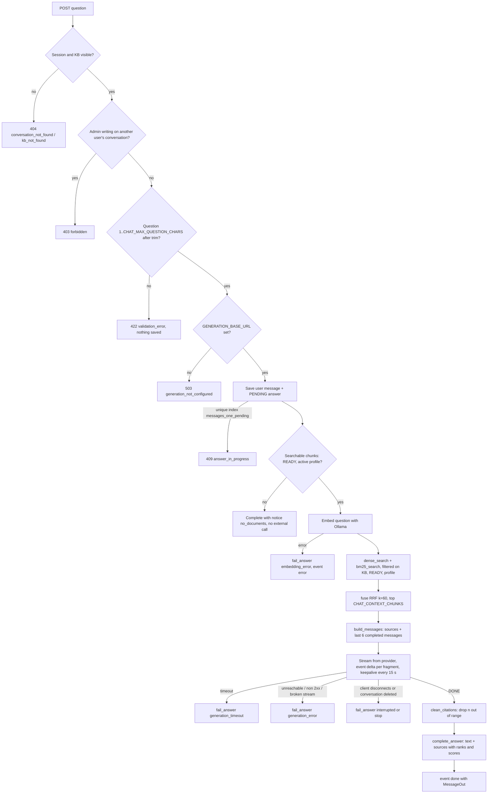

# PLAN for SPEC-2026-11-17-fase-3-chat

## Approach
Un pacchetto nuovo del backend, `app/chat`, con cinque parti:
- `generation.py`: client OpenAI-compatible in streaming;
- `retrieval.py`: ricerca vettoriale, BM25 e RRF;
- `prompt.py`: contesto, istruzioni e pulizia delle citazioni;
- `repository.py`: conversazioni, messaggi e fonti;
- `service.py` e `routes.py`: la domanda in streaming e le API delle conversazioni.

La generazione gira dentro la richiesta HTTP del backend, in modo asincrono: la rotta restituisce una `StreamingResponse`
di Starlette con `text/event-stream`. Il backend è un solo processo uvicorn (`app/run.py`), quindi un registro in memoria
delle risposte in corso basta per fermare una generazione quando la conversazione viene cancellata.

Flusso di una domanda (`POST`):
1. Controlli prima dello stream, che rispondono in JSON:
   - autorizzazione: KB visibile e conversazione dell'autore; per l'admin, 403 sulle conversazioni degli altri;
   - validazione della domanda: 422;
   - provider configurato: 503.
2. Una transazione salva il messaggio `user` e il messaggio `assistant` con stato `PENDING`. L'indice univoco parziale
   `messages_one_pending ON messages (conversation_id) WHERE status = 'PENDING'` fa fallire una seconda risposta
   concorrente: `IntegrityError` 23505 diventa 409 `answer_in_progress`, anche fra richieste simultanee.
3. Se la KB non ha chunk ricercabili nel profilo attivo (`has_searchable_chunks`), la risposta si chiude subito con
   `notice = 'no_documents'`.
4. Altrimenti:
   - embedding della domanda con `OllamaEmbedder` (fase 2) e il profilo attivo;
   - `dense_search` e `bm25_search` in sequenza, nella stessa sessione;
   - `fuse` con RRF, poi `load_candidates`;
   - `build_messages` e `OpenAICompatibleClient.stream`;
   - ogni frammento diventa un evento `delta`;
   - alla fine `clean_citations` toglie i [n] fuori intervallo, `complete_answer` salva testo e fonti e arriva l'evento
     `done`.
5. Su errore o timeout: `fail_answer(code)` ed evento `error`. Su disconnessione del client
   (`asyncio.CancelledError`/`GeneratorExit` del generatore): `fail_answer('interrupted')` in una sessione nuova, protetta
   con `asyncio.shield`.

Scelte tecniche, verificate su `paradedb/paradedb:0.26.4-pg17`:
- BM25 con il testo della domanda: `content ||| :q OR section_title ||| :q`, ordinato per `pdb.score(id)`. L'operatore
  `|||` tokenizza la stringa con l'analyzer del campo (`conservative-v1`) e cerca i token in OR, senza la sintassi del
  query parser. Prova sull'immagine:
  - `'"prezzo": (IVA) AND *'` trova «Il prezzo comprende IVA al 22%»;
  - `'NOT'`, `':::'` e `''` danno 0 righe senza errore;
  - `'C++ / C#?'` trova «C++».
  Filtri nella stessa istruzione: `kb_id = :kb`, la visibilità della KB, `documents.status = 'READY'` e
  `chunks.profile_id = :p`.
- Ricerca vettoriale: `ORDER BY (embedding::vector(N)) <=> CAST(:v AS vector(N)) LIMIT :limit`, con l'espressione di
  `embedding_expression(profile)` e `WHERE profile_id = :p`, così che si usi l'indice HNSW parziale del profilo. Nella
  stessa transazione si impostano `SET LOCAL hnsw.iterative_scan = relaxed_order`, `SET LOCAL hnsw.ef_search` almeno
  uguale al limite e un `hnsw.max_scan_tuples` adeguato (nota della fase 2); AC-008 lo verifica con 60 chunk di un altro
  profilo.
- Visibilità della KB: `KnowledgeBaseRepository.visible_kb_ids(user)` restituisce la sottoquery degli id visibili (tutte
  per l'admin, `kb_members` per `user`), usata con `kb_id IN (...)` in ogni query della chat. È la stessa regola di
  `_visible_to`.
- RRF: l'ordinamento usa `fractions.Fraction` per i punteggi (i pari merito di AC-009 sono esatti), poi il rank vettoriale,
  poi `chunk_id`; il punteggio salvato è il `float` della frazione.
- Fonti: `message_sources.chunk_id` è un UUID **senza** chiave esterna verso `chunks`. Una chiave esterna con
  `ON DELETE SET NULL` legherebbe la cancellazione dei documenti (fase 2: lock del documento, cascata sui chunk) a
  scritture sulle fonti, con i rischi di lock della fase 2. Alla lettura, l'estratto è
  `chunks LEFT JOIN` con `chunks.kb_id` uguale alla KB della conversazione; nessuna riga dà «Fonte non più disponibile».
  `document_name` è salvato con la fonte (metadato, non contenuto).
- Streaming fino al browser:
  - la risposta porta `X-Accel-Buffering: no`, così Nginx non bufferizza, e `Cache-Control: no-cache`;
  - il backend invia un commento SSE `: keepalive` ogni 15 secondi senza frammenti, che resta sotto il
    `proxy_read_timeout` di 60 secondi di Nginx;
  - la generazione termina al più tardi dopo `GENERATION_TIMEOUT_SECONDS`;
  - REQ-021 è quindi soddisfatto senza cambiare `nginx/`; AC-044 lo verifica nello stack Compose.
- Client del provider:
  - `httpx.AsyncClient.stream("POST", f"{base}/chat/completions", json={"model", "messages", "stream": True})`, con
    `Authorization: Bearer` se c'è la chiave;
  - le righe `data:` si leggono con `aiter_lines`, `data: [DONE]` chiude e `choices[0].delta.content` dà i frammenti;
  - il timeout complessivo è `asyncio.timeout(GENERATION_TIMEOUT_SECONDS)`;
  - `check()` fa `GET {base}/models` con `HEALTH_CHECK_TIMEOUT_SECONDS`.
- Frontend: `fetch` con `ReadableStream` e un parser SSE di poche righe in `api.stream`, perché `EventSource` fa solo GET e
  non manda corpo. La domanda è JSON, quindi passa `require_json` senza eccezioni. Nessuna dipendenza nuova, né nel
  backend né nel frontend.
- Avvio: `app/run.py` (`bootstrap`) chiama `ConversationRepository.mark_interrupted()` prima di uvicorn (REQ-017);
  `create_app` legge il profilo attivo con `ensure_profile` alla prima domanda e lo tiene in `app.state`.

Alternative scartate:
- `sse-starlette` o un'altra libreria SSE: è una dipendenza nuova; `StreamingResponse` e un formato di quattro eventi
  bastano.
- Generare nel worker RQ con Redis pub/sub verso il backend: più parti mobili, e l'unico worker è occupato
  dall'ingestion, che bloccherebbe la chat per minuti.
- Copiare l'estratto nella fonte: contraddice la minimizzazione confermata dall'owner (REQ-010).
- `EventSource` del browser: solo GET, quindi la domanda finirebbe nell'URL e nei log di Nginx.

## Interfaces
- External (HTTP, prefisso `/api`, errori `{"error": {"code", "message"}}`, sessione obbligatoria; un id non UUID dà
  lo stesso 404 di uno sconosciuto):
  - `GET /kbs/{kb_id}/conversations` → 200 `[ConversationOut]` (solo le proprie, per `updated_at` decrescente); 404
    `kb_not_found`.
  - `POST /kbs/{kb_id}/conversations` corpo `{"question": str}` → stream SSE; crea la conversazione con titolo
    `question.strip()[:80]`.
  - `POST /conversations/{conversation_id}/messages` corpo `{"question": str}` → stream SSE.
  - `POST /conversations/{conversation_id}/messages/{message_id}/retry` senza corpo → stream SSE; 409 `not_retryable` se
    il messaggio non è l'ultima risposta `FAILED`.
  - `GET /conversations/{conversation_id}` → 200 `ConversationDetail`; `PATCH` corpo `{"title": str}` → 200
    `ConversationOut`; `DELETE` → 204.
  - `GET /conversations/{conversation_id}/messages/{message_id}/sources/{number}` → 200 `SourceExcerpt`.
  - `GET /admin/conversations?kb_id=&user_id=` (`require_admin` prima dei parametri) → 200 `[AdminConversationOut]`.
  - Errori prima dello stream: 404 `conversation_not_found` (conversazione di un altro `user`, KB non visibile, id non
    UUID), 403 `forbidden` (admin che scrive sulla conversazione di un altro), 422 `validation_error`, 409
    `answer_in_progress`, 503 `generation_not_configured`.
  - Eventi SSE (una riga `event:` e una `data:` JSON):
    - `conversation` `{"conversation_id", "message_id"}` come primo evento;
    - `delta` `{"text"}`;
    - `done` `{"message": MessageOut}`;
    - `error` `{"error": {"code", "message"}}`, con `code` fra `embedding_error`, `generation_error`,
      `generation_timeout`;
    - commento `: keepalive` ogni 15 s.
  - Schemi:
    - `ConversationOut {id, kb_id, title, created_at, updated_at}`;
    - `ConversationDetail {…ConversationOut, messages: [MessageOut], read_only: bool}`;
    - `MessageOut {id, role: "user"|"assistant", content, status: "PENDING"|"COMPLETED"|"FAILED", error_code, notice,
      created_at, sources: [SourceOut]}`, dove `sources` contiene solo le citate;
    - `SourceOut {number, document_name, section_title, page_start, page_end}`;
    - `SourceExcerpt {…SourceOut, available: bool, content: str | null}`;
    - `AdminConversationOut {…ConversationOut, username, kb_name, message_count}`.
  - Provider: `POST {GENERATION_BASE_URL}/chat/completions` con `stream: true`; `GET {GENERATION_BASE_URL}/models` per la
    salute.
  - `GET /api/health`: `checks.generation` ∈ `ok | unreachable | not_configured`.
- Impostazioni (`app/config.py`, `.env.example`, `compose.yaml`, servizio `backend`; il worker non le legge):
  - `GENERATION_BASE_URL` (default vuoto), `GENERATION_MODEL` (vuoto), `GENERATION_API_KEY` (`SecretStr`, vuota),
    `GENERATION_TIMEOUT_SECONDS` (300, > 0);
  - `RETRIEVAL_CANDIDATES` (50, ≥ 1), `RRF_K` (60, ≥ 1), `CHAT_CONTEXT_CHUNKS` (8, ≥ 1), `CHAT_HISTORY_MESSAGES` (6,
    ≥ 0), `CHAT_MAX_QUESTION_CHARS` (4000, ≥ 1);
  - `_check_generation_settings`: con URL impostata e modello vuoto, `ValueError` che nomina `GENERATION_MODEL`.
- `app/chat/generation.py` (T-01):
  - produce `ChatMessage = TypedDict("ChatMessage", {"role": str, "content": str})`,
    `class GenerationError(Exception)` con `code: Literal["generation_error", "generation_timeout"]` e
    `class OpenAICompatibleClient`;
  - il client: `__init__(base_url: str, model: str, api_key: str | None, timeout: float)`,
    `async def stream(messages: Sequence[ChatMessage]) -> AsyncIterator[str]` e
    `async def check(timeout: float) -> Literal["ok", "unreachable"]`;
  - consuma `httpx`.
- `app/knowledge_bases/repository.py` (T-02): produce `KnowledgeBaseRepository.visible_kb_ids(user: User) -> Select`.
- `app/chat/retrieval.py` (T-02):
  - produce `@dataclass(frozen=True) Ranked(chunk_id: UUID, dense_rank: int | None, bm25_rank: int | None, score: float)`
    e `@dataclass(frozen=True) Candidate(chunk_id, document_id, document_name, section_title, page_start, page_end,
    content, dense_rank, bm25_rank, score)`;
  - le funzioni:
    - `async def dense_search(session, user, kb_id, profile: IndexingProfile, vector: Sequence[float], limit: int)
      -> list[UUID]`;
    - `async def bm25_search(session, user, kb_id, profile_id: UUID, question: str, limit: int) -> list[UUID]`;
    - `def fuse(dense: Sequence[UUID], bm25: Sequence[UUID], k: int) -> list[Ranked]`;
    - `async def load_candidates(session, user, kb_id, profile_id, ranked: Sequence[Ranked]) -> list[Candidate]`;
    - `async def has_searchable_chunks(session, user, kb_id, profile_id) -> bool`;
  - consuma `visible_kb_ids`, `embedding_expression` (fase 2), `Chunk` e `Document`.
- `app/chat/prompt.py` (T-03):
  - `SYSTEM_INSTRUCTIONS: str`, in inglese, chiede di usare solo le fonti, la lingua della domanda, [n] e di dire quando
    le fonti non bastano;
  - `def build_messages(question: str, candidates: Sequence[Candidate], history: Sequence[Message]) -> list[ChatMessage]`,
    con le fonti numerate da 1 nell'ordine dato, ciascuna con documento, sezione e pagine;
  - `def clean_citations(text: str, count: int) -> tuple[str, list[int]]`: testo senza i [n] fuori da 1..count, e numeri
    citati in ordine di prima comparsa.
- Dati (T-03, migrazione `0005_conversations.py`; `app/db/models.py`):
  - `conversations(id, kb_id → knowledge_bases ON DELETE CASCADE, user_id → users, title text, created_at, updated_at)`,
    con indice `(kb_id, user_id, updated_at)`;
  - `messages(id, conversation_id → conversations ON DELETE CASCADE, role, content text, status, error_code, notice,
    created_at)`, con `CHECK` sui valori e indice univoco parziale `messages_one_pending`;
  - `message_sources(message_id → messages ON DELETE CASCADE, number, chunk_id uuid senza FK, document_name,
    section_title, page_start, page_end, dense_rank, bm25_rank, score double precision, cited boolean, PRIMARY KEY
    (message_id, number))`.
- `app/chat/repository.py` (T-03, poi T-04 e T-05):
  - classi `ConversationRepository(session)`, `AnswerInProgress(Exception)`, `NotRetryable(Exception)`;
  - lettura per l'autore:
    - `list_for(user, kb_id) -> list[Conversation]`, sempre con `visible_kb_ids` e `user_id = user.id`;
    - `get_for(user, conversation_id) -> Conversation | None`, l'autore su una KB visibile;
    - `get_for_admin(conversation_id) -> Conversation | None`;
  - scrittura:
    - `create(user, kb_id, title) -> Conversation`, `rename(conversation, title)`, `delete(conversation)`;
    - `history(conversation, limit) -> list[Message]`, con i soli completati;
    - `start_answer(conversation, question) -> tuple[Message, Message]`, che solleva `AnswerInProgress`;
    - `restart_answer(conversation, message_id) -> Message`, che solleva `NotRetryable` o `AnswerInProgress`;
    - `complete_answer(message_id, content, notice, sources: Sequence[tuple[int, Candidate, bool]]) -> Message | None`
      (None se la conversazione è stata cancellata);
    - `fail_answer(message_id, code) -> None`;
    - `mark_interrupted() -> int`;
  - estratti e admin:
    - `excerpt(conversation, message_id, number) -> SourceExcerpt | None`;
    - `list_all(kb_id: UUID | None, user_id: UUID | None) -> list[AdminConversationRow]`.
- `app/chat/service.py` (T-03, T-04):
  - `async def answer_events(request, conversation, user_message, answer) -> AsyncIterator[str]`: il generatore degli
    eventi SSE, con keepalive, timeout e gestione della disconnessione;
  - `class ActiveAnswers`, con `register(conversation_id, task)` e `cancel(conversation_id)`, in `app.state.active_answers`.
- `app/chat/routes.py` (T-03, T-04, T-05): le rotte qui sopra; `app/main.py` include il router.
- Frontend:
  - `frontend/src/api/client.ts` (T-06):
    `api.stream(path: string, body: unknown | undefined, onEvent: (event: StreamEvent) => void, signal?: AbortSignal)
    : Promise<void>`, con `StreamEvent = {type: "conversation" | "delta" | "done" | "error"; data: unknown}`;
  - `frontend/src/components/ConversationView.tsx` (T-06): `ConversationView({conversation, readOnly, onRetry})`, con
    messaggi, citazioni [n] come pulsanti, fonti ed estratti; usato anche da T-07;
  - `frontend/src/pages/ChatPage.tsx` (T-06): rotta `/kbs/:kbId`; il nome e la descrizione della KB restano
    nell'intestazione;
  - `frontend/src/pages/admin/ConversationsPage.tsx` (T-07): rotta `/admin/conversations` con `adminOnly`.

## Flowchart

## Tasks
- [x] T-01 L'admin configura il provider di generazione e lo vede in `GET /api/health`; il client parla OpenAI-compatible in streaming — covers: AC-002, AC-003, AC-004, AC-005 — files: `backend/app/config.py`, `backend/app/chat/__init__.py`, `backend/app/chat/generation.py`, `backend/app/api/health.py`, `.env.example`, `compose.yaml`, `backend/tests/fakes/services.py`, `backend/tests/test_generation_client.py`, `backend/tests/test_health.py`, `backend/tests/test_config.py` — depends: none — verify: `python3 scripts/verify.py`
- [x] T-02 Il retrieval ibrido trova i chunk giusti della sola KB autorizzata, dei soli documenti pronti del profilo attivo, e li fonde con RRF — covers: AC-006, AC-007, AC-008, AC-009, AC-010 — files: `backend/app/chat/retrieval.py`, `backend/app/knowledge_bases/repository.py`, `backend/tests/test_retrieval.py`, `backend/tests/test_rrf.py` — depends: none — verify: `python3 scripts/verify.py`
- [ ] T-03 Una domanda riceve la risposta in streaming con citazioni verificate e nasce la conversazione salvata — covers: AC-001, AC-011, AC-012, AC-013, AC-014, AC-015, AC-017, AC-018, AC-021, AC-023, AC-045, AC-047, AC-048 — files: `backend/migrations/versions/0005_conversations.py`, `backend/app/db/models.py`, `backend/app/chat/prompt.py`, `backend/app/chat/repository.py`, `backend/app/chat/service.py`, `backend/app/chat/routes.py`, `backend/app/chat/schemas.py`, `backend/app/main.py`, `backend/app/config.py`, `.env.example`, `compose.yaml`, `backend/tests/test_prompt.py`, `backend/tests/test_chat_ask.py`, `backend/tests/test_chat_streaming.py` — depends: T-01, T-02 — verify: `python3 scripts/verify.py`
- [ ] T-04 Una risposta fallita, scaduta o interrotta resta visibile con il motivo e si riprova; una sola risposta alla volta — covers: AC-016, AC-031, AC-032, AC-033, AC-034, AC-035, AC-036 — files: `backend/app/chat/service.py`, `backend/app/chat/routes.py`, `backend/app/chat/repository.py`, `backend/app/run.py`, `backend/tests/test_chat_errors.py`, `backend/tests/test_chat_retry.py` — depends: T-03 — verify: `python3 scripts/verify.py`
- [ ] T-05 L'autore gestisce le proprie conversazioni e legge le fonti; l'admin le legge e le cancella; nessun accesso fuori dalla KB o dall'autore — covers: AC-019, AC-020, AC-022, AC-024, AC-025, AC-026, AC-027, AC-028, AC-029, AC-030, AC-037, AC-046 — files: `backend/app/chat/routes.py`, `backend/app/chat/repository.py`, `backend/app/chat/schemas.py`, `backend/app/chat/service.py`, `backend/tests/test_conversations.py`, `backend/tests/test_conversation_isolation.py`, `backend/tests/test_chat_sources.py`, `backend/tests/test_chat_logging_privacy.py` — depends: T-04 — verify: `python3 scripts/verify.py`
- [ ] T-06 L'utente chatta dalla pagina della KB: testo che compare man mano, citazioni apribili, «Riprova», elenco delle conversazioni; lo streaming attraversa Nginx — covers: AC-038, AC-039, AC-040, AC-041, AC-044 — files: `frontend/src/api/client.ts`, `frontend/src/components/ConversationView.tsx`, `frontend/src/pages/ChatPage.tsx`, `frontend/src/pages/ChatPage.test.tsx`, `frontend/src/pages/KnowledgeBasesPage.tsx`, `frontend/src/app/App.tsx`, `frontend/src/i18n/it.json`, `frontend/src/i18n/en.json`, `backend/tests/e2e/test_chat_ui.py`, `backend/tests/e2e/compose.fakes.yaml` — depends: T-05 — verify: `python3 scripts/verify.py`
- [ ] T-07 L'admin legge e cancella le conversazioni di tutti dalla pagina Conversazioni; chiude la fase 3 — covers: AC-042, AC-043 — files: `frontend/src/pages/admin/ConversationsPage.tsx`, `frontend/src/pages/admin/ConversationsPage.test.tsx`, `frontend/src/app/App.tsx`, `frontend/src/i18n/it.json`, `frontend/src/i18n/en.json`, `backend/tests/e2e/test_conversations_ui.py`, `docs/system/chat.md`, `docs/system/fondazioni.md`, `docs/specs/2026-11-17-fase-3-chat/spec.md`, `AGENTS.md` — depends: T-06 — verify: `python3 scripts/verify.py`

Ordine e parallelismo:
- T-01 e T-02 hanno file disgiunti e nessuna dipendenza, quindi possono andare in parallelo (`sdd-parallel`). Le
  impostazioni del retrieval (`RETRIEVAL_CANDIDATES`, `RRF_K`) le aggiunge T-03: le funzioni di T-02 ricevono `limit` e
  `k` come parametri.
- Da T-03 a T-07 i task sono in catena, perché condividono `routes.py`, `repository.py`, `App.tsx` e i18n.
- La revisione della fase 1 (REQ-003/AC-005: il controllo `generation`; UC-005: la KB apre la chat) entra in `## Revisions`
  delle due spec con la PR di design. `test_health.py` si aggiorna in T-01; la pagina della KB cambia in T-06, che
  mantiene nome e descrizione (`test_admin_flow.py` li controlla).
- Ogni task che aggiunge un'impostazione la aggiunge a `.env.example` e a `compose.yaml` (AC-033 della fase 1).

## Review focus
- Il documento cancellato fra il retrieval e il salvataggio della risposta: la fonte si salva lo stesso (nessuna FK) e
  alla lettura mostra «Fonte non più disponibile», senza errore (T-05).
- Due domande simultanee sulla stessa conversazione, o la stessa domanda inviata due volte: l'indice parziale lascia
  passare una sola risposta `PENDING`, l'altra riceve 409 (T-04, con richieste davvero concorrenti).
- Stream del provider anomalo: righe `data:` spezzate fra pacchetti, caratteri UTF-8 multibyte divisi, `choices` vuoto,
  `delta` senza `content`, nessun `[DONE]` prima della chiusura, corpo JSON di errore con 200. Testo intero, oppure
  `generation_error` (T-01).
- Contesto oltre la finestra del modello (chunk lunghi, storico lungo): il provider risponde 400 e la risposta diventa
  `generation_error` con «Riprova», senza 500 (T-04).
- Testo della risposta con HTML, markdown o `[n]` dentro codice: si mostra come testo (nessun `dangerouslySetInnerHTML`),
  e solo i [n] validi diventano pulsanti (T-06).

## Risks
- La ricerca HNSW filtrata può restituire meno di `RETRIEVAL_CANDIDATES` risultati: `iterative_scan`, `ef_search` e
  `max_scan_tuples` impostati localmente; AC-008 lo verifica con 60 chunk di un altro profilo vicini alla domanda.
- La disconnessione del client potrebbe non arrivare al generatore con il trasporto ASGI dei test: AC-033 si prova contro
  un uvicorn reale avviato dal test, non con `httpx.ASGITransport`.
- Nginx potrebbe bufferizzare o chiudere lo stream: `X-Accel-Buffering: no` e keepalive ogni 15 s; AC-044 lo prova nello
  stack Compose con frammenti ogni 20 s. Se fallisse, il ripiego è una `location` dedicata con `proxy_buffering off`
  in `nginx/`, area sensibile, da chiedere all'owner.
- Il registro in memoria `ActiveAnswers` vale per un solo processo uvicorn: lo resta finché `app/run.py` non avvia più
  worker (limite da scrivere nella pagina d'area).
- La migrazione 0005 aggiunge una cascata da `knowledge_bases` a conversazioni, messaggi e fonti: AC-029 la verifica.
  Senza FK verso `chunks` non c'è interazione di lock con la cancellazione dei documenti. Rollback: `downgrade` della 0005
  cancella le tre tabelle.

## Revisions
- 2026-11-17: aggiunto AC-048 (guasto interno → `internal_error`) a T-03, che contiene il codice; nessun nuovo task. Revisione della spec corrispondente: REQ-006/AC-012 (scambio fallito escluso per intero dalla cronologia), REQ-015, REQ-011. T-03 era bloccato dalla review (PR aperta, non unita) e prosegue sullo stesso branch.
