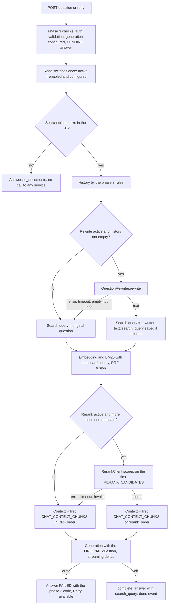

# PLAN for SPEC-2026-11-20-fase-4-rerank-rewrite

## Approach
Due passi nuovi dentro `_answer` di `app/chat/service.py`, ciascuno con un client proprio e un ripiego che non fa fallire
la risposta:
- `app/chat/rewrite.py`: `QuestionRewriter`, client OpenAI-compatible **senza streaming** (`POST
  {REWRITE_BASE_URL}/chat/completions` con `stream: false`) che restituisce la domanda autonoma o solleva `RewriteError`;
- `app/chat/rerank.py`: `RerankClient` con due adattatori (`tei` e `cohere`) che restituisce un punteggio per candidato o
  solleva `RerankError`, e la funzione pura `rerank_order` che costruisce l'ordine finale.

Le impostazioni globali stanno in un pacchetto nuovo, `app/app_settings/` (il nome evita `Settings` di `app/config.py`):
una tabella `app_settings` con una sola riga, un repository, due rotte admin. La migrazione `0006_rerank_rewrite.py` crea
la tabella con la riga iniziale (entrambi spenti) e aggiunge `messages.search_query` (testo, nullo).

Flusso di una domanda, dopo l'evento `conversation`:
1. `_answer` legge **una volta** le impostazioni (`AppSettingsRepository.switches()`) e calcola quali passi sono attivi
   (acceso e configurato): la risposta usa questa fotografia fino alla fine (REQ-003, AC-005).
2. Se la KB non ha chunk ricercabili: risposta `no_documents`, nessuna chiamata (come nella fase 3).
3. Cronologia (`ConversationRepository.history`, regole della fase 3). Con la riscrittura attiva e la cronologia non
   vuota: `QuestionRewriter.rewrite(question, history)`; su `RewriteError` o testo inutilizzabile la domanda cercata è
   l'originale. `search_query` = testo riscritto se differisce dall'originale (`strip().casefold()`), altrimenti None.
4. Embedding, `dense_search` e `bm25_search` con la domanda cercata; `fuse` come oggi.
5. Si caricano i primi `max(RERANK_CANDIDATES, CHAT_CONTEXT_CHUNKS)` della fusione. Con il reranker attivo e più di un
   candidato: `RerankClient.scores(query, texts)` sui primi `RERANK_CANDIDATES`, poi `rerank_order`; su `RerankError`
   resta l'ordine RRF. Il contesto prende i primi `CHAT_CONTEXT_CHUNKS`.
6. `build_messages` riceve **la domanda originale**; generazione, citazioni e `complete_answer(..., search_query=...)`
   come oggi. `done` porta `search_query` nel messaggio.

I due passi avvengono prima del primo `delta`: i keepalive di `_with_keepalive` coprono l'attesa (fino a 30 + 15 s in
più). Il tempo dei passi non entra nel `GENERATION_TIMEOUT_SECONDS`, che resta della sola generazione.

Il servizio `reranker` del Compose è Hugging Face text-embeddings-inference, nel profilo `rerank`. Il file
`compose.rerank-gpu.yaml` cambia l'immagine e riserva la GPU, sullo stesso modello di `compose.tls.yaml`, così non possono
esserci due immagini attive (ADR-004).

Alternative scartate:
- Riscrittura con il client della generazione in streaming e un testo raccolto: un solo client, ma la riscrittura ha un
  provider proprio (decisione dell'owner) e non serve lo streaming; un client non in streaming è più semplice da
  rendere robusto (una risposta, un timeout).
- Due profili `rerank-cpu` e `rerank-gpu`: con `--profile` ripetuto partirebbero entrambi, contro la constitution.
- Impostazioni in Redis: si perdono con un `FLUSHALL` e non hanno migrazioni; una riga in PostgreSQL è durevole e
  transazionale.
- Reranker nel worker RQ: la risposta aspetterebbe la coda dell'ingestion (ADR-002) e servirebbe Redis pub/sub.

## Interfaces
- External (spec):
  - `GET /api/admin/settings` → `200 {"rerank": {"enabled": bool, "configured": bool}, "rewrite": {...}}`;
  - `PUT /api/admin/settings` con `{"rerank_enabled"?: bool, "rewrite_enabled"?: bool}` → `200` con la stessa forma;
    `409 service_not_configured`, `422 validation_error`, `401`, `403 forbidden`; `require_admin` prima del corpo;
  - `MessageOut` e l'evento `done` hanno `search_query: str | null`;
  - `GET /api/health`: `checks.rewrite` e `checks.rerank` in `ok | unreachable | not_configured`;
  - reranker `tei`: `POST {RERANK_BASE_URL}/rerank` con `{"query", "texts", "truncate": true}` → `[{"index", "score"}]`;
    salute `GET /health`;
  - reranker `cohere`: `POST {RERANK_BASE_URL}/rerank` con `{"model", "query", "documents", "top_n"}` →
    `{"results": [{"index", "relevance_score"}]}`; salute `GET /models`;
  - riscrittura: `POST {REWRITE_BASE_URL}/chat/completions` con `{"model", "messages", "stream": false}` →
    `choices[0].message.content`; salute `GET /models`;
  - variabili: `REWRITE_BASE_URL`, `REWRITE_MODEL`, `REWRITE_API_KEY`, `REWRITE_TIMEOUT_SECONDS` (30), `RERANK_BASE_URL`,
    `RERANK_API` (`tei`), `RERANK_MODEL`, `RERANK_API_KEY`, `RERANK_CANDIDATES` (20), `RERANK_TIMEOUT_SECONDS` (15),
    `RERANK_COMPOSE_MODEL` (`BAAI/bge-reranker-v2-m3`, letta solo dal Compose).
- `app/config.py` (T-01): i campi `rewrite_base_url`, `rewrite_model`, `rewrite_api_key: SecretStr | None`,
  `rewrite_timeout_seconds`, `rerank_base_url`, `rerank_api: Literal["tei", "cohere"]`, `rerank_model`,
  `rerank_api_key: SecretStr | None`, `rerank_candidates`, `rerank_timeout_seconds`, con i controlli di REQ-001 e REQ-002;
  le proprietà `rewrite_configured: bool` e `rerank_configured: bool`.
- `backend/migrations/versions/0006_rerank_rewrite.py` (T-01): tabella `app_settings (id smallint primary key check
  (id = 1), rerank_enabled boolean not null default false, rewrite_enabled boolean not null default false, updated_at
  timestamptz not null default now())` con la riga `id = 1`; colonna `messages.search_query text null`.
- `app/db/models.py` (T-01): `AppSetting` e `Message.search_query: Mapped[str | None]`.
- `app/app_settings/` (T-01):
  - `repository.py`: `@dataclass(frozen=True) class Switches: rerank_enabled: bool; rewrite_enabled: bool`;
    `AppSettingsRepository(session).switches() -> Switches`; `.update(rerank_enabled: bool | None, rewrite_enabled:
    bool | None) -> Switches`;
  - `schemas.py`: `StepState {enabled, configured}`, `SettingsOut {rerank, rewrite}`, `SettingsUpdate`;
  - `routes.py`: `router` con le due rotte, incluso in `app/main.py`;
  - `active_steps(settings: Settings, switches: Switches) -> tuple[bool, bool]` (rerank attivo, rewrite attivo).
- `app/api/health.py` (T-01): `_rewrite(settings, limit)` e `_rerank(settings, limit)` → `CheckState`.
- `app/chat/rewrite.py` (T-02): `class RewriteError(Exception)` con `reason: Literal["unreachable", "http_error",
  "timeout", "invalid_response"]`; `build_rewrite_messages(question: str, history: Sequence[Message]) ->
  list[ChatMessage]`; `class QuestionRewriter(base_url, model, api_key, timeout)` con `async rewrite(question, history) ->
  str` (testo senza spazi iniziali e finali; `invalid_response` se vuoto o oltre `max_chars`).
- `app/chat/repository.py` (T-02): `complete_answer(message_id, content, notice, sources, search_query: str | None =
  None)`; `restart_answer` rimette `search_query` a None.
- `app/chat/schemas.py` (T-02): `MessageOut.search_query: str | None`.
- `app/chat/rerank.py` (T-03): `class RerankError(Exception)` con `reason` come sopra; `class RerankClient(api,
  base_url, model, api_key, timeout)` con `async scores(query: str, texts: Sequence[str]) -> list[float]` (un punteggio
  per testo, nell'ordine dei testi; `invalid_response` per indici fuori intervallo o ripetuti, testi mancanti, punteggi
  non numerici o non finiti); `rerank_order(candidates: Sequence[Candidate], scores: Sequence[float]) -> list[Candidate]`
  (i primi `len(scores)` per punteggio decrescente, a parità l'ordine RRF, poi gli altri nell'ordine RRF).
- `app/chat/service.py` (T-02, T-03): `_answer` con i passi del flusso; righe di log `chat rewrite <ids> used=… reason=…
  ms=…` e `chat rerank <ids> used=… reason=… candidates=… ms=…`.
- `backend/tests/fakes/services.py` (T-02, T-03): `FakeRewriteProvider` (risposte e ritardi programmabili, registro delle
  richieste) e `FakeReranker(api="tei" | "cohere")` (punteggi, errori, ritardi, `/health`, `/models`).
- Compose (T-04): servizio `reranker` (profilo `rerank`, immagine TEI CPU con tag fisso, `MODEL_ID`
  `${RERANK_COMPOSE_MODEL:-BAAI/bge-reranker-v2-m3}`, volume `reranker-models` su `/data`, nessuna porta, healthcheck su
  `/health`); `compose.rerank-gpu.yaml` (immagine TEI GPU con tag fisso, `deploy.resources.reservations.devices` NVIDIA);
  l'URL del servizio nel Compose è `http://reranker` (`.env.example` lo indica come esempio).
- Frontend (T-05): `frontend/src/pages/admin/SettingsPage.tsx` (rotta `/admin/settings` con `adminOnly`, voce di menu
  `settings.menu`); `ConversationView` mostra `chat.searchQuery` («Ricerca: {{query}}») sotto una risposta con
  `search_query`; il tipo `MessageOut` del frontend ha `search_query: string | null`.
- E2E (T-05): profili `rewrite` e `rerank` di `backend/tests/e2e/compose.fakes.yaml` con `E2E_REWRITE_URL`,
  `E2E_RERANK_URL` e script dei finti; progetto Compose e porta host propri (18880).

## Flowchart

## Tasks
- [x] T-01 L'admin legge e cambia gli interruttori dalla API, il backend valida la configurazione dei due servizi e la salute li mostra — covers: AC-001, AC-002, AC-006, AC-007, AC-019, AC-020 — files: `backend/app/config.py`, `.env.example`, `compose.yaml`, `backend/migrations/versions/0006_rerank_rewrite.py`, `backend/app/db/models.py`, `backend/app/app_settings/repository.py`, `backend/app/app_settings/routes.py`, `backend/app/app_settings/schemas.py`, `backend/app/main.py`, `backend/app/api/health.py`, `backend/tests/test_rerank_rewrite_config.py`, `backend/tests/test_app_settings.py`, `backend/tests/test_health.py` — depends: none — verify: `python3 scripts/verify.py`
- [ ] T-02 Una domanda di seguito viene cercata nella sua forma autonoma, con ripiego sulla domanda originale e `search_query` salvata; con i passi spenti la chat è quella della fase 3 — covers: AC-003, AC-004, AC-008, AC-009, AC-010, AC-011, AC-012, AC-018, AC-027 — files: `backend/app/chat/rewrite.py`, `backend/app/chat/service.py`, `backend/app/chat/repository.py`, `backend/app/chat/schemas.py`, `backend/tests/fakes/services.py`, `backend/tests/test_rewrite_client.py`, `backend/tests/test_chat_rewrite.py` — depends: T-01 — verify: `python3 scripts/verify.py`
- [ ] T-03 Il reranker riordina i candidati nei formati `tei` e `cohere`, con ripiego sull'ordine RRF; log e destinazioni dei due passi — covers: AC-005, AC-014, AC-015, AC-016, AC-017, AC-025, AC-026 — files: `backend/app/chat/rerank.py`, `backend/app/chat/service.py`, `backend/tests/fakes/services.py`, `backend/tests/test_rerank_client.py`, `backend/tests/test_chat_rerank.py`, `backend/tests/test_chat_steps_privacy.py` — depends: T-02 — verify: `python3 scripts/verify.py`
- [ ] T-04 L'admin avvia il reranker nel Compose su CPU o su GPU — covers: AC-024 — files: `compose.yaml`, `compose.rerank-gpu.yaml`, `.env.example`, `docs/adr/ADR-004-rerank-rewrite.md`, `backend/tests/test_compose_reranker.py` — depends: T-01 — verify: `python3 scripts/verify.py`
- [ ] T-05 L'admin accende i passi dalla pagina «Impostazioni» e la chat mostra «Ricerca: …»; chiude la fase 4 — covers: AC-013, AC-021, AC-022, AC-023, AC-028 — files: `frontend/src/pages/admin/SettingsPage.tsx`, `frontend/src/pages/admin/SettingsPage.test.tsx`, `frontend/src/components/ConversationView.tsx`, `frontend/src/components/ConversationView.test.tsx`, `frontend/src/app/App.tsx`, `frontend/src/i18n/it.json`, `frontend/src/i18n/en.json`, `backend/tests/e2e/compose.fakes.yaml`, `backend/tests/e2e/test_settings_ui.py`, `docs/system/chat.md`, `docs/system/fondazioni.md`, `docs/specs/2026-11-20-fase-4-rerank-rewrite/spec.md`, `AGENTS.md` — depends: T-03, T-04 — verify: `python3 scripts/verify.py`

Parallelismo: T-04 può girare insieme a T-02 e a T-03 (file disgiunti, dipende solo da T-01). T-02 e T-03 sono in
sequenza perché toccano entrambi `service.py` e i finti, e AC-016 e AC-025/AC-026 hanno bisogno dei due passi.

`test_health.py` della fase 3 si aggiorna in T-01 (revisione del requisito 002 della fase 3, voce in `## Revisions` della spec
della fase 3 con la PR di design).

## Review focus
- Testo riscritto con più righe, virgolette o un preambolo («Ecco la domanda: …»): si usa così com'è (senza spazi
  iniziali e finali) e compare in «Ricerca: …», così l'utente vede cosa è stato cercato (T-02).
- Cronologia vuota dopo il filtro della fase 3 (solo scambi falliti o `no_documents`): nessuna riscrittura, come per la
  prima domanda (T-02).
- Testo riscritto con NUL, surrogati soli o caratteri speciali BM25: la pulizia di `bm25_search` e i controlli della
  domanda della fase 3 valgono anche per il testo riscritto; nessun 500 (T-02).
- Punteggi del reranker `NaN`, `Infinity`, booleani o stringhe numeriche: `invalid_response` e ordine RRF (T-03).
- Chunk lunghi oltre il limite di token del modello del reranker: `truncate: true` nel formato `tei`, nessun errore 413
  (T-03); con `cohere` il troncamento è del provider.

## Risks
- Latenza su CPU con i due passi: fino a 45 s prima del primo frammento nel caso peggiore (30 + 15). Mitigazione: timeout
  e ripieghi; interruttori spenti di default; il tempo dei passi è nei log (`ms=`).
- `truncate: true` nel formato `tei` (REQ-008, decisione dell'owner): senza, TEI rifiuta i testi oltre il limite del
  modello e ogni chunk lungo farebbe ripiegare su RRF; AC-014 lo verifica.
- Modello del reranker scaricato al primo avvio: senza accesso a Hugging Face il servizio non diventa sano; il backend fa
  ripiego su RRF e la salute mostra `rerank: unreachable`. Lo si annota nell'area page.
- `compose.yaml` è un'area sensibile: T-01 aggiunge solo le variabili del backend, T-04 solo il servizio nel profilo;
  `test_stack.py` e `test_tls.py` (stack senza profili) devono restare verdi.
- Migrazione 0006 su dati esistenti: colonna nullable e una sola riga di impostazioni creata dalla migrazione; rollback
  con il `downgrade` della 0006, che toglie colonna e tabella.
- Regressione della fase 3: AC-027 confronta richieste, eventi e messaggio con i passi spenti; tutti i test della fase 3
  restano invariati (tranne `test_health.py`, revisionato).

## Revisions
- none
