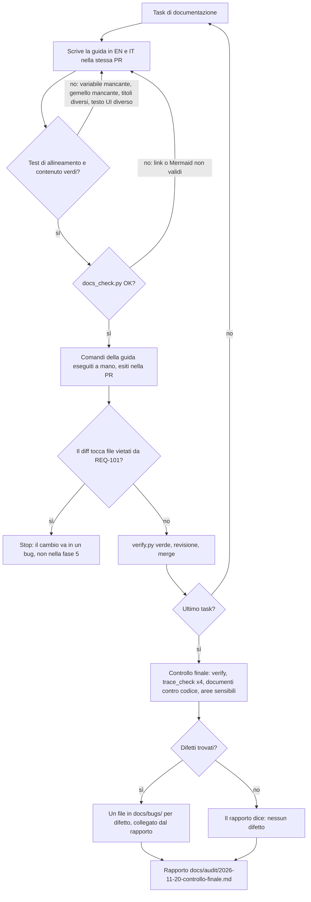

# PLAN for SPEC-2026-11-20-fase-5-documentazione

## Approach
Solo Markdown, immagini e test, senza toccare il codice dell'applicazione (REQ-101).
- Le guide stanno in `docs/guide/en/` e `docs/guide/it/`, con gli stessi quattro nomi di file (`user.md`, `admin.md`,
  `installation.md`, `architecture.md`). Ogni guida si scrive in inglese e in italiano nella stessa PR, così le due
  versioni nascono allineate. La prima riga dopo il titolo collega l'altra lingua; ogni guida collega le pagine di
  `docs/system/` per i dettagli tecnici, senza copiarle.
- La documentazione resta allineata al codice con test pytest nella suite del backend, che fa già parte di
  `scripts/verify.py` e della CI. I test leggono i file del repository e confrontano le guide con le fonti vere:
  - `.env.example` per le variabili;
  - `frontend/src/i18n/it.json` e `en.json` per i testi dell'interfaccia;
  - `compose.yaml` per volumi e servizi.

  Così un cambio futuro del codice che non aggiorna le guide fa fallire la verifica.
- Le schermate si catturano con un test pytest marcato `screenshots`, escluso dalla suite normale e dal passo e2e di
  `verify.py`. Avvia lo stack Compose con i servizi finti e dati inventati, come gli e2e, e salva i PNG in
  `docs/guide/images/<lingua>/`.
- `LICENSE` è il testo Apache-2.0 copiato senza modifiche dalla copia già installata in
  `backend/.venv/.../packaging-*.dist-info/licenses/LICENSE.APACHE`, quindi senza chiamate di rete.
- Il controllo finale è l'ultimo task: verifica completa, `trace_check.py` sulle quattro spec, confronto tra
  `docs/system/` e codice, revisione delle aree sensibili. Produce il rapporto in `docs/audit/` e un file in `docs/bugs/`
  per difetto (modello di `sdd-bugfix`), senza correggere nulla.

Alternative scartate:
- Un solo grande task per tutte le guide: la PR non sarebbe leggibile in 15-30 minuti, e le guide indipendenti non
  potrebbero procedere in parallelo.
- Un controllo con uno script nuovo in `scripts/` invece di test pytest: avrebbe richiesto un passo nuovo in `verify.py`,
  e i test del backend girano già in verify e in CI.
- Schermate catturate a mano: non ripetibili e a rischio di dati reali; il test `screenshots` le ricattura tutte con un
  comando.
- Traduzione di `docs/system/`: esclusa dalla spec; le guide la collegano.

## Interfaces
- External: nessuna API nuova. Comando nuovo, facoltativo: `uv run --directory backend pytest -m screenshots`
  (richiede Docker e Chromium, come gli e2e); non fa parte di `verify.py` né della CI.
- `backend/tests/docs_support.py` (T-01), helper condivisi dai test di documentazione:
  - `REPO_ROOT: Path`;
  - `LANGS = ("en", "it")`;
  - `GUIDES = ("user.md", "admin.md", "installation.md", "architecture.md")`;
  - `guide_path(lang: str, name: str) -> Path` (`docs/guide/<lang>/<name>`);
  - `read_text(path: Path) -> str` (UTF-8, righe normalizzate a `\n`);
  - `headings(text: str) -> list[str]` (titoli `##` e `###` fuori dai blocchi di codice);
  - `first_line_after_title(text: str) -> str`;
  - `env_example_names() -> list[str]` (nomi delle righe `NOME=` di `.env.example`, in ordine);
  - `variable_table_names(text: str) -> list[str]` (prima colonna `` `NOME` `` delle righe di tabella che iniziano con
    `` | `NOME` | ``);
  - `ui_text(lang: str, key: str) -> str` (valore della chiave puntata di `frontend/src/i18n/<lang>.json`);
  - `image_refs(text: str) -> list[str]` (percorsi delle immagini Markdown ``);
  - `compose_volumes() -> list[str]` (nomi della sezione `volumes:` di primo livello di `compose.yaml`, letti con PyYAML
    già presente).
- `backend/tests/test_docs_alignment.py` (T-01): AC-011 e AC-012, sui file che esistono, quindi verde anche prima delle
  guide successive:
  - per ogni lingua, ogni nome di `env_example_names()` deve stare in `variable_table_names` della guida di
    installazione, e ogni nome della tabella deve stare in `.env.example`;
  - per ogni file in `docs/guide/en/`, `docs/guide/it/`, `docs/guide/images/en/` e `docs/guide/images/it/` deve esistere
    il gemello nell'altra lingua; lo stesso vale per `README.md` e `README.it.md`;
  - per ogni coppia: stesso numero di `headings` e, nella prima riga dopo il titolo, il link relativo al gemello;
  - ogni `image_refs` di una guida esiste.
- Guida di installazione (T-01): tabella delle variabili `| `NOME` | significato | predefinito | obbligatoria |`, una riga
  per variabile di `.env.example`, nello stesso ordine.
- Test dei contenuti, uno per guida; ognuno controlla, nelle due lingue, che i testi dell'interfaccia elencati in
  `REQUIRED_UI_KEYS` compaiano nella guida esattamente come in `<lang>.json` (chiavi senza `{{...}}`):
  - `backend/tests/test_docs_user_guide.py` (T-02);
  - `backend/tests/test_docs_admin_guide.py` (T-03);
  - `backend/tests/test_docs_install_guide.py` (T-01): `compose.tls.yaml`, `--profile rerank`,
    `compose.rerank-gpu.yaml`, `/api/health`, gli stati `ok`, `degraded`, `unreachable`, `not_configured`, e ogni nome
    di `compose_volumes()`;
  - `backend/tests/test_docs_architecture_guide.py` (T-04): un blocco Mermaid `flowchart`, e i link a `docs/system/`,
    `docs/specs/`, `docs/adr/`, `AGENTS.md`, `docs/constitution.md`;
  - `backend/tests/test_docs_guides_complete.py` (T-06, AC-004): le due cartelle contengono esattamente `GUIDES`; sta in T-06
    perché solo allora esistono tutte e quattro le guide.
- `backend/tests/e2e/test_screenshots.py` (T-02):
  - marcatore `screenshots`, aggiunto a `markers` e escluso in `addopts` di `backend/pyproject.toml`;
  - progetto Compose `advancedrag-screenshots`, porta host 18980, profili `generation`, `rewrite`, `rerank`;
  - `down -v` alla fine;
  - viewport 1280×800 con `device_scale_factor=2`, browser in `it` e poi in `en`;
  - produce in `docs/guide/images/<lang>/` i file `login.png`, `kb-list.png`, `chat.png`, `admin-users.png`,
    `admin-kbs.png`, `admin-documents.png`, `admin-conversations.png`, `admin-settings.png`;
  - dati inventati: utenti `admin`, `mario.rossi` e `jane.doe`, KB «Manuali prodotto» e «Product manuals», tre documenti
    di poche righe;
  - `test_docs_user_guide.py` e `test_docs_admin_guide.py` controllano che le loro schermate siano citate.
- `backend/tests/test_readme.py` (T-05), AC-001, AC-003 e AC-010:
  - `badges(text) -> list[tuple[alt, image_url, link]]`, che legge ``;
  - controlla 20 badge uguali e nello stesso ordine nei due README, l'URL
    `https://github.com/jumping2000/advancedRAG/actions/workflows/verify.yml/badge.svg?branch=main` e il proprietario
    `jumping2000/advancedRAG` nei badge dinamici;
  - controlla i link alle quattro guide della stessa lingua;
  - controlla che `LICENSE` sia uguale byte per byte a `LICENSE.APACHE` della distribuzione `packaging` installata (letta
    con `importlib.metadata`).
- `backend/tests/test_docs_audit.py` (T-06), AC-014:
  - il rapporto ha i titoli delle sei parti di REQ-013;
  - ogni file di `docs/bugs/` è collegato dal rapporto;
  - ogni link del rapporto a `docs/bugs/` esiste.
- Bug (T-06): `docs/bugs/2026-11-20-<slug>.md` dal modello di `sdd-bugfix`, con la gravità.

## Flowchart

## Tasks
- [x] T-01 La guida di installazione IT/EN documenta ogni variabile e i test tengono allineate le guide — covers: AC-007, AC-011, AC-012, AC-017 — files: `backend/tests/docs_support.py`, `backend/tests/test_docs_alignment.py`, `backend/tests/test_docs_install_guide.py`, `docs/guide/en/installation.md`, `docs/guide/it/installation.md` — depends: none — verify: `python3 scripts/verify.py`
- [x] T-02 La guida utente IT/EN con le schermate catturate dallo stack di test — covers: AC-005, AC-009, AC-016 — files: `backend/tests/e2e/test_screenshots.py`, `backend/pyproject.toml`, `docs/guide/images/en/`, `docs/guide/images/it/`, `docs/guide/en/user.md`, `docs/guide/it/user.md`, `backend/tests/test_docs_user_guide.py` — depends: T-01 — verify: `python3 scripts/verify.py`
- [x] T-03 La guida admin IT/EN — covers: AC-006 — files: `docs/guide/en/admin.md`, `docs/guide/it/admin.md`, `backend/tests/test_docs_admin_guide.py` — depends: T-02 — verify: `python3 scripts/verify.py`
- [x] T-04 La guida di architettura e sviluppo IT/EN — covers: AC-008 — files: `docs/guide/en/architecture.md`, `docs/guide/it/architecture.md`, `backend/tests/test_docs_architecture_guide.py` — depends: T-01 — verify: `python3 scripts/verify.py`
- [x] T-05 I README EN/IT con i badge e la licenza Apache-2.0 — covers: AC-001, AC-002, AC-003, AC-010 — files: `README.md`, `README.it.md`, `LICENSE`, `backend/tests/test_readme.py` — depends: T-03, T-04 — verify: `python3 scripts/verify.py`
- [ ] T-06 Il controllo finale delle fasi 1-4, con il rapporto e un bug per difetto; chiude la fase 5 — covers: AC-004, AC-013, AC-014, AC-015 — files: `docs/audit/2026-11-20-controllo-finale.md`, `docs/bugs/`, `backend/tests/test_docs_audit.py`, `backend/tests/test_docs_guides_complete.py`, `docs/system/fondazioni.md`, `docs/specs/2026-11-20-fase-5-documentazione/spec.md`, `AGENTS.md` — depends: T-05 — verify: `python3 scripts/verify.py`

T-02 e T-04 dipendono solo da T-01 e toccano file diversi: possono andare in parallelo. T-03 segue T-02, perché usa le
sue schermate.

## Review focus
- Testi dell'interfaccia con caratteri tipografici («», …, apostrofi) e chiavi con `{{...}}`: i test confrontano le
  stringhe esatte di `<lang>.json`; le chiavi con interpolazione non entrano in `REQUIRED_UI_KEYS` (T-02, T-03).
- Nomi in maiuscolo che non sono variabili (`GET`, `HTTP`, `E2E_*`, `LIVE_SERVICES`): il controllo dei nomi
  sconosciuti legge solo la prima colonna della tabella delle variabili, non tutto il testo (T-01).
- File con fine riga Windows o con BOM: `read_text` normalizza `\r\n` e toglie il BOM, così titoli e prime righe si
  confrontano allo stesso modo su Windows e Linux (T-01).
- Schermate con dati che cambiano (date, id, ore): dati inventati e fissi; nessun id visibile nelle pagine catturate;
  controllo a occhio di ogni PNG prima del commit, con l'esito nella PR (T-02).
- URL dei badge con spazi e `|` («IT | EN»): codificati (`%20`, `%7C`), e i test confrontano gli URL esatti (T-05).

## Risks
- Una guida descrive un comportamento che il codice non ha. Controlli:
  - i test di contenuto leggono le fonti vere (i18n, `.env.example`, `compose.yaml`);
  - il reviewer confronta ogni guida con `docs/system/` e con il codice;
  - i comandi sono eseguiti e riportati nella PR (REQ-103).
- Una PR della fase 5 tocca file dell'applicazione (anti-goal). Controlli:
  - `diff_scope.py` limita ogni task ai suoi file;
  - T-06 controlla tutto il diff della fase rispetto a `5b3767a` (main prima della fase 5).
- Schermate superate dopo un cambio dell'interfaccia: il comando `pytest -m screenshots` le ricattura; il test di parità
  controlla che i nomi restino gli stessi nelle due lingue.
- GitHub non riconosce la licenza: il testo è copiato byte per byte e confrontato da `test_readme.py`; la pagina del
  repository si controlla dopo il merge di T-05.
- Peso del repository per i PNG (16 file a scala 2): il rapporto di T-02 riporta la dimensione totale. Sopra i 5 MB si
  chiede all'owner prima del commit.
- Revisione del controllo finale troppo grande per una PR: T-06 elenca e documenta i difetti, non li corregge; ogni
  correzione è una PR di `sdd-bugfix`.

## Revisions
- 2026-11-20: AC-004 e `test_docs_guides_complete.py` passano da T-04 a T-06. Il test chiede tutte e quattro le guide in entrambe le lingue, ma `user.md` esiste solo dopo T-02 e `admin.md` solo dopo T-03, che segue T-02: nella verifica e nella CI di T-04 sarebbe rimasto rosso. Trovato prima di avviare T-02 e T-04, nessun task era in corso.
