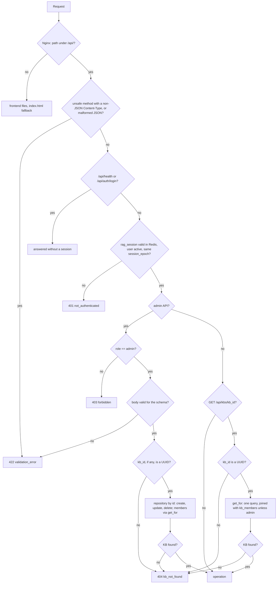
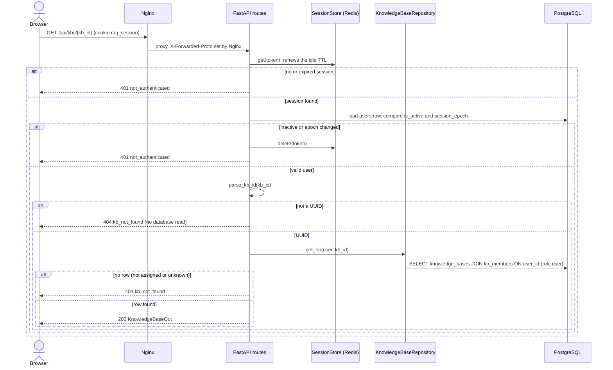
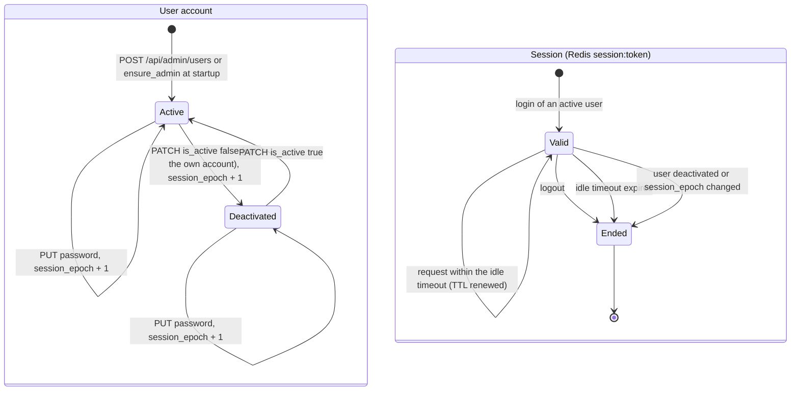
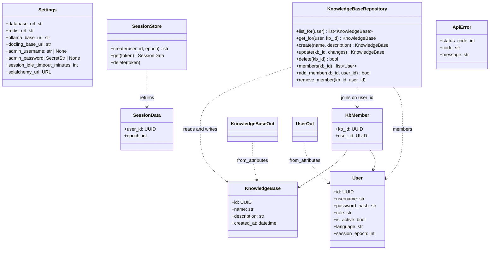
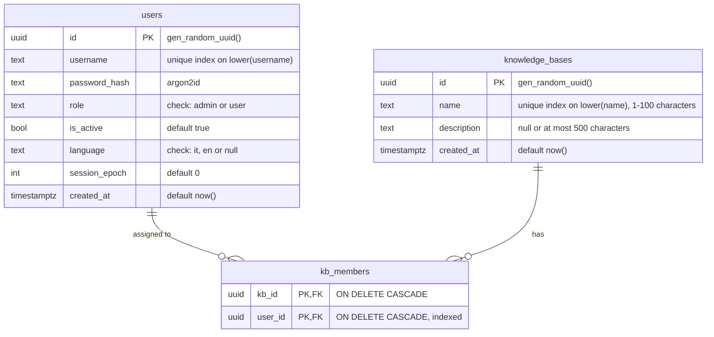

# Area: fondazioni (stack, access, users, knowledge bases)

- Last aligned: 2026-11-18
- Linked specs: SPEC-2026-11-06-fase-1-fondazioni, SPEC-2026-11-07-fase-2-ingestion, SPEC-2026-11-17-fase-3-chat

## Current behaviour
The platform runs as a Docker Compose stack of five services: `nginx` (the only one with a host port, `HTTP_PORT`,
default 80), `backend` (FastAPI on port 8000, inside the Compose network only), `worker` (phase 2, T-04: the image of
the backend running `python -m app.worker`, with no port), `redis` and `db` (ParadeDB, PostgreSQL 17 with the `vector`
and `pg_search` extensions). `backend` and `worker` run the same image (built once, by `backend`) and mount the same `uploads` volume at
`/data/uploads`. The worker gets only the common part of the environment (database, Redis, Ollama, Docling, `UPLOAD_DIR`
and the `EMBEDDING_*` and `CHUNK_*` settings), through a YAML anchor in `compose.yaml`: the admin account, the sessions,
the upload limit and the health timeout stay with the backend. The worker starts after the backend is healthy (the
backend applies the migrations) and has `stop_grace_period: 120s`: a stop lets the job in progress finish for two
minutes (RQ's warm shutdown), a longer job is killed and its document is recovered by the next start (see below). Nginx serves the compiled React frontend and proxies `/api/` to the
backend (the proxy lines live in `nginx/api-proxy.conf`, included by both server templates), always overwriting
`X-Forwarded-Proto` with its own scheme. The request body limit is 1 MB, except for the document upload
`/api/kbs/{id}/documents`, where it is `MAX_UPLOAD_SIZE_MB` + 1 MB and a request above it gets 413 with the JSON error
body `file_too_large` (phase 2, T-01). HTTPS is on only when the stack starts with
`compose.tls.yaml` (which publishes `HTTPS_PORT`, default 443, and passes it to Nginx) **and** `nginx/certs/` holds
both `cert.pem` and `key.pem`: then HTTP answers 301 to `https://`. Any other combination stays HTTP only, and the
entrypoint logs why (missing file, or `HTTPS_PORT not set`). At startup the backend (`python -m app.run`) applies the
Alembic migrations (`fileConfig(..., disable_existing_loggers=False)` in `migrations/env.py`, so that running them in
the process does not silence the loggers created before), creates the first admin from `ADMIN_USERNAME`/`ADMIN_PASSWORD` when no active admin exists, then
starts uvicorn. Ollama and Docling are external: `GET /api/health` reports them but they never block the startup.

The Compose has an optional sixth service, `reranker` (phase 4, T-04, ADR-004), only in the profile `rerank`: without
`--profile rerank` the stack is the five services above. It runs Hugging Face text-embeddings-inference, CPU image
`ghcr.io/huggingface/text-embeddings-inference:cpu-1.9.4`, with the model `MODEL_ID` = `RERANK_COMPOSE_MODEL` (default
`BAAI/bge-reranker-v2-m3`, also when the variable is empty or missing), downloaded from Hugging Face at its first start
into the `reranker-models` volume (mounted at `/data`). `MAX_CLIENT_BATCH_SIZE` is `RERANK_CANDIDATES` (20 when empty):
TEI refuses with 422 a `/rerank` with more texts (32 by default), and the backend sends up to `RERANK_CANDIDATES`. It
listens on port 80 of the Compose network only (no host port): the backend uses it with
`RERANK_BASE_URL=http://reranker` and `RERANK_API=tei`, which `.env` must set (the Compose does not set them). Its health
check is `curl` on `/health`, with a `start_period` of 30 minutes for the download. Only the first start needs Hugging
Face: until the model is in the volume (and always if that first download cannot reach Hugging Face) the service is not
healthy, the chat keeps the RRF order and `GET /api/health` shows `rerank` as `unreachable`; later starts read the model
from the volume. No other service waits for it. The CPU start (`--profile rerank` with `compose.yaml` alone) uses no GPU
image, device or runtime, so it pulls only the CPU image. GPU support is NVIDIA only: on a x86_64 host with the NVIDIA
Container Toolkit, `-f compose.rerank-gpu.yaml` replaces the image with
`ghcr.io/huggingface/text-embeddings-inference:1.9.4` (Ampere and Ada Lovelace; the per-family tags `86-1.9.4` and
`89-1.9.4` also exist, and Turing, Hopper and Blackwell change the tag in that file; Volta, Pascal and ARM hosts are not
covered) and reserves one GPU, so the service stays one; the file alone, without the profile, starts no reranker.

The worker (`app/worker.py`) runs the jobs of the RQ queue `ingestion` one at a time with `rq.SimpleWorker` (no fork per
job). While it runs, a daemon thread writes the Redis key `ingestion:worker:alive:{hostname}` (value `1`, expiry 30
seconds) every 10 seconds; `python -m app.worker --healthcheck`, the Compose health check, exits 0 if the key of its own
host exists and 1 otherwise. A job (`process_document_job`) takes a document from QUEUED to PROCESSING in one statement
(no QUEUED row: it ends quietly), then reads it: a PDF, DOCX, PPTX or XLSX goes to Docling (`DoclingClient`: `POST
{DOCLING_BASE_URL}/v1/convert/file`, multipart field `files` named `<document id>.<format>`, form fields `from_formats`
= the format, `to_formats` = `json`, `do_ocr` = `false`, `include_images` = `false` (`DOCLING_INCLUDE_IMAGES`), header `X-Api-Key` only when `DOCLING_API_KEY` is set, timeout
`DOCLING_TIMEOUT_SECONDS`, 600) and its `document.json_content` (a DoclingDocument) becomes blocks: headings with their
level, paragraphs, one block per table row (cells joined by " | "; a table without `data.grid` is rebuilt from `data.table_cells`), the page of each from `prov[].page_no`; the runs of
an inline group are one paragraph; pictures and the furniture layer (headers, footers) are left out. A TXT or MD is read
directly as UTF-8. The text is normalized; if fewer than `MIN_EXTRACTED_CHARS` (50) characters that are not white remain
(or nothing that can be chunked), the document becomes UNSUPPORTED `no_text_extracted` and its original is deleted at
once. Otherwise Ollama gives the vectors in groups of `EMBEDDING_BATCH_SIZE` (16) texts (timeout
`EMBEDDING_TIMEOUT_SECONDS`, 120), the chunks are saved in one transaction, both indexes are checked, and the document
is marked READY with its `chunk_count` and its original is deleted. Any failure makes the document FAILED with a code
and a fixed English message and no chunk, and keeps the original for `FAILED_ORIGINAL_RETENTION_DAYS` days (7) so that the
admin can retry.

Before the worker accepts its first job (`startup` in `app/worker.py`, the heartbeat is already beating) it recovers
and cleans, three independent steps of `app/ingestion/cleanup.py`: a failure of one is logged by the type of the error
and the others and the worker go on. `recover_interrupted` turns every document left PROCESSING (only a worker that died
can leave one: there is one worker) into FAILED `unexpected_error` "Processing was interrupted" through
`DocumentRepository.mark_failed`, which deletes its chunks; the original is kept, so the admin can retry.
`requeue_pending` puts every QUEUED document on the queue again (a retry whose enqueue failed, a lost job); a document
that already has a job just gets a second one, and the claim at the start of the job lets only one work.
`cleanup_originals` deletes files only, never a row or a chunk: the original of a FAILED document more than
`FAILED_ORIGINAL_RETENTION_DAYS` days after it failed (`documents.updated_at`, the FAILED transition; a retry that
fails again starts the time again; the document stays FAILED with its reason; the document is read again just before
its file is deleted, so a Retry after the list was made keeps its original, and a Retry in the instant between that
check and the deletion is not excluded: the job then fails the document for the missing original); the files named
exactly `{uuid}` (canonical lower case) that have no document, and the `{uuid}.part` of an upload that never finished,
when they were last written more than one hour ago (any other name in `UPLOAD_DIR` is left alone); and the original
that survives in a READY or UNSUPPORTED document, whatever its age (the worker can die between the status mark and the
removal). The original of a QUEUED or PROCESSING document is never deleted. The same cleanup then runs every hour in a
daemon thread (`worker-cleanup`, an event loop per run).

A document deleted while a job processes it (REQ-019) is not resurrected: `persist_chunks` locks the document row and
raises `DocumentGone` when it is gone (the delete waits for that lock and takes the chunks with it by cascade), the
READY, UNSUPPORTED and FAILED marks change only a PROCESSING row, and the original is removed by the delete itself, so
a job that finds neither the row nor the file ends quietly and writes nothing. A job that exceeds the 3600 s timeout of
the queue ends FAILED `unexpected_error` "The processing time limit was exceeded" (chunks deleted, original kept). RQ's
`SimpleWorker` enforces the timeout with SIGALRM, whose handler raises `JobTimeoutException` in the main thread: while
the event loop is idle (waiting for Docling or Ollama, the usual case) the exception leaves `asyncio.run` and the
pipeline never sees it, so `process_document_job` catches it around `asyncio.run` and calls `fail_after_timeout`
(verified with a real RQ worker and a 5 s timeout, `test_worker_recovery.py`); the pipeline's own branch covers the case
where the signal lands in its code.

Attempts (REQ-016, `app/ingestion/retry.py`): the Docling call and each group of embeddings are repeated on their own,
only after a temporary error (connection refused, timeout, 5xx, 429), up to `INGESTION_MAX_ATTEMPTS` (3) attempts in
all, waiting `INGESTION_RETRY_BACKOFF_SECONDS` (10 s) and then twice that (20 s) between them; any other error is not
repeated. The reasons (`status_reason.code`, with its fixed message):

| Code | Final state | When |
|---|---|---|
| `docling_unreachable` | FAILED | Docling refuses the connection, times out or hangs up, on every attempt |
| `docling_error` | FAILED | Docling answers 5xx or 429 on every attempt, or an answer that is not a conversion |
| `docling_error` (refused key) | FAILED | Docling answers 401 or 403: "The document parsing service refused the request: check DOCLING_API_KEY", at once, the original stays |
| `parse_failed` | FAILED | Docling refuses the file (any other 4xx, or `status: failure`), or a TXT/MD is not UTF-8 |
| `no_text_extracted` | UNSUPPORTED | too little text after the normalization (original deleted at once) |
| `embedding_unreachable` | FAILED | Ollama refuses the connection, times out or hangs up, on every attempt |
| `embedding_error` | FAILED | Ollama answers 5xx or 429 on every attempt, or any other 4xx at once |
| `embedding_invalid_response` | FAILED | a wrong number of vectors, a vector that is empty, ragged, not made of numbers or holding NaN or infinity |
| `embedding_dimension_mismatch` | FAILED | well formed vectors whose size is not `EMBEDDING_DIMENSIONS` (the profile's) |
| `verification_failed` | FAILED | the vector or the BM25 index did not return every saved chunk (the chunks are deleted) |
| `unexpected_error` | FAILED | anything else: a bug, a database error, a missing original; the 3600 s timeout of the job ("The processing time limit was exceeded"); a worker that died in the middle of the document ("Processing was interrupted", set at the next start) |

A Docling `partial_success` is accepted and the document goes on; the worker logs one warning with the document id and
the number of errors Docling reported, never their text. The messages never carry the content, a file name or what the
other service said. Logs carry the document id, the status,
the reason code, the step (`docling`, `embeddings`) and the attempt number, never content, file names, vectors or
exception messages (REQ-102).

Users are local accounts with role `admin` or `user`. Login matches the username exactly and creates a server-side
session in Redis (`session:<token>`, idle TTL `SESSION_IDLE_TIMEOUT_MINUTES`, renewed by every request) with an
`HttpOnly`, `SameSite=Lax` cookie `rag_session`, `Secure` only over HTTPS, without `Max-Age`/`Expires`. Every
authenticated request reloads the user: a deactivated user, or a session whose `session_epoch` differs from the
user's, gets 401; deactivation and password reset increment the epoch, so they end every session of the user. The
admin creates users (names unique on `lower()`, trimmed, 3–64 letters, digits, `.`, `_`, `-`; passwords of at least 12
characters, stored as Argon2id), deactivates/reactivates them (never themself) and resets their passwords.

The admin creates knowledge bases (names trimmed, 1–100 characters, unique on `lower()`; description optional,
trimmed, up to 500 characters, a blank one stored as null; NUL and lone surrogate characters get 422), renames them,
deletes them (with their assignments) and assigns or removes users. Every read of a
KB goes through `KnowledgeBaseRepository`, which for any role other than the exact `admin` joins `kb_members` on the
user's id in the same SQL query: a user lists and opens only the assigned KBs, and a KB that is not assigned, does not
exist or has an id that is not a UUID gets the same 404 `kb_not_found`. The UI (Italian or English: browser language
first, then the language saved in the profile) has the login page, the KB list as home page ("Le tue knowledge base"
for a user, "Tutte le knowledge base" for the admin) and, for the admin, the Users, Knowledge Base, (phase 2, T-07)
Documents and (phase 3, T-07) Conversations pages; a `user` sees none of the admin menus. Since phase 3 the opened KB under
`/kbs/{id}` is the chat page (`ChatPage`: the KB name and description stay in the header, the own conversations on the left,
the messages and the question field on the right). The Documents page is described in [ingestion.md](ingestion.md); the chat
page, the Conversations page and everything behind them (retrieval, streaming, conversations) in [chat.md](chat.md). The member picker of the Knowledge Base page offers only
active users; an inactive user already assigned stays listed, marked as deactivated.

## Interfaces
Errors are always `{"error": {"code": "<code>", "message": "<English text>"}}`; the UI translates the `code`.

| Method and path | Who | Success | Errors |
|---|---|---|---|
| `GET /api/health` | anyone | 200 `{"status": "ok"\|"degraded", "checks": {"database", "redis", "ollama", "docling", "worker", "generation", "rewrite", "rerank"}}`, each `ok` or `unreachable`, except `generation`, `rewrite` and `rerank`; `worker` is `ok` when at least one `ingestion:worker:alive:*` key exists in Redis; `generation` (phase 3) is `not_configured` when `GENERATION_BASE_URL` is empty (no request is sent), else `ok` if `GET {GENERATION_BASE_URL}/models` answers 2xx within `HEALTH_CHECK_TIMEOUT_SECONDS`, else `unreachable`; `rewrite` and `rerank` (phase 4) follow the same rule with `GET {REWRITE_BASE_URL}/models` and, for the reranker, `GET {RERANK_BASE_URL}/health` (`tei`) or `GET {RERANK_BASE_URL}/models` (`cohere`), each with its own key as `Authorization: Bearer` when set and no redirect followed; they depend on the configuration, not on the switches of the admin; `status` is `ok` only if every check is `ok`, so a stack without a generation provider, a rewriting service or a reranker is `degraded` | 503 (same body) when database or Redis is `unreachable`; the other checks never change the code |
| `POST /api/auth/login` `{"username", "password"}` | anyone | 200 `UserOut` + cookie | 401 `invalid_credentials` (wrong password, unknown or deactivated user) |
| `POST /api/auth/logout` | session | 204 | 401 `not_authenticated` |
| `GET /api/auth/me`, `PATCH /api/auth/me` `{"language": "it"\|"en"}` | session | 200 `UserOut` | 401, 422 |
| `GET /api/admin/users`, `POST /api/admin/users` `{"username", "password", "role"}` | admin | 200 `[UserOut]`, 201 `UserOut` | 409 `username_taken`; 422 `invalid_username`, `password_too_short` |
| `PATCH /api/admin/users/{user_id}` `{"is_active"}` | admin | 200 `UserOut` | 404 `user_not_found`; 409 `cannot_deactivate_self` |
| `PUT /api/admin/users/{user_id}/password` `{"password"}` | admin | 204 | 404 `user_not_found`; 422 `password_too_short` |
| `GET /api/kbs` | session | 200 `[KnowledgeBaseOut]` (own KBs; all for the admin), ordered by `lower(name)` | 401 |
| `GET /api/kbs/{kb_id}` | session | 200 `KnowledgeBaseOut` | 404 `kb_not_found` (not assigned, unknown, not a UUID) |
| `POST /api/kbs` `{"name", "description"?}` | admin | 201 `KnowledgeBaseOut` | 409 `kb_name_taken`; 422 `validation_error` |
| `PATCH /api/kbs/{kb_id}` `{"name"?, "description"?}` | admin | 200 `KnowledgeBaseOut` (only the fields sent change; `"description": null` or a blank one clears it) | 404 `kb_not_found`; 409 `kb_name_taken`; 422 `validation_error` (also `"name": null`) |
| `DELETE /api/kbs/{kb_id}` | admin | 204 (assignments, documents and chunks removed by cascade; the originals of its documents are removed right after, best effort: a file that cannot be removed is logged by document id and error type, and the hourly sweep deletes it) | 404 `kb_not_found` |
| `POST /api/kbs/{kb_id}/documents/{document_id}/retry` (no body) | admin | 202 `DocumentOut` in QUEUED, without reason, and a new job on the queue (phase 2, T-05) | 404 `kb_not_found`, `document_not_found`; 409 `not_retryable` (the document is not FAILED, also for the second of two simultaneous presses), 409 `original_missing` (FAILED, but the original was deleted) |
| `DELETE /api/kbs/{kb_id}/documents/{document_id}` | admin | 204: the document, its chunks (cascade) and its original are removed at once, in any state, also PROCESSING (phase 2, T-06) | 404 `kb_not_found`, `document_not_found` (unknown, not a UUID or of another KB, the same body) |
| `GET /api/kbs/{kb_id}/members` | admin | 200 `[UserOut]`, ordered by `lower(username)` | 404 `kb_not_found` |
| `PUT /api/kbs/{kb_id}/members/{user_id}` | admin | 204 (idempotent: one row, also under concurrency; inactive users accepted) | 404 `kb_not_found`, then 404 `user_not_found` (also for a non-UUID id) |
| `DELETE /api/kbs/{kb_id}/members/{user_id}` | admin | 204 (also when the user was not assigned) | 404 `kb_not_found`, then 404 `user_not_found` |
| `GET /api/admin/settings` | admin | 200 `{"rerank": {"enabled", "configured"}, "rewrite": {"enabled", "configured"}}`: `enabled` is the saved switch, `configured` whether the base URL of the service is set (phase 4) | 401, 403 `forbidden` |
| `PUT /api/admin/settings` `{"rerank_enabled"?, "rewrite_enabled"?}` | admin | 200, the same body with the saved state (only the fields sent change; switching off is always allowed) | 409 `service_not_configured` (a step switched on whose service is not configured: nothing is saved, not even the other field); 422 `validation_error` (neither field, or a value that is not a JSON boolean: `"yes"`, `"true"`, `1`, `null`) |

- Order of the checks: a `POST`/`PUT`/`PATCH`/`DELETE` whose `Content-Type` is not `application/json`
  (`require_json`) and a body that is not well-formed JSON get 422 `validation_error` first, before the session;
  then 401 `not_authenticated` on every API but health and login without a valid session; then 403 `forbidden` for
  a `user` on every admin API, before the schema of the body, the ids and any database read (the same 403 for any
  KB or user id, so nothing depends on which KBs exist); then 422 `validation_error` for a body that fails the
  schema (the details are never echoed); then the ids (404).
- The one exception to `require_json` is the document upload of phase 2 (`POST /api/kbs/{kb_id}/documents`): it takes
  `multipart/form-data`, but only with the header `X-Requested-With: XMLHttpRequest` (a form of another site cannot send
  it); without it the request gets 422 `validation_error` like any other non-JSON body. The upload route stores the
  file in `UPLOAD_DIR` (the `uploads` volume, mounted on the backend at `/data/uploads`) under the document id;
  `ApiError` can carry `extra` fields that go inside the `error` object.
- Other generic answers: 404 `not_found` ("Not Found") for an
  unknown path and 405 `method_not_allowed` ("Method Not Allowed"); other HTTP errors `http_error`.
- `UserOut` = `{"id", "username", "role", "is_active", "language"}` (never a password or hash);
  `KnowledgeBaseOut` = `{"id", "name", "description", "created_at"}`. Extra fields in a body are ignored.
- Frontend routes: `/login`, `/` (own KB list), `/kbs/:kbId` (the chat page since phase 3), `/admin/users`, `/admin/kbs`,
  `/admin/documents` (phase 2, T-07) and `/admin/conversations` (phase 3, T-07); the four `/admin/` routes are admin only: a
  `user` is sent to `/`, no session to `/login`. The header menu of the admin lists Users, Knowledge Base, Documents and
  Conversations; the client has `api.upload` for the multipart upload of a document and `api.stream` for the answers.
- Configuration (`.env.example`): `POSTGRES_PASSWORD` (any character, set on the URL object, never pasted into
  `DATABASE_URL`), `HTTP_PORT`, `HTTPS_PORT` (with `compose.tls.yaml`), `DATABASE_URL`, `REDIS_URL` (set by
  `compose.yaml`), `OLLAMA_BASE_URL`, `DOCLING_BASE_URL`, `HEALTH_CHECK_TIMEOUT_SECONDS` (2), `ADMIN_USERNAME`,
  `ADMIN_PASSWORD`, `SESSION_IDLE_TIMEOUT_MINUTES` (480), and from phase 2 `UPLOAD_DIR` (fixed to the `uploads` volume,
  `/data/uploads`, by `compose.yaml`) and `MAX_UPLOAD_SIZE_MB` (20, in MiB; passed to the backend and to Nginx),
  `EMBEDDING_BATCH_SIZE` (16, at least 1) and `EMBEDDING_TIMEOUT_SECONDS` (120, above 0) for the worker, and, only for
  the worker (the backend does not receive them), `DOCLING_API_KEY` (a secret, empty in `.env.example`; blank means no key),
  `DOCLING_TIMEOUT_SECONDS` (600, above 0), `INGESTION_MAX_ATTEMPTS` (3, at least 1), `INGESTION_RETRY_BACKOFF_SECONDS`
  (10, 0 or more), `MIN_EXTRACTED_CHARS` (50, 0 or more), `FAILED_ORIGINAL_RETENTION_DAYS` (7, from 1 to 3650: how long the original of a FAILED
  document is kept after it failed) and `DOCLING_INCLUDE_IMAGES` (false: Docling is not asked to
  extract images; an interface switch for it is deferred to the settings page of phase 4).
- Generation provider (phase 3, T-01; backend only, the worker does not get them): `GENERATION_BASE_URL` (empty: not
  configured, the backend starts and health shows `not_configured`; otherwise the base of an OpenAI-compatible API, an
  `http` or `https` URL with a host, for example `https://api.openai.com/v1` or `http://ollama:11434/v1`, with or
  without a final slash; any other value, such as `ollama:11434/v1` or `ftp://x`, stops the backend at startup and the
  error names `GENERATION_BASE_URL`), `GENERATION_MODEL` (required when the base URL is
  set: the backend does not start and the error names `GENERATION_MODEL`), `GENERATION_API_KEY` (a secret, empty in
  `.env.example`; sent as `Authorization: Bearer` to the provider only when set, also by the health check) and
  `GENERATION_TIMEOUT_SECONDS` (300, above 0: the whole of one generation). Blank values count as empty. The client
  (`backend/app/chat/generation.py`) streams `POST {base}/chat/completions` and raises `GenerationError` with the code
  `generation_error` (provider unreachable, status not 2xx, a redirect (never followed), a body that is not an event
  stream, a malformed event, an error object in the stream, a `finish_reason` other than `stop` such as `length` or
  `content_filter` (a cut answer is never a completed one), a stream with no text at all, a stream that ends without
  `[DONE]` and without a `finish_reason`, or a key or message that cannot be encoded, such as a non-ASCII key) or
  `generation_timeout` (the whole generation, counted from the first read of the stream, also when the data is
  already buffered); the messages are fixed text and the error holds no other exception, so that neither the key nor
  the prompt can reach a log. The key is kept as a secret string in the client. Settings errors do not print the
  input values (a startup error never shows `GENERATION_API_KEY`).
- Rewriting and reranker (phase 4, T-01; backend only, the worker does not get them): `REWRITE_BASE_URL`,
  `REWRITE_MODEL`, `REWRITE_API_KEY`, `REWRITE_TIMEOUT_SECONDS` (30, a finite number above 0) and `RERANK_BASE_URL`,
  `RERANK_API` (`tei` or `cohere`, default `tei`; blank is `tei`), `RERANK_MODEL` (required with `cohere`),
  `RERANK_API_KEY`, `RERANK_CANDIDATES` (20, from 1 to `RETRIEVAL_CANDIDATES`), `RERANK_TIMEOUT_SECONDS` (15, a finite
  number above 0). An empty base URL means not configured; the base URLs follow the rule of `GENERATION_BASE_URL`, and
  `REWRITE_MODEL` is required with `REWRITE_BASE_URL`. `RERANK_API`, `RERANK_MODEL` and `RERANK_CANDIDATES` are checked
  only with `RERANK_BASE_URL` set, so a `.env` of phase 3 (for example `RETRIEVAL_CANDIDATES` below 20) starts as
  before; the two timeouts are always checked (`inf` and `nan` refused). Any value that is not valid stops the backend
  at startup with a message that names the variable and never shows a URL or a key; the two keys are secrets, empty in
  `.env.example`. The global switches
  `rerank_enabled` and `rewrite_enabled` are the single row of `app_settings` (migration 0006, `id = 1`, both off at
  first; `backend/app/app_settings/`); a step is active only when it is switched on and configured (`active_steps`).
- The retry route (phase 2, T-05) is the second POST without a JSON body: a POST with no `Content-Type` passes
  `require_json`, so the UI presses the button with a plain `fetch` POST. It checks the original with `UploadStorage`
  before it requeues (`DocumentRepository.requeue` changes FAILED to QUEUED in one statement, so two simultaneous
  requests queue the document once), and a failure to reach Redis after that leaves the document QUEUED (the
  start-up of the worker puts QUEUED documents without a job back on the queue).
- All five document routes (upload, list, detail, retry, delete) sit behind the router-level `require_admin`: a `user`,
  assigned to the KB or not, gets the same 403 whatever the ids and the body, and a request without a session 401 (phase
  2, T-06, AC-012).

## Diagrams

### Flowchart

### Sequence diagram

### State diagram

### Class diagram

### ER diagram

## Constraints and delicate points
- Isolation (constitution, anti-goal of the spec): every new access to a KB, its documents or conversations (phases
  2–3) goes through `KnowledgeBaseRepository.list_for`/`get_for` or an equivalent query joined with `kb_members` in the
  same SQL statement; only the exact role `admin` skips the join (fail closed). `tests/test_isolation.py` proves it
  also by calling the repository directly and counting the statements. Phase 3 extends the rule to conversations: a `user`
  reads only their own conversations of KBs they can still see (`ConversationRepository.get_for`/`list_for`, one statement),
  deleting a KB deletes its conversations by cascade, and the admin reads every conversation but writes in none of another
  user's (see [chat.md](chat.md)).
- "Not assigned", "unknown" and "not a UUID" must stay indistinguishable for a `user` (same 404 body); the admin
  routes check the role before the schema of the body, the ids and any database read, so a `user` gets the same 403
  whatever ids it sends (only a non-JSON or malformed body gets 422 first, which says nothing about the KBs).
- Uniqueness of user and KB names is decided by the unique indexes on `lower()` (names trimmed first): concurrent
  requests get 409, never 500. The database collation (`en_US.utf8`) folds Unicode case (`Élite` = `élite`). Login,
  instead, matches the username exactly (owner's decision, T-03).
- Applied migrations (`0001_users`, `0002_knowledge_bases`) are never edited: a change is a new migration. The DB
  also enforces the KB length limits with check constraints, and `kb_members.user_id` is indexed for the user filter
  (both confirmed by the owner). PostgreSQL `text` refuses NUL and lone surrogates: the KB schema rejects them with
  422 before the database.
- No secret in responses or logs: the engine sets `hide_parameters=True` (no bound values in statement logs or
  database errors) and validation errors never echo the input.
- Owner's decisions in the area: T-02 HTTPS only with `compose.tls.yaml` (with certificates but no `HTTPS_PORT` Nginx
  stays HTTP and logs the reason); T-03 exact-match login, and startup stops naming the variable when the first admin
  must be created with an invalid `ADMIN_USERNAME` (REQ-007 rule, or an existing account that is not an active admin)
  or an `ADMIN_PASSWORD` shorter than 12 characters; T-04 a failed language save goes back to the previous language
  with a translated error, and after sign-out the login page keeps the last language used; T-05 a non-UUID user id
  gets 404 `user_not_found`, deactivation asks for a confirmation, the admin's own row has no Deactivate button, and
  resetting the own password signs the admin out to the login page with a message; T-06 an inactive user can be
  assigned through the API but the picker offers only active users (inactive members stay listed, marked), the
  admin's home is titled "Tutte le knowledge base", the description is trimmed like the name, and the Knowledge Base
  page layout and texts are as built.
- The home page shows a failed KB list load as a plain message, not an `alert`: the header's language selector owns
  the alert of a failed language save.
- Tests: backend tests use the real ParadeDB and Redis of `compose.test.yaml` (ports 55432 and 56379) with fresh state
  per test; e2e tests (`-m e2e`) build the full stack under their own Compose project and ports and remove it with
  `down -v`; the UI e2e uses Playwright with Chromium (`playwright install chromium` in CI,
  `PLAYWRIGHT_CHROMIUM_EXECUTABLE` for a Chromium already on the machine).

### Known limits of the ingestion (phase 2, T-05 and T-06)
The complete list, with the notes for phase 3, is in [ingestion.md](ingestion.md).
- A garbage file for which docling-serve answers 500 is repeated 3 times and ends `docling_error`, not `parse_failed`
  (the worker cannot tell it from a server that is down).
- Merged table cells repeat their text in every row they span, and the " | " separators count toward
  `MIN_EXTRACTED_CHARS`.
- Captions that can only be reached through the children of a picture are not read (pictures are skipped).
- The shape of Docling's answer rests on its documentation and on fixtures: run the live smoke tests once by hand
  (`LIVE_SERVICES=1`, marker `live`) before using the system, and try a table, a PPTX, an XLSX and a corrupt PDF.
- Three attempts of up to `DOCLING_TIMEOUT_SECONDS` (600 s) plus the waits can reach the 3600 s timeout of the job; keep
  `INGESTION_MAX_ATTEMPTS` small. docling-serve has its own limit for a synchronous conversion
  (`DOCLING_SERVE_MAX_SYNC_WAIT` on the server) that can answer 504 before the client timeout: raise it with the client.
- There is one worker (phase 2, T-06, accepted for v1): a second worker starting while the first is processing a
  document would make that document FAILED "Processing was interrupted" (the start-up cannot tell its own dead
  predecessor from a live peer), so the `worker` service is never scaled.
- The hourly sweep leaves alone any file of `UPLOAD_DIR` that is not named exactly `{uuid}` or `{uuid}.part`: a stray file
  with another name stays until someone removes it.

## Characterization tests
- none: the area was built from the spec (greenfield); its acceptance tests are listed under References.

## References
- Spec and plan: [spec.md](../specs/2026-11-06-fase-1-fondazioni/spec.md),
  [plan.md](../specs/2026-11-06-fase-1-fondazioni/plan.md); toolchain: [ADR-001](../adr/ADR-001-toolchain-fase-1.md).
- Stack: [compose.yaml](../../compose.yaml), [compose.tls.yaml](../../compose.tls.yaml),
  [compose.rerank-gpu.yaml](../../compose.rerank-gpu.yaml) (reranker on GPU, phase 4: [ADR-004](../adr/ADR-004-rerank-rewrite.md)),
  [nginx/entrypoint-tls.sh](../../nginx/entrypoint-tls.sh), [backend/app/run.py](../../backend/app/run.py),
  [backend/app/api/health.py](../../backend/app/api/health.py); the switches of phase 4:
  [app_settings/routes.py](../../backend/app/app_settings/routes.py),
  [0006_rerank_rewrite.py](../../backend/migrations/versions/0006_rerank_rewrite.py).
- Worker (phase 2, T-04 to T-06): [worker.py](../../backend/app/worker.py), [cleanup.py](../../backend/app/ingestion/cleanup.py),
  [jobs.py](../../backend/app/ingestion/jobs.py),
  [pipeline.py](../../backend/app/ingestion/pipeline.py), [embeddings.py](../../backend/app/ingestion/embeddings.py),
  [docling.py](../../backend/app/ingestion/docling.py), [retry.py](../../backend/app/ingestion/retry.py),
  [errors.py](../../backend/app/ingestion/errors.py), [routes.py of the documents](../../backend/app/documents/routes.py).
- Access: [backend/app/auth/deps.py](../../backend/app/auth/deps.py),
  [backend/app/auth/routes.py](../../backend/app/auth/routes.py),
  [backend/app/auth/sessions.py](../../backend/app/auth/sessions.py),
  [backend/app/auth/bootstrap.py](../../backend/app/auth/bootstrap.py),
  [backend/app/users/service.py](../../backend/app/users/service.py).
- Knowledge bases: [repository.py](../../backend/app/knowledge_bases/repository.py),
  [routes.py](../../backend/app/knowledge_bases/routes.py),
  [0002_knowledge_bases.py](../../backend/migrations/versions/0002_knowledge_bases.py).
- Frontend: [App.tsx](../../frontend/src/app/App.tsx),
  [KnowledgeBasesPage.tsx](../../frontend/src/pages/KnowledgeBasesPage.tsx),
  [KnowledgeBaseAdminPage.tsx](../../frontend/src/pages/admin/KnowledgeBaseAdminPage.tsx),
  [UsersPage.tsx](../../frontend/src/pages/admin/UsersPage.tsx),
  [DocumentsPage.tsx](../../frontend/src/pages/admin/DocumentsPage.tsx) (phase 2, T-07),
  [ChatPage.tsx](../../frontend/src/pages/ChatPage.tsx) and
  [ConversationsPage.tsx](../../frontend/src/pages/admin/ConversationsPage.tsx) (phase 3, [chat.md](chat.md)).
- Tests: `backend/tests/` (`test_isolation.py`, `test_knowledge_bases.py`, `test_users.py`, `test_auth.py`, ...),
  `backend/tests/e2e/` (`test_stack.py`, `test_tls.py`, `test_admin_flow.py`, `test_ingestion_e2e.py`, `test_documents_ui.py`, `test_chat_ui.py`, `test_conversations_ui.py`), `frontend/src/**/*.test.tsx`;
  phase 2, T-05: `test_docling.py`, `test_retry.py`, `test_pipeline_errors.py`, `test_retry_route.py`,
  `test_logging_privacy.py`; phase 2, T-06: `test_cleanup.py`, `test_document_delete.py`, `test_worker_recovery.py`; and the opt-in `tests/live/test_live_services.py` (`LIVE_SERVICES=1`, marker `live`, never in
  the default run or in CI: run it once by hand against your real Docling and Ollama).
