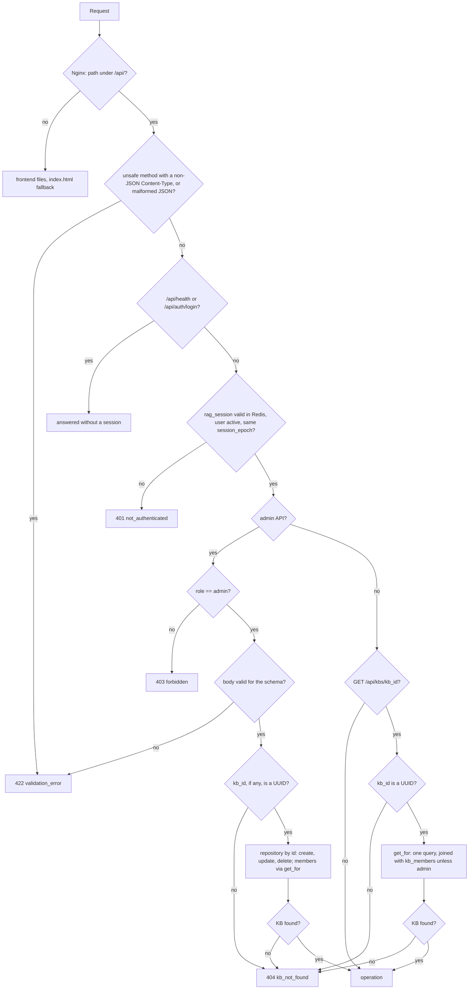
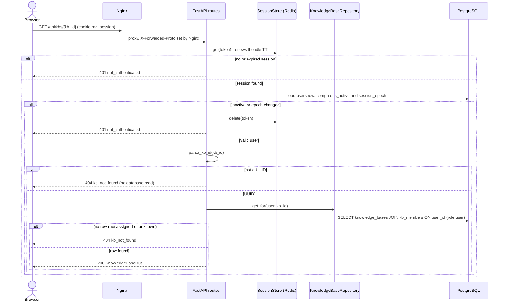
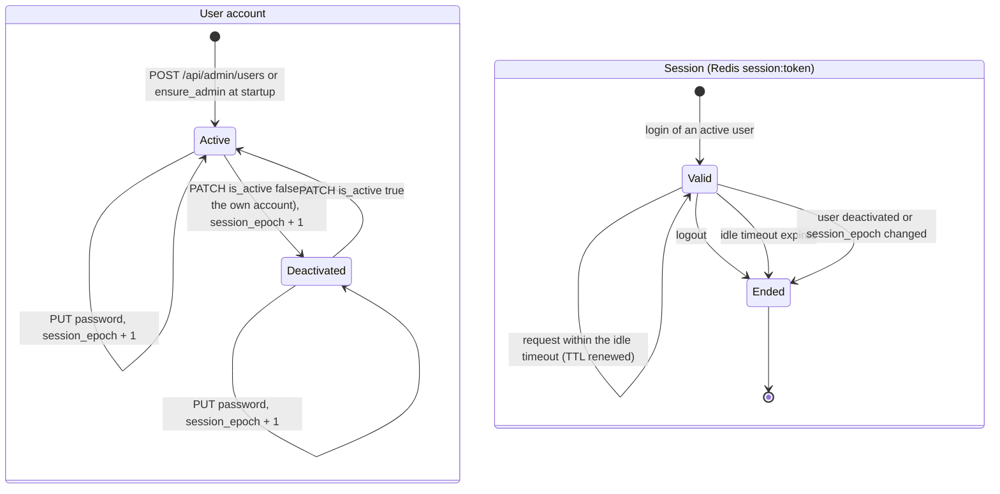
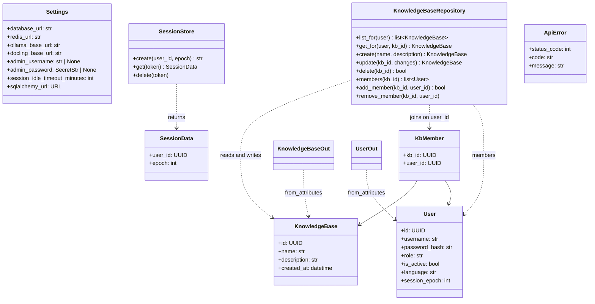
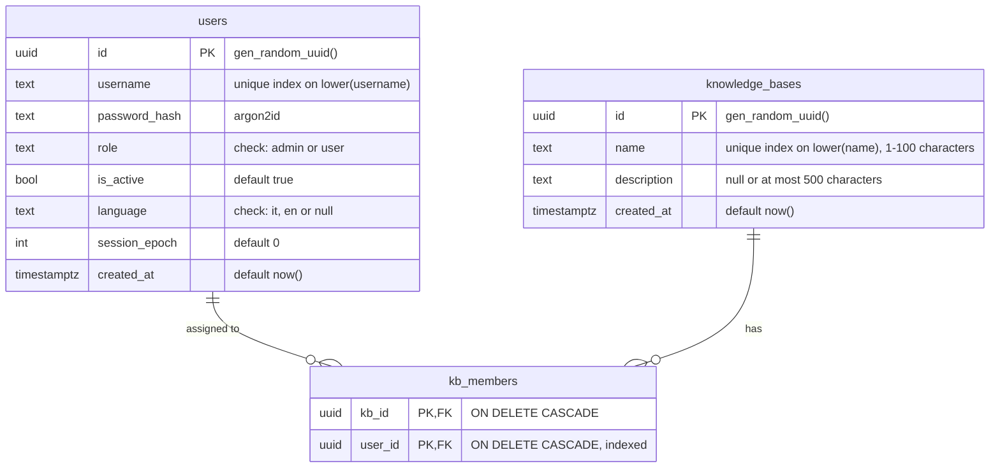

# Area: fondazioni (stack, access, users, knowledge bases)

- Last aligned: 2026-11-07
- Linked specs: SPEC-2026-11-06-fase-1-fondazioni

## Current behaviour
The platform runs as a Docker Compose stack of five services: `nginx` (the only one with a host port, `HTTP_PORT`,
default 80), `backend` (FastAPI on port 8000, inside the Compose network only), `worker` (phase 2, T-04: the image of
the backend running `python -m app.worker`, with no port), `redis` and `db` (ParadeDB, PostgreSQL 17 with the `vector`
and `pg_search` extensions). `backend` and `worker` read the same environment (one YAML anchor in `compose.yaml`) and
mount the same `uploads` volume at `/data/uploads`; the worker starts after the backend is healthy (the backend applies
the migrations). Nginx serves the compiled React frontend and proxies `/api/` to the
backend (the proxy lines live in `nginx/api-proxy.conf`, included by both server templates), always overwriting
`X-Forwarded-Proto` with its own scheme. The request body limit is 1 MB, except for the document upload
`/api/kbs/{id}/documents`, where it is `MAX_UPLOAD_SIZE_MB` + 1 MB and a request above it gets 413 with the JSON error
body `file_too_large` (phase 2, T-01). HTTPS is on only when the stack starts with
`compose.tls.yaml` (which publishes `HTTPS_PORT`, default 443, and passes it to Nginx) **and** `nginx/certs/` holds
both `cert.pem` and `key.pem`: then HTTP answers 301 to `https://`. Any other combination stays HTTP only, and the
entrypoint logs why (missing file, or `HTTPS_PORT not set`). At startup the backend (`python -m app.run`) applies the
Alembic migrations, creates the first admin from `ADMIN_USERNAME`/`ADMIN_PASSWORD` when no active admin exists, then
starts uvicorn. Ollama and Docling are external: `GET /api/health` reports them but they never block the startup.

The worker (`app/worker.py`) runs the jobs of the RQ queue `ingestion` one at a time with `rq.SimpleWorker` (no fork per
job). While it runs, a daemon thread writes the Redis key `ingestion:worker:alive:{hostname}` (value `1`, expiry 30
seconds) every 10 seconds; `python -m app.worker --healthcheck`, the Compose health check, exits 0 if the key of its own
host exists and 1 otherwise. A job (`process_document_job`) takes a document from QUEUED to PROCESSING in one statement
(no QUEUED row: it ends quietly), reads a TXT or MD as UTF-8, normalizes and chunks it, asks Ollama for the vectors in
groups of `EMBEDDING_BATCH_SIZE` (16) texts (timeout `EMBEDDING_TIMEOUT_SECONDS`, 120), saves all the chunks in one
transaction, checks both indexes, then marks the document READY with its `chunk_count` and deletes the original. Any
failure makes the document FAILED with a reason and no chunk, and keeps the original. Interim until phase 2 T-05: PDF,
DOCX, PPTX and XLSX end FAILED `unexpected_error` ("Docling parsing is not available yet"), a text with nothing to read
FAILED `parse_failed`, and a failed step is not repeated. The detail of the pipeline is in the phase 2 spec and plan.

Users are local accounts with role `admin` or `user`. Login matches the username exactly and creates a server-side
session in Redis (`session:<token>`, idle TTL `SESSION_IDLE_TIMEOUT_MINUTES`, renewed by every request) with an
`HttpOnly`, `SameSite=Lax` cookie `rag_session`, `Secure` only over HTTPS, without `Max-Age`/`Expires`. Every
authenticated request reloads the user: a deactivated user, or a session whose `session_epoch` differs from the
user's, gets 401; deactivation and password reset increment the epoch, so they end every session of the user. The
admin creates users (names unique on `lower()`, trimmed, 3–64 letters, digits, `.`, `_`, `-`; passwords of at least 12
characters, stored as Argon2id), deactivates/reactivates them (never themself) and resets their passwords.

The admin creates knowledge bases (names trimmed, 1–100 characters, unique on `lower()`; description optional,
trimmed, up to 500 characters, a blank one stored as null; NUL and lone surrogate characters get 422), renames them,
deletes them (with their assignments) and assigns or removes users. Every read of a
KB goes through `KnowledgeBaseRepository`, which for any role other than the exact `admin` joins `kb_members` on the
user's id in the same SQL query: a user lists and opens only the assigned KBs, and a KB that is not assigned, does not
exist or has an id that is not a UUID gets the same 404 `kb_not_found`. The UI (Italian or English: browser language
first, then the language saved in the profile) has the login page, the KB list as home page ("Le tue knowledge base"
for a user, "Tutte le knowledge base" for the admin) with the opened KB under `/kbs/{id}`, and for the admin the Users
and Knowledge Base pages; a `user` sees neither admin menu. The member picker of the Knowledge Base page offers only
active users; an inactive user already assigned stays listed, marked as deactivated.

## Interfaces
Errors are always `{"error": {"code": "<code>", "message": "<English text>"}}`; the UI translates the `code`.

| Method and path | Who | Success | Errors |
|---|---|---|---|
| `GET /api/health` | anyone | 200 `{"status": "ok"\|"degraded", "checks": {"database", "redis", "ollama", "docling", "worker"}}`, each `ok` or `unreachable`; `worker` is `ok` when at least one `ingestion:worker:alive:*` key exists in Redis | 503 (same body) when database or Redis is `unreachable` |
| `POST /api/auth/login` `{"username", "password"}` | anyone | 200 `UserOut` + cookie | 401 `invalid_credentials` (wrong password, unknown or deactivated user) |
| `POST /api/auth/logout` | session | 204 | 401 `not_authenticated` |
| `GET /api/auth/me`, `PATCH /api/auth/me` `{"language": "it"\|"en"}` | session | 200 `UserOut` | 401, 422 |
| `GET /api/admin/users`, `POST /api/admin/users` `{"username", "password", "role"}` | admin | 200 `[UserOut]`, 201 `UserOut` | 409 `username_taken`; 422 `invalid_username`, `password_too_short` |
| `PATCH /api/admin/users/{user_id}` `{"is_active"}` | admin | 200 `UserOut` | 404 `user_not_found`; 409 `cannot_deactivate_self` |
| `PUT /api/admin/users/{user_id}/password` `{"password"}` | admin | 204 | 404 `user_not_found`; 422 `password_too_short` |
| `GET /api/kbs` | session | 200 `[KnowledgeBaseOut]` (own KBs; all for the admin), ordered by `lower(name)` | 401 |
| `GET /api/kbs/{kb_id}` | session | 200 `KnowledgeBaseOut` | 404 `kb_not_found` (not assigned, unknown, not a UUID) |
| `POST /api/kbs` `{"name", "description"?}` | admin | 201 `KnowledgeBaseOut` | 409 `kb_name_taken`; 422 `validation_error` |
| `PATCH /api/kbs/{kb_id}` `{"name"?, "description"?}` | admin | 200 `KnowledgeBaseOut` (only the fields sent change; `"description": null` or a blank one clears it) | 404 `kb_not_found`; 409 `kb_name_taken`; 422 `validation_error` (also `"name": null`) |
| `DELETE /api/kbs/{kb_id}` | admin | 204 (assignments removed by cascade) | 404 `kb_not_found` |
| `GET /api/kbs/{kb_id}/members` | admin | 200 `[UserOut]`, ordered by `lower(username)` | 404 `kb_not_found` |
| `PUT /api/kbs/{kb_id}/members/{user_id}` | admin | 204 (idempotent: one row, also under concurrency; inactive users accepted) | 404 `kb_not_found`, then 404 `user_not_found` (also for a non-UUID id) |
| `DELETE /api/kbs/{kb_id}/members/{user_id}` | admin | 204 (also when the user was not assigned) | 404 `kb_not_found`, then 404 `user_not_found` |

- Order of the checks: a `POST`/`PUT`/`PATCH`/`DELETE` whose `Content-Type` is not `application/json`
  (`require_json`) and a body that is not well-formed JSON get 422 `validation_error` first, before the session;
  then 401 `not_authenticated` on every API but health and login without a valid session; then 403 `forbidden` for
  a `user` on every admin API, before the schema of the body, the ids and any database read (the same 403 for any
  KB or user id, so nothing depends on which KBs exist); then 422 `validation_error` for a body that fails the
  schema (the details are never echoed); then the ids (404).
- The one exception to `require_json` is the document upload of phase 2 (`POST /api/kbs/{kb_id}/documents`): it takes
  `multipart/form-data`, but only with the header `X-Requested-With: XMLHttpRequest` (a form of another site cannot send
  it); without it the request gets 422 `validation_error` like any other non-JSON body. The upload route stores the
  file in `UPLOAD_DIR` (the `uploads` volume, mounted on the backend at `/data/uploads`) under the document id;
  `ApiError` can carry `extra` fields that go inside the `error` object.
- Other generic answers: 404 `not_found` ("Not Found") for an
  unknown path and 405 `method_not_allowed` ("Method Not Allowed"); other HTTP errors `http_error`.
- `UserOut` = `{"id", "username", "role", "is_active", "language"}` (never a password or hash);
  `KnowledgeBaseOut` = `{"id", "name", "description", "created_at"}`. Extra fields in a body are ignored.
- Frontend routes: `/login`, `/` (own KB list), `/kbs/:kbId`, `/admin/users`, `/admin/kbs` (admin only; a `user`
  is sent to `/`, no session to `/login`).
- Configuration (`.env.example`): `POSTGRES_PASSWORD` (any character, set on the URL object, never pasted into
  `DATABASE_URL`), `HTTP_PORT`, `HTTPS_PORT` (with `compose.tls.yaml`), `DATABASE_URL`, `REDIS_URL` (set by
  `compose.yaml`), `OLLAMA_BASE_URL`, `DOCLING_BASE_URL`, `HEALTH_CHECK_TIMEOUT_SECONDS` (2), `ADMIN_USERNAME`,
  `ADMIN_PASSWORD`, `SESSION_IDLE_TIMEOUT_MINUTES` (480), and from phase 2 `UPLOAD_DIR` (fixed to the `uploads` volume,
  `/data/uploads`, by `compose.yaml`) and `MAX_UPLOAD_SIZE_MB` (20, in MiB; passed to the backend and to Nginx),
  `EMBEDDING_BATCH_SIZE` (16, at least 1) and `EMBEDDING_TIMEOUT_SECONDS` (120, above 0) for the worker.

## Diagrams

### Flowchart

### Sequence diagram

### State diagram

### Class diagram

### ER diagram

## Constraints and delicate points
- Isolation (constitution, anti-goal of the spec): every new access to a KB, its documents or conversations (phases
  2–3) goes through `KnowledgeBaseRepository.list_for`/`get_for` or an equivalent query joined with `kb_members` in the
  same SQL statement; only the exact role `admin` skips the join (fail closed). `tests/test_isolation.py` proves it
  also by calling the repository directly and counting the statements.
- "Not assigned", "unknown" and "not a UUID" must stay indistinguishable for a `user` (same 404 body); the admin
  routes check the role before the schema of the body, the ids and any database read, so a `user` gets the same 403
  whatever ids it sends (only a non-JSON or malformed body gets 422 first, which says nothing about the KBs).
- Uniqueness of user and KB names is decided by the unique indexes on `lower()` (names trimmed first): concurrent
  requests get 409, never 500. The database collation (`en_US.utf8`) folds Unicode case (`Élite` = `élite`). Login,
  instead, matches the username exactly (owner's decision, T-03).
- Applied migrations (`0001_users`, `0002_knowledge_bases`) are never edited: a change is a new migration. The DB
  also enforces the KB length limits with check constraints, and `kb_members.user_id` is indexed for the user filter
  (both confirmed by the owner). PostgreSQL `text` refuses NUL and lone surrogates: the KB schema rejects them with
  422 before the database.
- No secret in responses or logs: the engine sets `hide_parameters=True` (no bound values in statement logs or
  database errors) and validation errors never echo the input.
- Owner's decisions in the area: T-02 HTTPS only with `compose.tls.yaml` (with certificates but no `HTTPS_PORT` Nginx
  stays HTTP and logs the reason); T-03 exact-match login, and startup stops naming the variable when the first admin
  must be created with an invalid `ADMIN_USERNAME` (REQ-007 rule, or an existing account that is not an active admin)
  or an `ADMIN_PASSWORD` shorter than 12 characters; T-04 a failed language save goes back to the previous language
  with a translated error, and after sign-out the login page keeps the last language used; T-05 a non-UUID user id
  gets 404 `user_not_found`, deactivation asks for a confirmation, the admin's own row has no Deactivate button, and
  resetting the own password signs the admin out to the login page with a message; T-06 an inactive user can be
  assigned through the API but the picker offers only active users (inactive members stay listed, marked), the
  admin's home is titled "Tutte le knowledge base", the description is trimmed like the name, and the Knowledge Base
  page layout and texts are as built.
- The home page shows a failed KB list load as a plain message, not an `alert`: the header's language selector owns
  the alert of a failed language save.
- Tests: backend tests use the real ParadeDB and Redis of `compose.test.yaml` (ports 55432 and 56379) with fresh state
  per test; e2e tests (`-m e2e`) build the full stack under their own Compose project and ports and remove it with
  `down -v`; the UI e2e uses Playwright with Chromium (`playwright install chromium` in CI,
  `PLAYWRIGHT_CHROMIUM_EXECUTABLE` for a Chromium already on the machine).

## Characterization tests
- none: the area was built from the spec (greenfield); its acceptance tests are listed under References.

## References
- Spec and plan: [spec.md](../specs/2026-11-06-fase-1-fondazioni/spec.md),
  [plan.md](../specs/2026-11-06-fase-1-fondazioni/plan.md); toolchain: [ADR-001](../adr/ADR-001-toolchain-fase-1.md).
- Stack: [compose.yaml](../../compose.yaml), [compose.tls.yaml](../../compose.tls.yaml),
  [nginx/entrypoint-tls.sh](../../nginx/entrypoint-tls.sh), [backend/app/run.py](../../backend/app/run.py),
  [backend/app/api/health.py](../../backend/app/api/health.py).
- Worker (phase 2, T-04): [worker.py](../../backend/app/worker.py), [jobs.py](../../backend/app/ingestion/jobs.py),
  [pipeline.py](../../backend/app/ingestion/pipeline.py), [embeddings.py](../../backend/app/ingestion/embeddings.py).
- Access: [backend/app/auth/deps.py](../../backend/app/auth/deps.py),
  [backend/app/auth/routes.py](../../backend/app/auth/routes.py),
  [backend/app/auth/sessions.py](../../backend/app/auth/sessions.py),
  [backend/app/auth/bootstrap.py](../../backend/app/auth/bootstrap.py),
  [backend/app/users/service.py](../../backend/app/users/service.py).
- Knowledge bases: [repository.py](../../backend/app/knowledge_bases/repository.py),
  [routes.py](../../backend/app/knowledge_bases/routes.py),
  [0002_knowledge_bases.py](../../backend/migrations/versions/0002_knowledge_bases.py).
- Frontend: [App.tsx](../../frontend/src/app/App.tsx),
  [KnowledgeBasesPage.tsx](../../frontend/src/pages/KnowledgeBasesPage.tsx),
  [KnowledgeBaseAdminPage.tsx](../../frontend/src/pages/admin/KnowledgeBaseAdminPage.tsx),
  [UsersPage.tsx](../../frontend/src/pages/admin/UsersPage.tsx).
- Tests: `backend/tests/` (`test_isolation.py`, `test_knowledge_bases.py`, `test_users.py`, `test_auth.py`, ...),
  `backend/tests/e2e/` (`test_stack.py`, `test_tls.py`, `test_admin_flow.py`, `test_ingestion_e2e.py`), `frontend/src/**/*.test.tsx`.
