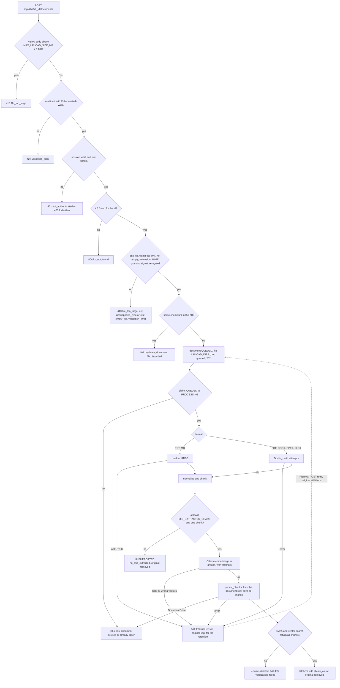
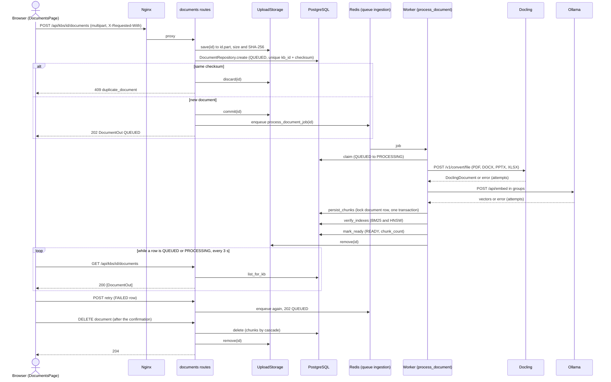
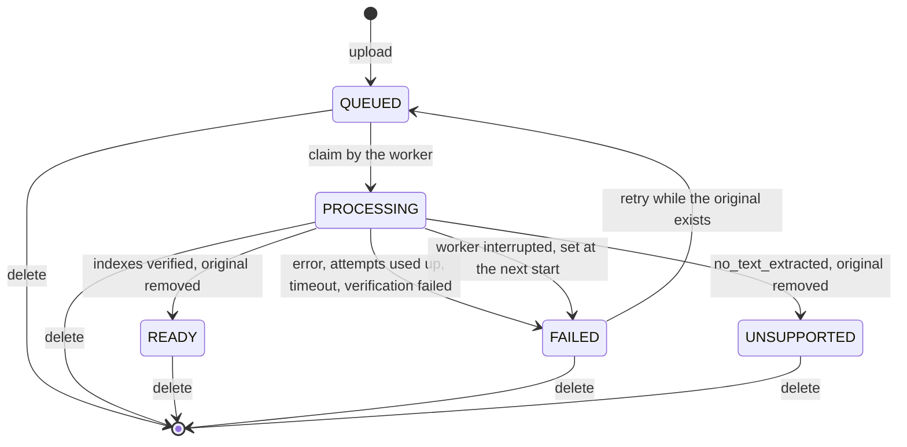
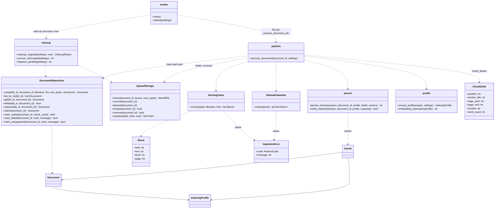
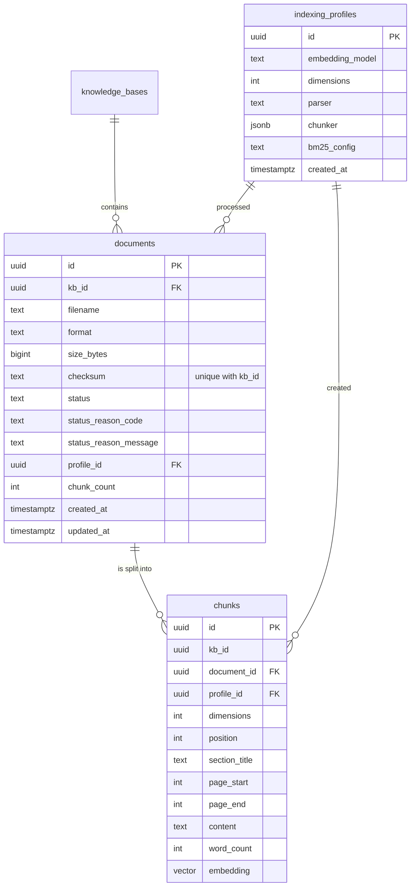

# Area: ingestion (documents, worker, chunks and indexes)

- Last aligned: 2026-11-07
- Linked specs: SPEC-2026-11-07-fase-2-ingestion

## Current behaviour
The admin brings documents into a knowledge base (KB) and a separate worker process turns each one into chunks with
vectors and a lexical (BM25) index, ready for the hybrid retrieval of phase 3. Nothing of this is visible to the role
`user`: documents, chunks and their metadata are admin-only in this phase. The stack-level facts (the five Compose
services, Nginx limits, the `uploads` volume, the `worker` service and its environment) are in
[fondazioni.md](fondazioni.md); this page is the ingestion as a whole.

An upload (`POST /api/kbs/{kb_id}/documents`, one file per request) copies the file in streaming to
`UPLOAD_DIR/{id}.part` while it computes the size and the SHA-256, rejects an empty file and one whose extension, declared
MIME type and signature do not name the same format (PDF, DOCX, PPTX, XLSX, TXT or MD; only the first bytes of a PDF and the
name list of a ZIP are read, never the content), inserts the document as QUEUED (the unique index `(kb_id, checksum)`
refuses a duplicate, also between two simultaneous requests), renames the file to `UPLOAD_DIR/{id}` and puts the job
`app.ingestion.jobs.process_document_job` on the RQ queue `ingestion` (`job_timeout` 3600 s, result not kept). The file
name is cleaned for display only (last path component, no control or format characters, NFC, at most 255 characters) and is
never used as a path. A failure after the insert (database, Redis) removes the row and the file and answers 500
`internal_error`.

The worker (`python -m app.worker`, one job at a time with `rq.SimpleWorker`) claims the document (`QUEUED` to
`PROCESSING` in one statement, nothing to do if there is no QUEUED row), reads it (TXT and MD directly as UTF-8; PDF, DOCX,
PPTX and XLSX through Docling, with attempts), normalizes the text, cuts it into structural chunks, asks Ollama for the
vectors in groups, saves every chunk in one transaction under a lock on the document row, checks that the BM25 index and a
vector search both return all the chunks, and only then marks the document READY with its `chunk_count` and deletes the
original. Fewer than `MIN_EXTRACTED_CHARS` characters that are not white give UNSUPPORTED `no_text_extracted` (no OCR) and
the original is deleted at once. Any other outcome is FAILED with a reason code and a fixed English message, no chunk left
and the original kept for `FAILED_ORIGINAL_RETENTION_DAYS` days so that the admin can retry. The details of the reading,
of the attempts and of the reason codes are in [fondazioni.md](fondazioni.md) (section Current behaviour) and are
summarized below.

The Documents page (`/admin/documents`, menu "Documenti"/"Documents", admin only; a `user` is sent to `/`, no session to
`/login`) lets the admin choose a KB, select one or more files (each goes in a request of its own through `api.upload`,
`multipart/form-data` with `X-Requested-With: XMLHttpRequest` and no JSON content type) and see a row per document with
name, size, translated status, translated reason, date and the actions. A file that the API refuses (duplicate 409,
unsupported type 415, too large 413, empty 422, and every other error code of the upload) shows its translated message
next to its name in the list of uploads and adds no row. While any row is QUEUED or PROCESSING the page reads the list
again every 3 seconds (the timer is cleaned up when the KB changes or the page is left, and it stops once every row is
READY, FAILED or UNSUPPORTED). "Riprova"/"Retry" is offered for every FAILED row and calls the retry route: the row goes to
QUEUED; if the API answers `original_missing` the message appears in the row and the button disappears. "Elimina"/"Delete"
asks for a confirmation ("Conferma"/"Annulla"; Cancel leaves the row and sends nothing) and then calls the delete route.
Load errors (the KB list, the document list, a failed poll that keeps the rows on the screen) are plain messages, not
`role="alert"`: the header's language selector owns the alert of a signed-in page.

## Interfaces
Errors are always `{"error": {"code": "<code>", "message": "<English text>"}}`; the UI translates the `code`
(`documents.errors.*`, falling back to `errors.*` and `errors.unknown`). `DocumentOut` = `{"id", "kb_id", "filename",
"size_bytes", "status", "status_reason": {"code", "message"} | null, "chunk_count", "created_at", "updated_at"}`; it never
carries the checksum, the path or the content, and it does not say whether the original file still exists.

| Method and path | Who | Success | Errors |
|---|---|---|---|
| `POST /api/kbs/{kb_id}/documents` (`multipart/form-data`, field `file`, header `X-Requested-With: XMLHttpRequest`) | admin | 202 `DocumentOut` (QUEUED) | 413 `file_too_large` (also from Nginx, same body); 415 `unsupported_type`; 422 `empty_file`, `validation_error` (no header, no file, two files, malformed multipart); 409 `duplicate_document` with `"existing": {"id", "filename"}` inside `error`; 404 `kb_not_found`; 500 `internal_error` |
| `GET /api/kbs/{kb_id}/documents` | admin | 200 `[DocumentOut]`, newest first (`created_at`, then `id`, descending); no paging | 404 `kb_not_found` |
| `GET /api/kbs/{kb_id}/documents/{document_id}` | admin | 200 `DocumentOut` | 404 `kb_not_found`, `document_not_found` (unknown, of another KB, or not a UUID: the same body) |
| `POST /api/kbs/{kb_id}/documents/{document_id}/retry` (no body) | admin | 202 `DocumentOut` in QUEUED, reason cleared, new job queued | 404 `kb_not_found`, `document_not_found`; 409 `not_retryable` (not FAILED, also the second of two simultaneous requests), 409 `original_missing`; 500 `internal_error` (Redis down: the document stays QUEUED) |
| `DELETE /api/kbs/{kb_id}/documents/{document_id}` | admin | 204: row, chunks (cascade) and original removed at once, in any status, also PROCESSING | 404 `kb_not_found`, `document_not_found` |
| `DELETE /api/kbs/{kb_id}` | admin | 204, the documents, chunks and originals of the KB go with it | 404 `kb_not_found` |
| `GET /api/health` | anyone | adds `"worker": "ok"\|"unreachable"` to `checks` (`ok` when a key `ingestion:worker:alive:*` exists in Redis) | 503 when the database or Redis is `unreachable` |

- Order of the checks on the document routes: the upload alone is the exception to `require_json` (multipart only with
  `X-Requested-With`, else 422 `validation_error`); then 401 `not_authenticated`; then 403 `forbidden` for a `user`, before
  the ids and the body (the router-level `require_admin`), whatever KB or document id it sends; then 404 `kb_not_found`
  (through `KnowledgeBaseRepository`, also for an id that is not a UUID); then, for the upload, the size announced by
  `Content-Length` (413 above `MAX_UPLOAD_SIZE_MB` + 1 MB without reading the body), the single `file` field, the real size,
  the empty file, the type and the checksum.
- Other codes of the same family that the page may meet: 401 `not_authenticated`, 403 `forbidden`, `network_error` (client
  side). `user_not_found` (404) belongs to the user and KB-member routes of [fondazioni.md](fondazioni.md) and is never
  answered by a document route. 500 `internal_error` is the answer to a failure the code did not foresee after the row
  exists (upload) or after the document was requeued (retry); only the document id and the error type are logged.
- `DocumentRepository(session)` (every method takes the `kb_id`; the route checks the KB first with
  `KnowledgeBaseRepository.get_for`): `create(kb_id, document_id, filename, fmt, size_bytes, checksum) -> Document` (the id
  is generated by the caller because the original is stored under it before the row exists; raises
  `DuplicateDocument(existing)`), `list_for_kb(kb_id)`, `get(kb_id, document_id)`, `delete(kb_id, document_id) -> bool`,
  `requeue(kb_id, document_id) -> Document | None`, `ids_for_kb(kb_id)`; and, for the worker, across KBs: `claim`,
  `mark_ready(document_id, chunk_count)`, `mark_failed(document_id, code, message)` (also deletes the chunks),
  `mark_unsupported`, `ids_in_status`, `statuses`, `is_failed_before`.
- Chunk storage: `persist_chunks(session, document_id, profile, drafts, vectors) -> int` locks the document row
  (`SELECT ... FOR UPDATE` while PROCESSING; `DocumentGone` if it is gone), checks the vectors (count, size, finite) and saves
  all chunks and the document's `profile_id` in one transaction; `verify_indexes(session, document_id, profile, expected)
  -> bool`. `ensure_profile(engine, settings) -> IndexingProfile` inserts the profile with `ON CONFLICT DO NOTHING` and
  creates its HNSW index. `UploadStorage(upload_dir)`: `save`, `commit`, `discard`, `path`, `part_path`, `exists`, `remove`,
  `orphans`.

### Statuses and reason codes
Statuses: `QUEUED`, `PROCESSING`, `READY`, `FAILED`, `UNSUPPORTED` (Italian labels "In coda", "In elaborazione", "Pronto",
"Fallito", "Non supportato"). The reason is present exactly when the status is FAILED or UNSUPPORTED (a database check).

| Code | Status | When |
|---|---|---|
| `docling_unreachable` | FAILED | Docling refuses the connection, times out or hangs up, on every attempt |
| `docling_error` | FAILED | Docling answers 5xx or 429 on every attempt, 401 or 403 (check `DOCLING_API_KEY`, at once), or a reply that is not a conversion |
| `parse_failed` | FAILED | Docling refuses the file (other 4xx, `status: failure`), or a TXT/MD is not UTF-8 |
| `embedding_unreachable` | FAILED | Ollama refuses the connection, times out or hangs up, on every attempt |
| `embedding_error` | FAILED | Ollama answers 5xx or 429 on every attempt, or another 4xx at once |
| `embedding_invalid_response` | FAILED | wrong number of vectors, or a vector that is empty, ragged, not numeric, NaN or infinite |
| `embedding_dimension_mismatch` | FAILED | well formed vectors of a size other than `EMBEDDING_DIMENSIONS` |
| `verification_failed` | FAILED | the vector or the BM25 index did not return every saved chunk (the chunks are deleted) |
| `no_text_extracted` | UNSUPPORTED | less than `MIN_EXTRACTED_CHARS` characters that are not white, or nothing to chunk |
| `unexpected_error` | FAILED | a bug, a database error or a missing original; the 3600 s job timeout ("The processing time limit was exceeded"); a worker that died mid-document ("Processing was interrupted", set at the next start) |

### Settings (`.env`, all in `.env.example`; secrets empty there)
Backend and worker: `UPLOAD_DIR` (fixed to the `uploads` volume, `/data/uploads`, by `compose.yaml`), `EMBEDDING_MODEL`
(`bge-m3`), `EMBEDDING_DIMENSIONS` (1024, 1 to 2000), `EMBEDDING_BATCH_SIZE` (16), `EMBEDDING_TIMEOUT_SECONDS` (120),
`CHUNK_TARGET_WORDS` (300), `CHUNK_MIN_WORDS` (50), `CHUNK_MAX_WORDS` (450), `CHUNK_OVERLAP_PERCENT` (15; minimum <= target
<= maximum is checked at start). Backend only: `MAX_UPLOAD_SIZE_MB` (20; Nginx gets the same value and allows that + 1 MB of
multipart framing on the upload route only). Worker only: `DOCLING_API_KEY` (secret, blank means none),
`DOCLING_TIMEOUT_SECONDS` (600), `DOCLING_INCLUDE_IMAGES` (false), `INGESTION_MAX_ATTEMPTS` (3),
`INGESTION_RETRY_BACKOFF_SECONDS` (10, doubled between attempts), `MIN_EXTRACTED_CHARS` (50),
`FAILED_ORIGINAL_RETENTION_DAYS` (7, 1 to 3650). Another model, size or chunker parameter starts a new indexing profile;
documents already indexed keep theirs and are not re-indexed (phase 2 has no re-indexing: the admin uploads them again).

### Worker lifecycle
- Start (`main`): the heartbeat thread first (`ingestion:worker:alive:{hostname}`, value `1`, expiry 30 s, written every 10 s),
  so that the Compose health check (`python -m app.worker --healthcheck`) does not fail during the rest; then `startup`, three
  independent steps (one that fails is logged by its error type and the others run): `recover_interrupted` (every PROCESSING
  document becomes FAILED `unexpected_error` "Processing was interrupted", chunks deleted, original kept), `requeue_pending`
  (every QUEUED document gets a job again; a duplicate job is harmless because the claim lets only one work) and
  `cleanup_originals`; then the cleanup thread (`worker-cleanup`, every hour, each run in an event loop of its own); then
  `SimpleWorker(...).work()` on the queue `ingestion` (RQ registration TTL 60 s).
- Each job (`process_document_job`) owns an `asyncio.run`. The RQ timeout (3600 s) is a SIGALRM exception in the main thread:
  if it lands while the loop is idle, `process_document_job` catches it around `asyncio.run` and calls `fail_after_timeout`.
- Stop: the Compose service has `stop_grace_period: 120s`; a SIGTERM lets the job in progress finish (RQ warm shutdown). A
  longer job is killed and its document is recovered by the next start. There is one worker.

### Retention and deletion of the originals
An original lives only in `UPLOAD_DIR`, named by the document id. It is deleted when the document becomes READY or
UNSUPPORTED, when the document or its KB is deleted, and, for FAILED, `FAILED_ORIGINAL_RETENTION_DAYS` days after the document
failed (`documents.updated_at`; a retry that fails again starts the time again; the document stays FAILED with its reason).
`cleanup_originals` (at the start of the worker and every hour) deletes files only: the expired FAILED originals, the files
named exactly `{uuid}` with no document, the `{uuid}.part` of an upload that never finished (both when last written more than
one hour ago) and the original that survives in a READY or UNSUPPORTED document. The original of a QUEUED or PROCESSING
document is never deleted. Any other name in `UPLOAD_DIR` is left alone. Logs never carry document content, file names or
vectors; they carry the document id, the status, the reason code, the step and the attempt number.

### Manual check against the real services (before real use)
Automated tests use fakes and never call the real Ollama, Docling or OpenAI. The shape of Docling's answer rests on its
documentation and on fixtures, so before real use run the opt-in live tests once by hand against your own instances
(`backend/tests/live/test_live_services.py`; they convert a tiny PDF and DOCX and embed one text, and store nothing):

```
LIVE_SERVICES=1 LIVE_DOCLING_BASE_URL=http://docling:5001 LIVE_OLLAMA_BASE_URL=http://ollama:11434 \
LIVE_EMBEDDING_MODEL=bge-m3 uv run --directory backend pytest -m live
```

Then upload by hand, from the Documents page, a PDF with a table, a PPTX, an XLSX and a corrupt PDF: the first three must
reach "Pronto" with sensible chunks, the corrupt one must end "Fallito" with a reason.

## Diagrams

### Flowchart


### Sequence diagram


### State diagram


### Class diagram


### ER diagram


## Constraints and delicate points
- Isolation (anti-goal of the spec): documents, chunks and sources are returned only through routes that check the KB with
  `KnowledgeBaseRepository`, behind `require_admin`; `DocumentRepository` puts the `kb_id` in every query. A `user` gets 403 on
  every document route, and a document of another KB, an unknown one and an id that is not a UUID get the same 404.
- Vectors of different indexing profiles never mix: every vector search filters on `profile_id`, and `chunks.embedding` is
  a `vector` without a fixed size with `CHECK (vector_dims(embedding) = dimensions)` and the foreign key
  `(profile_id, dimensions)` to the profile, so the database refuses a vector of the wrong size.
- Migrations `0003_documents` and `0004_chunks` are applied and never edited: a change is a new migration. The BM25 index
  `chunks_bm25` (`conservative-v1`: lowercase and ASCII folding, no stemming; `kb_id` and `document_id` are filter fields) is
  created by `0004`; the HNSW index of each profile is created at runtime by `ensure_profile` under an advisory lock.
- A job is idempotent: the claim is a single `UPDATE ... WHERE status = 'QUEUED'`, and the READY, UNSUPPORTED and FAILED marks
  change only a PROCESSING row, so a document deleted while it is processed is not resurrected (`persist_chunks` locks the
  row; the delete waits and takes the chunks with it).
- The upload is the only POST that is not JSON (`require_json` exception, by route path and with `X-Requested-With`); the retry
  route is the second POST without a body (no `Content-Type`, so it passes `require_json`; the UI sends it with `api.post`
  and no body).
- The page cannot know whether the original of a FAILED document still exists (`DocumentOut` has no such field): it offers
  "Riprova" for every FAILED row and handles `original_missing` in the row.
- Logs (REQ-102): the document id, the status, the reason code, the step, the attempt number, the type of an exception; never
  content, file names, vectors or exception messages.

## Known limits
- One worker (accepted for v1): a second worker starting while the first processes a document would make that document FAILED
  "Processing was interrupted" (the start-up cannot tell a dead predecessor from a live peer). Never scale the `worker`
  service.
- `verify_indexes` counts rows with the BM25 index and an exact-count HNSW query with iterative scan; on a very large `chunks`
  table it may be slow, and a false negative would fail a good document with `verification_failed` (the admin retries).
- `DOCLING_INCLUDE_IMAGES` is read by the worker only; a switch for it in the interface is deferred to the settings page of
  phase 4.
- A Redis failure right after "Riprova" answers 500 and leaves the document QUEUED without a job: the next start of the
  worker puts it back on the queue (`requeue_pending`); until then it stays "In coda".
- No re-indexing, no OCR, no download or preview of a document, no paging of the list, no document list for the role `user`
  (spec non-scope). PPTX and XLSX follow the same chunking rules as the other formats.
- Three attempts of up to `DOCLING_TIMEOUT_SECONDS` plus the waits can reach the 3600 s job timeout; keep
  `INGESTION_MAX_ATTEMPTS` small. docling-serve has its own limit for a synchronous conversion
  (`DOCLING_SERVE_MAX_SYNC_WAIT`) that can answer 504 before the client timeout.
- A garbage file for which docling-serve answers 500 ends `docling_error` after three attempts, not `parse_failed`. Merged
  table cells repeat their text in every row they span, and pictures (and their captions) are not read.
- Notes for phase 3 (retrieval): join `documents.status = 'READY'` (a chunk of a document that is not READY must never be
  returned); filter every vector search on `chunks.profile_id`, restrict it to the KB through `kb_members`, and order by the
  profile's own expression `embedding::vector(N)` (`embedding_expression(profile)`) with `<=>` so that the partial HNSW index
  is used; run the search with `SET LOCAL hnsw.iterative_scan = relaxed_order` (and a `hnsw.max_scan_tuples` that suits), because
  pgvector applies the `WHERE` after the HNSW scan and without it a filtered search can return fewer rows than asked.
  BM25 queries use the `@@@` operator on `chunks` with `kb_id` as a filter field.

## Characterization tests
- none: the area was built from the spec (greenfield); its acceptance tests are listed under References.

## References
- Spec, plan and ADR: [spec.md](../specs/2026-11-07-fase-2-ingestion/spec.md), [plan.md](../specs/2026-11-07-fase-2-ingestion/plan.md),
  [ADR-002](../adr/ADR-002-ingestion.md); stack and the per-step details of the worker: [fondazioni.md](fondazioni.md).
- API: [routes.py](../../backend/app/documents/routes.py), [repository.py](../../backend/app/documents/repository.py),
  [storage.py](../../backend/app/documents/storage.py), [formats.py](../../backend/app/documents/formats.py),
  [queue.py](../../backend/app/documents/queue.py), [schemas.py](../../backend/app/documents/schemas.py).
- Pipeline: [pipeline.py](../../backend/app/ingestion/pipeline.py), [jobs.py](../../backend/app/ingestion/jobs.py),
  [docling.py](../../backend/app/ingestion/docling.py), [embeddings.py](../../backend/app/ingestion/embeddings.py),
  [chunker.py](../../backend/app/ingestion/chunker.py), [persist.py](../../backend/app/ingestion/persist.py),
  [profile.py](../../backend/app/ingestion/profile.py), [cleanup.py](../../backend/app/ingestion/cleanup.py),
  [worker.py](../../backend/app/worker.py).
- Data: [0003_documents.py](../../backend/migrations/versions/0003_documents.py), [0004_chunks.py](../../backend/migrations/versions/0004_chunks.py).
- Frontend: [DocumentsPage.tsx](../../frontend/src/pages/admin/DocumentsPage.tsx), [client.ts](../../frontend/src/api/client.ts).
- Tests: `backend/tests/` (`test_documents_upload.py`, `test_chunk_storage.py`, `test_pipeline_text.py`,
  `test_pipeline_errors.py`, `test_retry_route.py`, `test_cleanup.py`, `test_document_delete.py`, `test_worker_recovery.py`,
  `test_logging_privacy.py`, ...), `backend/tests/e2e/` (`test_ingestion_e2e.py`, `test_upload_limit.py`,
  `test_documents_ui.py`), `frontend/src/pages/admin/DocumentsPage.test.tsx`, and the opt-in `backend/tests/live/`.
